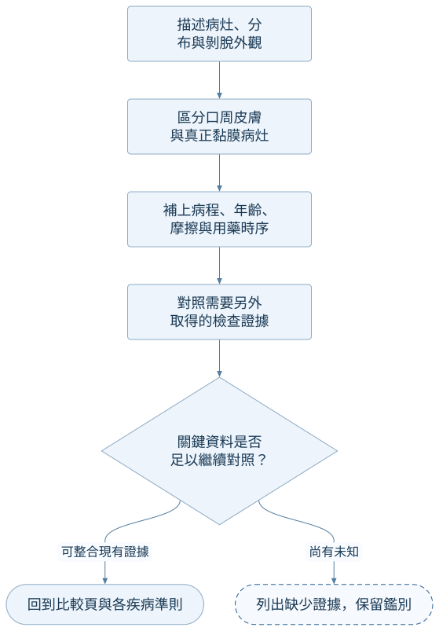

## 外觀之後，還需要什麼證據？

照片可描述病灶與分布；病史、全身黏膜檢查、病理與檢驗須另外取得。本頁是講義支持的鑑別學習順序，**不是經驗證的自動診斷演算法**。[@A:guide][@A:c2][@B:blister]

## 從描述走向驗證

<!-- flow:epidermal-detachment-reasoning -->

## 對照與延伸

- [三疾病與兩疾病對照表](../comparisons/epidermal-detachment-differential.md)。
- [SJS 正式準則圖](sjs-diagnostic-criteria.md)。
- [SSSS](../concepts/staphylococcal-scalded-skin-syndrome.md)、[遺傳性 EB](../concepts/inherited-epidermolysis-bullosa.md)、[SJS/TEN](../concepts/sjs-ten.md)。
