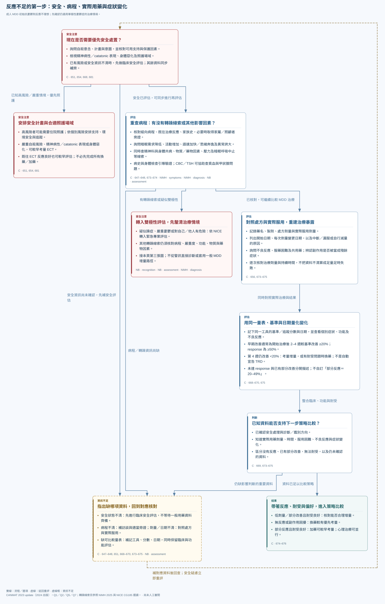
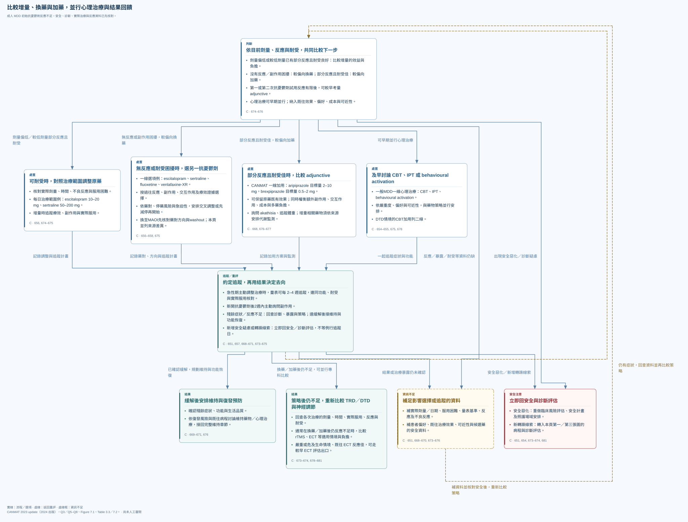
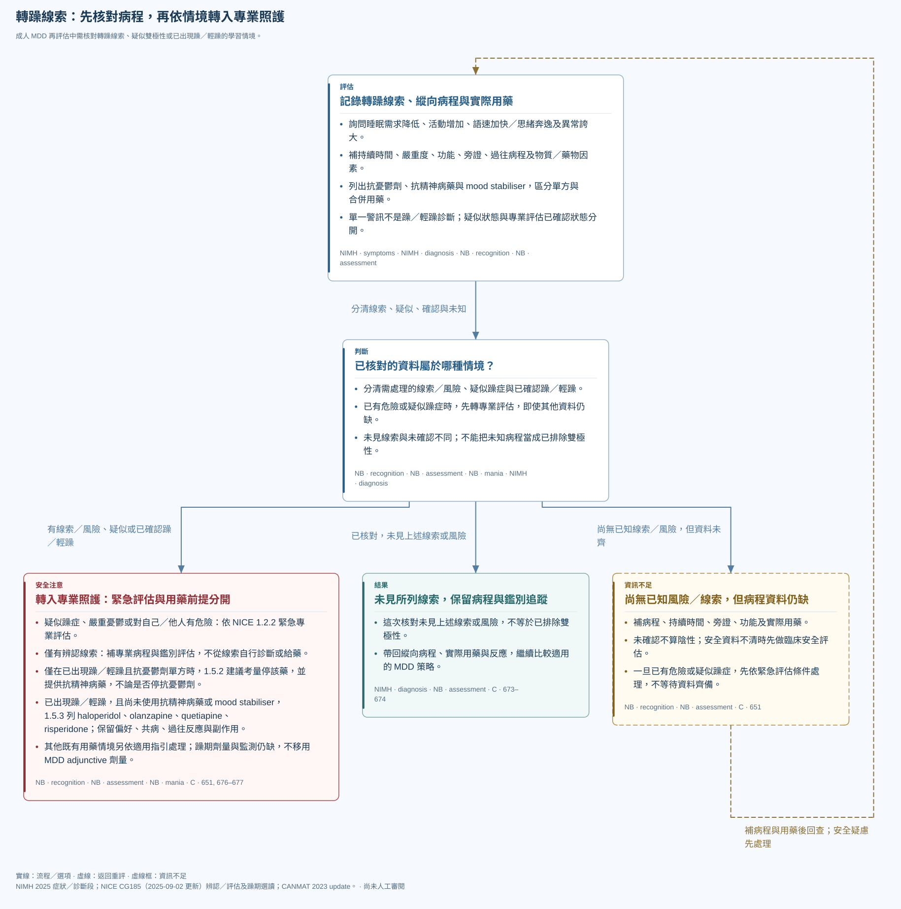
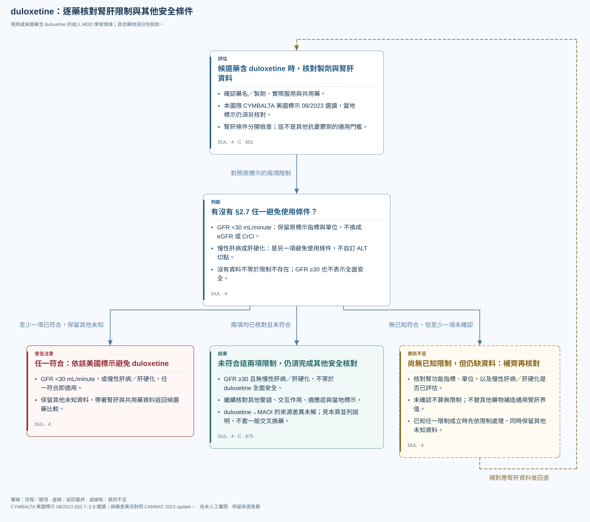

## 如何使用這組流程

四張圖依次處理**目前是否安全、實際接受了什麼治療、結果是否能比較，以及下一步如何共同選擇**。第一張先核對資料；第二張比較策略並接回追蹤；第三張處理轉躁辨認與專業照護，第四張獨立核對 duloxetine 腎肝限制，依實際情境選讀。這是 CANMAT Q7／Figure 7.1 的學習性整理，不能根據未提供的資料自動選藥、確認充分療程失敗或診斷 TRD。**安全風險不因資料缺漏而等待。**[@C:11,14,29,33-36,41]

NIMH、NICE CG185 與 CYMBALTA 美國標示使用已登錄的**選讀範圍**：辨認線索、評估／轉介、部分躁期建議及 duloxetine 的腎肝／換藥條文；沒有完成整份雙極性指引、完整躁期準則或完整藥品標示評讀。內容仍為 **not_reviewed**；duloxetine→MAOI 的來源差異維持 **open**，見下方相鄰說明。[@NIMH:diagnosis][@NB:recognition][@NB:mania][@DUL:4]

## 一、先確認安全、病程、暴露與症狀變化

自殺意念／計畫／意圖、精神病性或 catatonic 表現、身體惡化與適合照護場域先核對；其餘病史、實際用藥與量表資料可並行收集。**未知不等於陰性，也不能把藥量或日期不清算成足量足時失敗。**[@C:7-8,11,14,33-35,41]

<!-- flow:mdd-canmat-reassessment -->

量化變化需對照**同一量表的基準、追蹤值與日期**。改善百分比的算術為「（基準分數－追蹤分數）÷基準分數×100%」，僅在基準為正且數值可比較時使用；這是對來源所述「較基準改善」的計算整理，不是額外診斷規則。第 4 週仍改善 <20% 可觸發增量或換藥考量，並保留耐受與實際暴露條件；**不能只憑這個數值判定 TRD**。本來源沒有通用依從性百分比、所有藥物一致的充分療程週數，或「部分反應＝20–49%」的定義。[@C:29,33-35]

## 二、比較策略，及早納入心理治療，再用結果回饋

**無反應或原藥副作用困擾時，較偏向換藥；部分反應且耐受良好時，較偏向加藥。** 這是臨床選擇的偏向，不是互斥條件。第一或第二次抗憂鬱劑試用反應有限後，可較早考量 adjunctive，無須要求每個人先反覆換單藥；心理治療也可早期納入。[@C:34-38]

<!-- flow:mdd-canmat-strategy -->

### 具名選項與劑量的用途

下表讓策略討論能對照具名選項，**不提供完整起始、遞增或停換藥處方**。抗憂鬱劑的每日治療範圍與 adjunctive 的目標量用途不同；不可將範圍下限當成每個人的起始量，也不可將 MDD adjunctive 數值移作躁期劑量。[@C:16,36-37]

| 用途／線別 | 具名選項 | CANMAT 原表數值 | 選擇時需保留的資訊 |
| --- | --- | --- | --- |
| MDD 一線抗憂鬱劑範例 | Escitalopram | 每日治療範圍 10–20 mg/day | 實際服用、反應、耐受、交互作用與個別安全條件。[@C:16,35] |
| MDD 一線抗憂鬱劑範例 | Sertraline | 每日治療範圍 50–200 mg/day | 不是與其他藥等量互換的表格。[@C:16,35] |
| MDD 一線抗憂鬱劑範例 | Fluoxetine | 每日治療範圍 20–60 mg/day | 換藥須保留長半衰期與特定藥對方向，尤其 MAOI。[@C:16,35] |
| MDD 一線抗憂鬱劑範例 | Venlafaxine-XR | 每日治療範圍 75–225 mg/day | 保留 XR 製劑；不能從這列推得其他製劑的操作。[@C:16] |
| 本版 DTD 一線 adjunctive | Aripiprazole | **目標量 2–10 mg** | 留意 akathisia、體重增加與多藥負擔；未提供完整起始／遞增方案。[@C:36-37] |
| 本版 DTD 一線 adjunctive | Brexpiprazole | **目標量 0.5–2 mg** | 留意 akathisia、體重增加與交互作用；不是其他診斷通用劑量。[@C:36-37] |

增量前先核對能否耐受與目前是否仍有合理調整空間；更高劑量可能增加療效，也可能增加副作用與服用困難。加藥可保留已有改善，卻增加成本、交互作用與多藥負擔；CANMAT 指出長期 adjunctive 應持續多久的證據仍有限。對增重相關藥物，Table 5.1 建議基準及每 6 個月監測體重、血糖與血脂；這項通用建議不取代各藥專屬監測。[@C:28,35-37]

CBT、IPT 與 behavioural activation 是一般 MDD 的一線心理治療；**DTD 初始藥物反應不足情境的 CBT 加用列二線**，不能將不同情境的線別混稱。嚴重 MDE 合併精神病性症狀時，先處理精神病性症狀，結構式心理治療待其緩解後再考量。[@C:14-15,35,38]

### 重評的時間與去向

急性期主動調整治療時，量表可每 **2–4 週**使用，與症狀、功能、不良反應及實際服用一起檢視；新開抗憂鬱劑後 **2 週內**主動詢問副作用。這是兩項不同建議，不能把前者當成所有藥物完成充分療程的時間，也不能把後者外推為每種 adjunctive 的專屬追蹤期限。出現安全惡化或轉躁線索時，先回安全與診斷評估。[@C:11,17,28-30,33-34]

緩解後接維持與復發預防，仍檢視個別殘餘症狀、功能和生活品質；**response（較基準改善 ≥50%）不等於緩解或完全恢復**。一般換藥／加藥後仍不足時，可重查 TRD／DTD 的定義與神經調節適用性；嚴重、危及生命或既往 ECT 反應良好等情境仍可較早評估 ECT。[@C:29-31,33-34,38-41]

## 三、核對轉躁線索與專業照護情境

睡眠需求降低、活動增加、語速加快／思緒奔逸及異常誇大，是要詢問與取得旁證的**辨認線索**；不以單一線索或症狀清單確診躁／輕躁。NICE CG185 1.2.2 對疑似躁症、嚴重憂鬱或對自己／他人有危險者建議緊急專業評估。**只有線索、疑似躁症及已由專業評估判定躁／輕躁，是不同資訊狀態。**[@NIMH:symptoms][@NIMH:diagnosis][@NB:recognition][@NB:assessment]

<!-- flow:mdd-mania-safety -->

### 躁／輕躁處置保留原建議的前提

NICE 1.5.2 的情境是**已出現躁／輕躁且正在使用抗憂鬱劑單方**：考量停用抗憂鬱劑，並提供抗精神病藥處置，不論是否停抗憂鬱劑。1.5.3 對已出現躁／輕躁、且尚未使用抗精神病藥或 mood stabiliser 者列 haloperidol、olanzapine、quetiapine 或 risperidone，選擇仍保留偏好、共病、過往反應與副作用。這些是專業照護的特定情境建議，**不是由某一轉躁警訊直接觸發給藥**；本頁未提供完整躁期劑量與監測，也不把上述 MDD adjunctive 劑量移用。[@NB:mania][@C:36-37]

## 四、獨立核對 duloxetine 腎肝限制

<!-- flow:mdd-medication-safety -->

CYMBALTA 美國標示 08/2023 §2.7 列 **GFR <30 mL/minute 時避免使用**；**慢性肝病或肝硬化亦應避免使用**，兩項獨立核對。保留標示原有的 GFR 名稱與單位，不改寫為通用 eGFR／CrCl 或 ALT 切點。GFR 恰為 30 不落在此處的「<30」條件，**仍不等於 duloxetine 全面安全**；其他警語、交互作用、適應症及當地標示須另核對。[@DUL:4]

### 未解換藥差異

**未解差異（open）：duloxetine→MAOI 的適用範圍與時間窗。** CANMAT Q7.d 對其他 serotonergic 藥物換至 MAOI，一般寫至少 2 週 washout；fluoxetine→MAOI 則至少 5 週。CYMBALTA 美國標示 §2.9 對停 duloxetine 後開始用於精神疾病的 MAOI 寫至少 5 天；反方向 MAOI→duloxetine 則至少 14 天。這些藥對、方向、來源與版本不能合併成單一數字；本頁保留並列，尚未由使用者確認如何處理差異，圖中不自行裁決或給換藥排程。[@C:35][@DUL:4]

目前仍缺其他候選藥完整的腎肝調整、起始與遞增、停換藥以及監測資料；duloxetine 的選讀也不足以代表完整處方評讀。沒有來源的操作保留缺口，不因已列具名選項就宣稱完成處方級流程。[@C:16,36][@DUL:4]

## 回想問題

第 4 週量表較基準改善 10%，能否直接判定足量足時失敗或 TRD？

不能。此結果可觸發調整考量，但仍要核對實際藥量、各劑量日期、服用困難、耐受、診斷及共病。CANMAT 沒有在這個節點提供所有藥物一致的充分療程週數；常用 TRD 定義另涉及至少兩次治療劑量且足夠時間的抗憂鬱劑試用，且並無全體共識。[@C:29,33-35]

已有部分改善而且耐受良好，為何可以較早比較加藥？

加藥可保留已有改善，CANMAT 建議第一或第二次抗憂鬱劑試用反應有限後可較早考量；仍須權衡副作用、交互作用、多藥負擔及偏好，並與增量、換藥和心理治療比較。這是偏向，不是必須加藥的規則。[@C:34-37]

GFR 30 mL/minute 是否代表 duloxetine 已通過所有安全核對？

不是。這只表示不落在該美國標示 §2.7 的 GFR &lt;30 條件；慢性肝病／肝硬化另有避免使用條件，其他安全內容與當地標示也要核對。未知腎肝資料更不能算成限制不存在。[@DUL:4]

## 接回完整知識

- [評估與測量](../concepts/mdd-assessment-and-measurement.md)：量表、風險與缺資料。
- [反應不足與 DTD](../concepts/mdd-inadequate-response.md)：策略線別、其他 adjunctive 選項及限制；換藥時並讀本頁未解差異。
- [藥物與安全](../concepts/mdd-pharmacotherapy.md)：交互作用、監測與跨科警訊。
- [維持與復發預防](../concepts/mdd-continuation-and-maintenance.md)：緩解後照護與停藥考量。
- [神經調節](../concepts/mdd-neuromodulation.md)：嚴重／TRD／DTD 情境及方案。
- [指引比較](../comparisons/mdd-guideline-comparison.md)：不同版本的差異與原文缺口。
