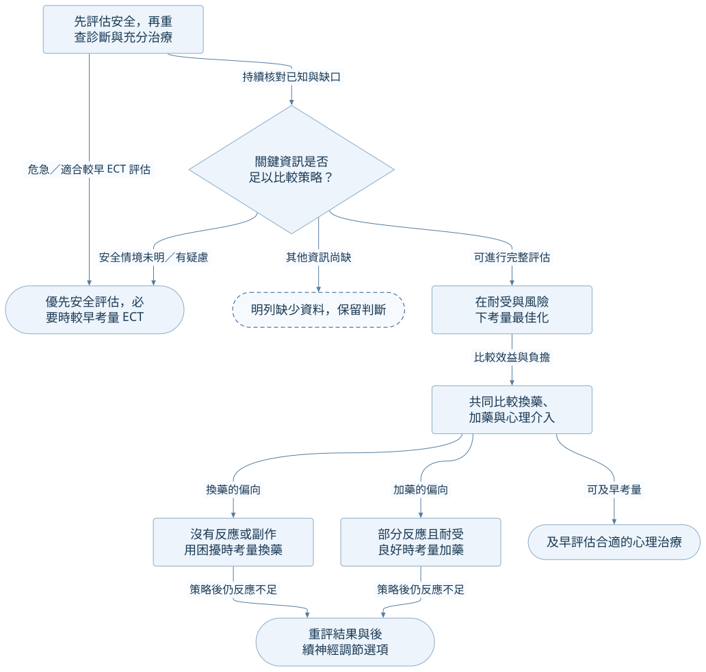

## 使用這張圖前

這是 CANMAT Q7／Figure 7.1 的**學習性簡化與來源對照**，主要討論初始藥物反應不足。它不根據未提供的病例資料自動判定失敗、TRD 或選藥；每個分支保留臨床再評估、偏好及可近性。嚴重且危及生命等情境可優先考量 ECT，不能把一般序列當成必經流程。[@C:14,33-35,41]

## 再評估與策略取捨

<!-- flow:mdd-canmat-reassessment -->

## 接回完整知識

- [評估與測量](../concepts/mdd-assessment-and-measurement.md)：量表、風險與缺資料。
- [反應不足與 DTD](../concepts/mdd-inadequate-response.md)：換藥、加藥、劑量及限制。
- [藥物與安全](../concepts/mdd-pharmacotherapy.md)：交互作用、監測與跨科警訊。
- [神經調節](../concepts/mdd-neuromodulation.md)：嚴重／TRD／DTD 情境及方案。
- [指引比較](../comparisons/mdd-guideline-comparison.md)：另一版本的差異與原文缺口。
