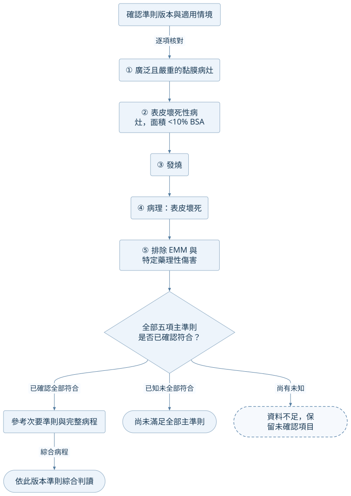

## 準則版本與範圍

本圖呈現 Watanabe 指引 Table 3 的 **日本 SJS 診斷準則（2025）**。全部五項主準則須符合，並參考次要準則及完整臨床病程。日本 TEN 準則與國際分型另有面積定義差異，保留在[診斷與評估](../concepts/sjs-ten-diagnosis.md)，不合併成一套條件。[@W:9-10]

## 五項主準則與判讀

<!-- flow:japanese-sjs-criteria -->

## 閱讀相關內容

- [SJS/TEN 核心概念與圖像](../concepts/sjs-ten.md)。
- [完整診斷、鑑別與驗證限制](../concepts/sjs-ten-diagnosis.md)。
- [SSSS、EB 與 SJS/TEN 比較](../comparisons/epidermal-detachment-differential.md)。
