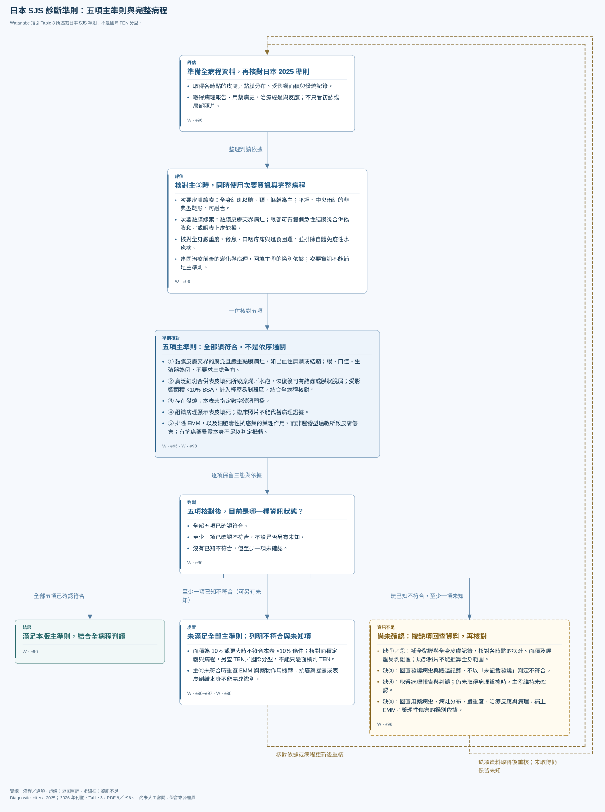
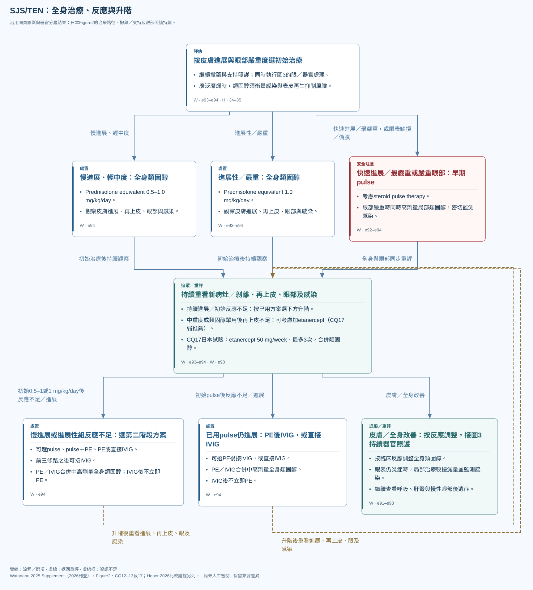
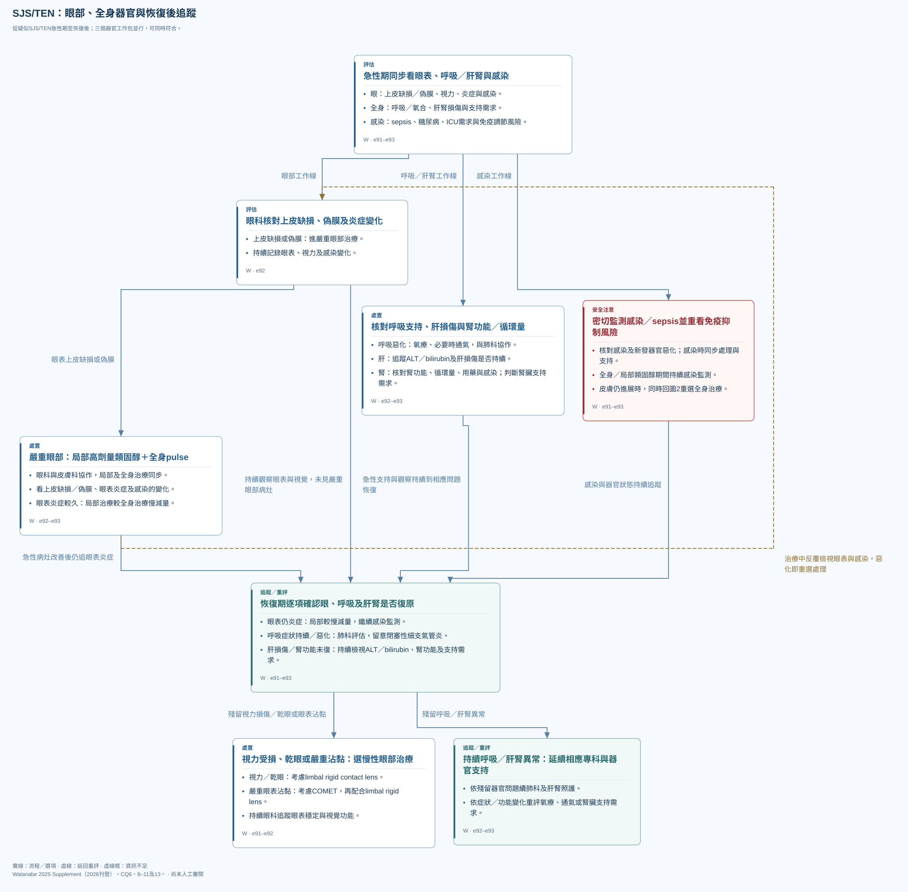

## 從疑似到恢復後：三段相連的臨床任務

廣泛紅斑合併水疱／糜爛及黏膜損傷時，**及早撤除可能致病藥物、開始支持照護，並同步查看眼表**。診斷與病理回補期間，眼部及全身照護持續前進。以下連接辨識與診斷、嚴重度／器官分層、全身治療與反應，再接眼部與恢復後追蹤。[@H:1-2][@W:5-7]

用途是SJS/TEN的臨床學習；診斷與治療主幹採Watanabe日本2025指引補充（2026英文次出版），國際面積分類及Heuer療效比較分開呈現。本站編輯將來源內容分成三段連續路徑；人工審閱尚未完成，分類及療效差異維持`open`。[@W:6-11][@H:1,3-6]

## 圖1：辨識、診斷與嚴重度分層

先記錄全病程皮膚／黏膜分布、各時點面積、發燒、病理、用藥與治療反應，五項主準則一起核對。次要線索、全身嚴重度／倦怠、治療反應及表皮壞死病理，同時參與EMM鑑別。[@W:9]

<!-- flow:japanese-sjs-criteria -->

### 準則定位與邊界

| 核對項目 | 保留的條件與實際去向 |
| --- | --- |
| 日本SJS | **全部五項主準則**，並參考次要資訊與完整病程。黏膜病灶可在眼、口腔、生殖器等交界，不要求三處均有。受影響區**<10% BSA，含輕壓易剝離區**。[@W:9] |
| 病理 | 主④為表皮壞死。成熟病灶可見全層壞死；**每200×視野至少10個壞死角質形成細胞為desirable註記**。未取得病理維持未確認。[@W:9] |
| 次要線索 | 臉／頸／軀幹為主的平坦暗紅非典型靶形、雙側急性結膜炎合併偽膜／眼表上皮缺損、倦怠／口咽痛及進食困難，另須排除自體免疫水疱病。[@W:9] |
| 資料未齊或已知不符 | 逐項保留不符與未知、回補相應資料，仍疑似時繼續撤藥／支持及器官照護；資料取得或病程改變後重核。[@W:9-10][@H:1-2] |
| 日本TEN | **>10% BSA（含輕壓易剝離區）＋發燒＋排除指定疾病**三項全滿足，並考慮次要資訊及完整病程；排除AGEP、自體免疫水疱病、SSSS、TSS、impetigo及抗癌藥藥理性傷害。[@W:10] |
| 國際分類與日本差異 | Heuer使用SJS **<10%**、overlap **10–30%**、TEN **>30%**。日本TEN的門檻為**>10%**；恰10%的日本準則界線留待釐清，照護按當下進展與器官狀態繼續。[@H:1][@W:9-10] |
| 例外與全病程 | 日本SJS註記少數可僅黏膜病灶；TEN另註記瀰漫紅斑起病、因治療調整未達10%的不完全型。保留原文例外，連同完整病程判讀。[@W:9-10] |
| 抗癌藥直接藥理性傷害 | CQ16以enfortumab vedotin為例；須核對機轉。支持直接藥理性傷害時，考慮局部類固醇、口服抗組織胺等支持療法，**高劑量全身類固醇／免疫抑制須審慎**。[@W:11] |

### 嚴重度與預後使用不同資料

治療分層看**進展速度、皮膚／糜爛範圍、眼表上皮缺損或偽膜，以及呼吸、肝腎與感染狀態**。皮膚表現輕但眼部嚴重時，CQ13仍支持考慮早期pulse。[@W:5-7]

CRISTEN依初診臨床資料與病史，各項1分；Table2的詳細定義如下。它提供預後資訊，原文沒有將分數連到pulse、PE或IVIG的治療切點。[@W:8]

| CRISTEN項目 | Table2詳細定義 |
| --- | --- |
| 年齡 | ≥65歲 |
| 表皮剝離 | >10% BSA |
| 惡性腫瘤 | 活動期 |
| 糖尿病 | 需藥物治療；不含僅飲食指導者 |
| 腎損傷 | Chronic kidney disease |
| 細菌感染 | 肺炎、sepsis、泌尿道感染；不含輕微感冒／上呼吸道炎症 |
| 心血管疾病 | 心衰竭、瓣膜病、心律不整、主動脈瘤、心絞痛、心房／心室中隔缺損、治療中的高血壓 |
| 疑似致病藥 | 含抗生素 |
| 黏膜 | 眼、口腔及生殖器三處均受損 |
| 發病前全身類固醇 | 不論劑量或使用期間 |

Table2來源：PDF8／印刷e95。CRISTEN由日本382例提出、七國415例驗證，AUC分別0.876及0.827；仍需累積病例。9、10分死亡率原表空白。SCORTEN的參數、預測校準與CRISTEN分開閱讀，本頁保留為預後評估資料。[@W:8]

## 圖2：全身治療、反應不足與升階

繼續撤藥、支持照護及圖3器官處理，依Figure2三欄選初始方案。**反應不足或仍進展時，不延誤第二階段**；升階後回看新病灶／剝離、再上皮、眼表、感染與全身器官。[@W:6-7]

<!-- flow:sjs-systemic-treatment -->

### 劑量性質、選項與療效差異

| 來源情境 | 具名方案與反應去向 |
| --- | --- |
| 慢進展、輕中度 | 全身類固醇，**prednisolone equivalent 0.5–1.0 mg/kg/day**；反應不佳接進展性／嚴重組第二階段。[@W:7] |
| 進展性／嚴重 | Figure2中欄為全身類固醇，**prednisolone equivalent 1.0 mg/kg/day**。第二階段列**pulse、pulse＋PE、PE或直接IVIG**；前三路之後可接IVIG。[@W:7] |
| 快速進展／最嚴重、含嚴重眼部 | 考慮早期**steroid pulse therapy**；反應不足可選**PE後IVIG，或直接IVIG**。CQ13引述發病4日內pulse可能減少嚴重眼後遺症。[@W:6-7] |
| PE／IVIG安全與順序 | 合併中高劑量全身類固醇；**IVIG後不立即PE**，避免移除已輸入免疫球蛋白。[@W:7] |
| Etanercept加用 | CQ17對中重度、類固醇單用後再上皮不足等情境，**弱推薦與類固醇合用，原指引evidence level III**。文中日本試驗為**50 mg/week、最多3次**；文內主要選擇包含BSA≥10%、類固醇無效或副作用高風險者。[@W:11] |
| 監測與調整 | 觀察皮膚進展、再上皮、眼部及感染；改善後按臨床反應調整全身類固醇。**已廣泛糜爛者須衡量感染與再生抑制風險**；眼部局部減量可慢於全身。[@W:5-7] |

**原文件的表述差異保留：**Figure2框內分三組，中欄為1.0 mg/kg/day；圖說把rapidly progressive or severe概括為應及早pulse。CQ13則建議嚴重、快速進展或皮疹輕但眼重時考慮pulse。本圖依原圖三欄呈現，並保留CQ13的選用條件。[@W:6-7]

**療效比較仍未解決：**Watanabe推薦早期高劑量／pulse；Heuer的類固醇對支持照護死亡率RR0.50（95%CI0.23–1.09），未見明確統計優勢。Etanercept對支持照護RR0.32（0.11–0.93）有訊號，但樣本未達OIS，對類固醇的死亡率比較未達顯著。這兩篇的建議、比較對象及證據限制保持並列。[@W:6,11][@H:3-6]

Etanercept的日本未核准／未納保資訊以原文截至2025年9月為限。更多直接比較與終點見[證據差異](../comparisons/sjs-ten-evidence.md)。[@W:11][@H:3-6]

## 圖3：眼部、全身器官與恢復後追蹤

眼部、呼吸／肝腎及感染三條工作線可以同時存在；合流表示共同重評，依各問題的反應持續處理。**上皮缺損或偽膜提示嚴重眼部侵犯**，需局部高劑量類固醇與全身pulse協同處理，密切監測感染。[@W:4-6]

<!-- flow:sjs-organ-followup -->

### 眼部治療：推薦與病例系列分開讀

CQ10建議急性嚴重眼病灶合併高劑量局部類固醇與全身pulse，**局部減量可慢於全身**，因眼表炎症持續較久。年輕、NSAID／感冒藥相關者在治療開始後仍可能惡化。[@W:5]

| CQ10十例病例系列的方案 | 來源中的劑量／時間性質 |
| --- | --- |
| 局部 | 0.1% betamethasone滴眼**每日9次**、betamethasone眼膏**每日2次** |
| 全身 | pulse後平均初始prednisolone equivalent **1.5 mg/kg/day**，按反應減量 |
| 減量 | 全身從**第2週**、局部從**第3週**開始減量；停全身類固醇平均為pulse後26日，範圍12–60日 |

這是CQ10引用的十例系列，數字以該系列為範圍；治療主線採來源推薦的合併治療、感染監測及依眼表反應較慢減量。[@W:5]

### 器官觀察與後續

| 問題 | 當下觀察／處理 | 持續異常後的去向 |
| --- | --- | --- |
| 呼吸道／肺 | 查看呼吸、氧合與支持需求；肺炎、間質性肺炎、喉水腫或ARDS可需氧療／通氣 | 持續或逐年惡化的呼吸症狀與肺科合作，評估包括閉塞性細支氣管炎的可能性。[@W:5] |
| 肝 | 追蹤ALT／bilirubin及肝損傷變化 | 肝損傷可持續，罕見急性肝衰竭／vanishing bile duct syndrome；異常未復延續肝臟照護。[@W:5-6] |
| 腎 | 核對腎功能、循環量、藥物、感染與腎臟支持需求 | AKI可需透析，部分需長期腎臟支持；按恢復情形續腎臟照護。[@W:6] |
| 感染 | 密切查看感染／sepsis與新器官惡化，重新衡量免疫抑制風險 | 感染與皮膚進展可並存，感染處理及器官支持與全身治療重選並行。[@W:4-6] |
| 慢性眼部後遺症 | 查看視力、乾眼、角膜混濁／不規則散光與眼表沾黏 | 視力／乾眼可考慮limbal rigid contact lens；嚴重沾黏可考慮COMET，再配合limbal rigid lens。[@W:4-5] |

## 操作資訊尚缺的範圍 {#operational-gaps}

兩篇未提供完整支持照護操作表、pulse的具名藥／劑量／天數、PE交換量／次數、IVIG完整療程、全身初始類固醇途徑與完整減量表，以及逐藥禁忌／安全篩檢與監測。來源亦未給各療法固定重評間隔、無效天數、出院標準或統一長期器官追蹤間隔。本頁用具名病灶、器官及感染變化接回治療選擇，處方與時程缺口集中保留在此。[@W:5-7,11][@H:6]

## 教學情境走查

以下是合成教學測試，非病例。預期答案由原來源先定，再核對三圖。

| 情境 | 沿圖應能回答的下一步與後續 |
| --- | --- |
| 五項符合、慢進展輕中度 | 撤藥／支持→日本SJS→0.5–1 mg/kg/day→重看皮膚／眼／感染；不足接進展性組第二階段，改善後按反應調整與器官追蹤。 |
| 病理未取得、BSA小但有眼表缺損／偽膜 | 病理維持未確認並回補；眼部及全身照護立即前進，考慮早期pulse＋局部高劑量類固醇與感染監測。 |
| 一項已知不符、另一項未知 | 保留兩者並重查；仍疑似時分層照護，新資料回填五項清單。 |
| BSA9.9%、10%、10.1%、30%、30.1% | 保留日本<10%／>10%與國際10–30%／>30%分類差異；恰10%的日本界線未補定義，按實際進展與器官繼續處理。 |
| 1 mg/kg/day後仍進展 | 選pulse、pulse＋PE、PE或直接IVIG；前三路可再接IVIG，PE／IVIG合併中高劑量類固醇。 |
| pulse後仍進展；或剛給IVIG欲做PE | pulse後可選PE→IVIG或直接IVIG；**IVIG後不立即PE**，等待時間來源未指定。 |
| 皮膚改善、眼表仍炎症 | 全身按反應調整；局部較慢減量並監測感染，殘留視力／乾眼／沾黏接慢性眼部選項。 |
| 呼吸需求上升、腎傷害與感染並存 | 呼吸支持／肺科、肝腎循環量及用藥核對、感染處理並行；同時重看免疫調節風險。 |

準則、初始及第二階段方案、眼部與器官去向分別回查Table3、Figure2及CQ6、8–13、16–17；案例核對屬Agent來源／邏輯檢查，人工醫學審閱仍待完成。[@W:4-11][@H:1-2]

## 延伸閱讀

- [SJS/TEN核心概念與圖像](../concepts/sjs-ten.md)。
- [診斷、鑑別及藥物檢測](../concepts/sjs-ten-diagnosis.md)。
- [系統性治療與證據比較](../concepts/sjs-ten-treatment.md)。
- [眼部及全身器官併發症](../concepts/sjs-ten-organs.md)。
