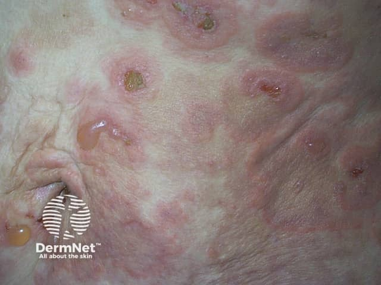
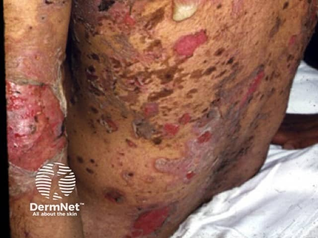

## 水疱緊不緊？BP 與 PV {#atlas-c1}

| 比較面向 | Bullous pemphigoid / BP | Pemphigus vulgaris / PV |
| --- | --- | --- |
| 照片主體 | 緊繃圓頂水疱，常有完整疱頂。 | 鬆弛薄壁水疱易破，常以糜爛、痂皮為主。 |
| 黏膜 | 較少侵犯；仍可能有。 | 口腔糜爛常見，可先於皮膚病灶。 |
| 題幹 | 高齡、劇癢、蕁麻疹樣前驅皮疹。 | 糜爛疼痛、持續口腔病灶。 |
| Nikolsky | 通常陰性。 | 可陽性，但不具單病專一性。 |
| 病理／DIF | 表皮下裂隙；基底膜帶線狀 IgG／C3。 | 基底層上棘層鬆解；細胞間網狀 IgG／C3。 |

照片看的是疱頂與糜爛分布；組織分離層次與 DIF 不能由普通照片直接判定。BP 也會破疱、也可能沒有水疱；不能以單一特徵作絕對排除。

[@A:c1]

<figure class="clinical-image" data-asset-id="asset-dermatology-2c86e4afaa1b14be"><figcaption>臨床照片 紅色斑塊上同時可見完整圓頂水疱與破疱後的小糜爛、痂皮。Image sourced from DermNet · © DermNet · 原圖／出處 · <a href="https://dermnetnz.org/imagedetail/9292-bullous-pemphigoid" target="_blank" rel="noopener">原圖來源</a> · <a href="https://creativecommons.org/licenses/by-nc-nd/4.0/" target="_blank" rel="noopener">CC BY-NC-ND 4.0</a> · 原圖未修改</figcaption></figure>
<figure class="clinical-image" data-asset-id="asset-dermatology-135a14c7466b27b1"><figcaption>臨床照片 軀幹皮膚散布大小不一的紅色糜爛與痂皮，周圍有明顯深色色素改變。Image sourced from DermNet · © DermNet · 原圖／出處 · <a href="https://dermnetnz.org/imagedetail/9413-pemphigus-vulgaris" target="_blank" rel="noopener">原圖來源</a> · <a href="https://creativecommons.org/licenses/by-nc-nd/4.0/" target="_blank" rel="noopener">CC BY-NC-ND 4.0</a> · 原圖未修改</figcaption></figure>

## 延伸閱讀

- [水疱性類天疱瘡](../concepts/bullous-pemphigoid.md#atlas-d03)
- [尋常天疱瘡](../concepts/pemphigus-vulgaris.md#atlas-d09)
