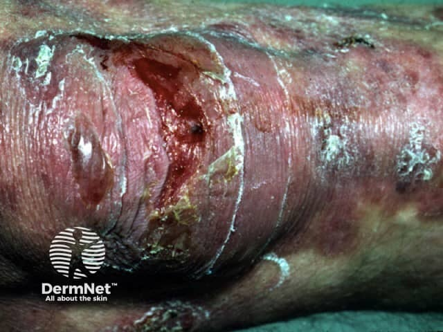
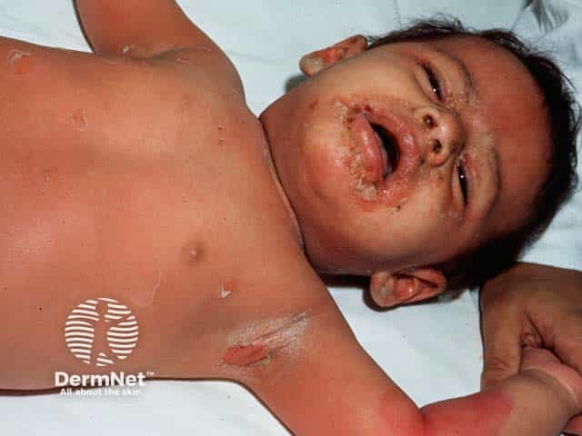
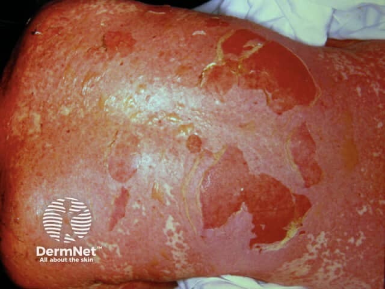
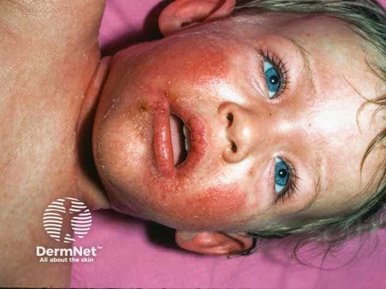
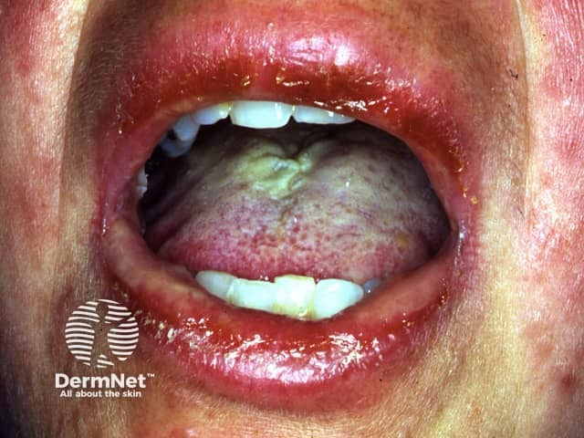

## 大片脫皮：EB、SSSS、SJS/TEN {#atlas-c2}

| 面向 | 遺傳性 EB | SSSS | SJS / TEN |
| --- | --- | --- | --- |
| 病程 | 嬰幼兒起或開始活動後；輕微摩擦反覆起疱。 | 多幼童，急性發燒、觸痛及迅速脫皮。 | 急性疼痛暗紅疹，追問近期用藥及全身不適。 |
| 可見線索 | 摩擦部位水疱；依亞型可見瘢痕、甲異常。 | 表淺薄疱、皺紙樣脫屑，常累及皺摺／口周。 | 暗紅紫斑、扁平非典型靶、廣泛糜爛。 |
| 黏膜 | 依亞型而異。 | 通常保留；口周結痂不等於口腔糜爛。 | 常有明顯口腔、眼或生殖器糜爛。 |
| 檢驗 | 依裂隙位置、抗原定位與基因分型。 | 表淺表皮分離；整合臨床與感染檢查。 | 典型病理為全層表皮壞死。 |

國際慣用分類：SJS <10%、重疊 10-30%、TEN >30%，計算已剝離／可剝離表皮 BSA，不是全部紅斑。Nikolsky 陽性無法單獨區分三者；遺傳性 EB 不等於後天自體免疫性 EBA。

[@A:c2]

<figure class="clinical-image" data-asset-id="asset-dermatology-04117c49a5c2d4bb"><figcaption>臨床照片 關節附近可見透明薄疱皮、大片糜爛及周圍發亮的舊瘢痕樣皮膚。Image sourced from DermNet · © DermNet · 原圖／出處 · <a href="https://dermnetnz.org/imagedetail/7589-epidermolysis-bullosa" target="_blank" rel="noopener">原圖來源</a> · <a href="https://creativecommons.org/licenses/by-nc-nd/4.0/" target="_blank" rel="noopener">CC BY-NC-ND 4.0</a> · 原圖未修改</figcaption></figure>
<figure class="clinical-image" data-asset-id="asset-dermatology-dbaad579513017f7"><figcaption>臨床照片 幼童腋下可見淺表皮膚剝離，口鼻周圍有糜爛結痂，軀幹伴紅斑。Image sourced from DermNet · © Dr Lawrence Meyerson · 原圖／出處 · <a href="https://dermnetnz.org/imagedetail/3257-staphylococcal-scalded-skin-syndrome" target="_blank" rel="noopener">原圖來源</a> · <a href="https://creativecommons.org/licenses/by-nc-nd/4.0/" target="_blank" rel="noopener">CC BY-NC-ND 4.0</a> · 原圖未修改</figcaption></figure>
<figure class="clinical-image" data-asset-id="asset-dermatology-ce5fa13acc3d2f99"><figcaption>臨床照片 軀幹可見大片表皮脫落，留下鮮紅糜爛面，邊緣殘留薄而捲起的表皮。Image sourced from DermNet · © DermNet · 原圖／出處 · <a href="https://dermnetnz.org/imagedetail/8151-toxic-epidermal-necrolysis" target="_blank" rel="noopener">原圖來源</a> · <a href="https://creativecommons.org/licenses/by-nc-nd/4.0/" target="_blank" rel="noopener">CC BY-NC-ND 4.0</a> · 原圖未修改</figcaption></figure>

## SSSS 與 SJS/TEN：先找黏膜，再看病程 {#atlas-blister}

| 比較面向 | SSSS | SJS/TEN |
| --- | --- | --- |
| 典型題幹 | 嬰幼兒急性發燒、煩躁、觸痛；成人可有腎功能／免疫問題。 | 急性皮膚疼痛、暗紅斑與近期用藥；各年齡皆可發生。 |
| 照片線索 | 薄壁水疱、皺紙樣表皮、淺層剝脫，皺褶與口周常明顯。 | 暗紅或非典型靶形斑、糜爛、出血性痂；可伴大片剝離。 |
| 黏膜 | 通常保留。口周有痂不等於口腔內糜爛。 | 口腔、眼或生殖器黏膜糜爛常見。 |
| 機制／組織 | 葡萄球菌剝脫毒素作用於 desmoglein-1；分離在表皮顆粒層。 | 角質細胞壞死，成熟病灶可見全層表皮壞死及較深分離。 |
| Nikolsky | 可陽性。 | 可陽性；不能只靠此徵象區分兩者。 |
| 確認重點 | 病程、感染源培養；必要時切片確認表淺裂隙。 | 用藥時序、皮膚／黏膜檢查、病理與全身剝離範圍。 |

**SJS/TEN 分型：**依全身「已剝離／可剝離表皮」BSA：SJS <10%；重疊型 10-30%；TEN >30%。紅斑面積與剝離面積要分開。黏膜侵犯可出現在這三型，不能單靠口腔照片分型。

[@B:blister]

<figure class="clinical-image" data-asset-id="asset-dermatology-d8c0d702e22af0ec"><figcaption>臨床照片 口鼻周圍的紅斑、痂與細裂隙是讀圖線索；真正口腔黏膜是否保留，仍須檢查。Image sourced from DermNet · © Dr Lawrence Meyerson · 原圖／出處 · <a href="https://dermnetnz.org/imagedetail/3251-staphylococcal-scalded-skin-syndrome" target="_blank" rel="noopener">原圖來源</a> · <a href="https://creativecommons.org/licenses/by-nc-nd/4.0/" target="_blank" rel="noopener">CC BY-NC-ND 4.0</a> · 原圖未修改</figcaption></figure>
<figure class="clinical-image" data-asset-id="asset-dermatology-60699d694a6bdf4c"><figcaption>臨床照片 來源標示 SJS：嘴唇紅腫、表面糜爛與痂，口內亦見黏膜病灶。Image sourced from DermNet · © DermNet · 原圖／出處 · <a href="https://dermnetnz.org/imagedetail/8470-stevens-johnson-syndrome" target="_blank" rel="noopener">原圖來源</a> · <a href="https://creativecommons.org/licenses/by-nc-nd/4.0/" target="_blank" rel="noopener">CC BY-NC-ND 4.0</a> · 原圖未修改</figcaption></figure>

## 延伸閱讀

- [毒性表皮壞死溶解症](../concepts/sjs-ten.md#atlas-d12)
- [葡萄球菌燙傷樣皮膚症候群](../concepts/staphylococcal-scalded-skin-syndrome.md#atlas-d58)
