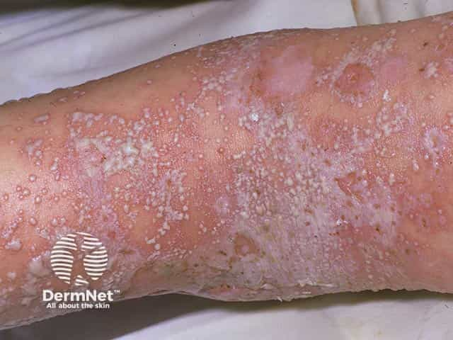
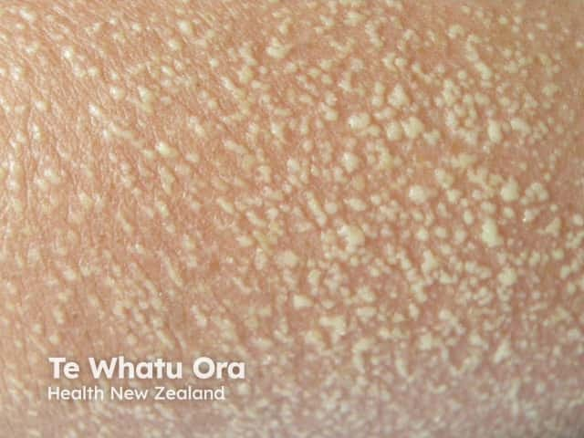
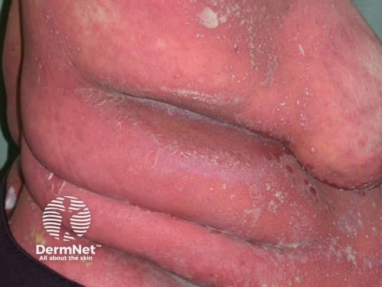

## 全身性膿疱性乾癬 vs 急性廣泛性發疹性膿疱症 {#atlas-d11}

**新藥後急發、快速消退偏 AGEP；反覆發作或既有乾癬線索偏 GPP。** [@A:d11]

### 辨認特徵

- GPP：發紅疼痛的皮膚上出現非毛囊性無菌膿疱，可融合成較大片「膿湖」。 [@A:d11]
- AGEP：密集針尖大小非毛囊性膿疱，常從臉或皺摺開始，紅腫背景與顏面水腫可明顯。 [@A:d11]
- 兩者都可有發燒、嗜中性球上升及後續脫屑；單張近照高度重疊。 [@A:d11]

### 最容易混淆

- AGEP 停致病藥後多於約兩週內消退；藥物潛伏期會依藥物及再暴露而變，不可只背 48 小時。 [@A:d11]
- GPP 可以沒有既往斑塊型乾癬，也可能受藥物誘發；乾癬病史並非充分或必要條件。 [@A:d11]
- 毛囊炎：膿疱多以毛囊為中心；必要時做培養排除感染。 [@A:d11]

### 驗證方法

需整合用藥時序、既往病程、膿疱培養與病理；AGEP 可用 EuroSCAR 框架評估。 [@A:d11]

### 判讀限制

**AGEP 正確全名為 acute generalised exanthematous pustulosis，並非 erythematous pustulosis；膿疱不等於細菌感染。** [@A:d11]

### 增補校正

GPP 的重點是紅底非毛囊性膿疱；典型三區靶形病灶另見多形性紅斑。 [@B:corrections]

### 圖像對照

<figure class="clinical-image" data-asset-id="asset-dermatology-13433e467fa373dc"><figcaption>臨床照片 紅色皮膚上密集分布表淺白黃膿疱，部分相互融合，旁有脫屑與痂皮。Image sourced from DermNet · © Dr Richard Ashton · 原圖／出處 · <a href="https://dermnetnz.org/imagedetail/1852-generalised-pustular-psoriasis" target="_blank" rel="noopener">原圖來源</a> · <a href="https://creativecommons.org/licenses/by-nc-nd/4.0/" target="_blank" rel="noopener">CC BY-NC-ND 4.0</a> · 原圖未修改</figcaption></figure>
<figure class="clinical-image" data-asset-id="asset-dermatology-b3be30ae1e2f856d"><figcaption>臨床照片 紅色背景上密布大小相近的細小白色膿疱，像針尖撒滿皮膚。Image sourced from DermNet · © Te Whatu Ora · 原圖／出處 · <a href="https://dermnetnz.org/imagedetail/4379-acute-generalised-exanthematous-pustulosis" target="_blank" rel="noopener">原圖來源</a> · <a href="https://creativecommons.org/licenses/by-nc-nd/4.0/" target="_blank" rel="noopener">CC BY-NC-ND 4.0</a> · 原圖未修改</figcaption></figure>

[@A:d11]

### 講義所列參考頁

查看外部參考連結

以下連結由講義提供，未將這些原文視為本次已完整閱讀的獨立來源。
<ul><li><a href="https://dermnetnz.org/topics/generalised-pustular-psoriasis" target="_blank" rel="noopener">DermNet - Generalised pustular psoriasis</a></li><li><a href="https://dermnetnz.org/topics/acute-generalised-exanthematous-pustulosis" target="_blank" rel="noopener">DermNet - Acute generalised exanthematous pustulosis</a></li><li><a href="https://pmc.ncbi.nlm.nih.gov/articles/PMC11859758/" target="_blank" rel="noopener">Awethe et al. - Validation of the EuroSCAR Criteria for AGEP (JAAD, 2025)</a></li><li><a href="https://pubmed.ncbi.nlm.nih.gov/38691347/" target="_blank" rel="noopener">IPC GPP consensus (2024)</a></li><li><a href="https://www.medsafe.govt.nz/profs/PUArticles/December2020/Acute-generalised-exanthematous-pustulosis-AGEP.html" target="_blank" rel="noopener">Medsafe - AGEP</a></li></ul>

## 密集膿疱：GPP 與 AGEP {#atlas-c3}

| 面向 | 全身性膿疱性乾癬 / GPP | AGEP |
| --- | --- | --- |
| 共同外觀 | 紅底上的大量非毛囊性膿疱。 | 紅底上的大量非毛囊性膿疱。 |
| 較支持的形態 | 可融合成膿湖，也可只有細小膿疱。 | 常針尖樣、皺摺較密，可合併臉腫。 |
| 病程重點 | 反覆發作或持續病程；可無既往斑塊型乾癬。 | 常與新藥有時間關聯，停致病藥後多約兩週內改善。 |
| 時間陷阱 | 有乾癬病史並不能排除 AGEP。 | 常迅速發作，但不是一律 48 小時內。 |
| 進一步證據 | 病理的乾癬樣變化／海綿狀膿疱，配合病程。 | 病理的嗜酸性球、凋亡角質細胞等可支持；結合 EuroSCAR。 |

發燒、嗜中性球增加與脫屑兩者都可能有；一張近照常無法定案。「無菌」不能只靠照片證實。AGEP 的 E 是 exanthematous。

[@A:c3]

<figure class="clinical-image" data-asset-id="asset-dermatology-d484eb5bea26d03f"><figcaption>臨床照片 大片紅斑覆蓋軀幹與皺摺，散布細小白色膿疱樣病灶及脫屑。Image sourced from DermNet · © DermNet · 原圖／出處 · <a href="https://dermnetnz.org/imagedetail/6023-generalised-pustular-psoriasis" target="_blank" rel="noopener">原圖來源</a> · <a href="https://creativecommons.org/licenses/by-nc-nd/4.0/" target="_blank" rel="noopener">CC BY-NC-ND 4.0</a> · 原圖未修改</figcaption></figure>
<figure class="clinical-image" data-asset-id="asset-dermatology-b3be30ae1e2f856d"><figcaption>臨床照片 紅色背景上密布大小相近的細小白色膿疱，像針尖撒滿皮膚。Image sourced from DermNet · © Te Whatu Ora · 原圖／出處 · <a href="https://dermnetnz.org/imagedetail/4379-acute-generalised-exanthematous-pustulosis" target="_blank" rel="noopener">原圖來源</a> · <a href="https://creativecommons.org/licenses/by-nc-nd/4.0/" target="_blank" rel="noopener">CC BY-NC-ND 4.0</a> · 原圖未修改</figcaption></figure>

## 延伸閱讀

- [多形性紅斑](../concepts/erythema-multiforme.md#atlas-d06)
