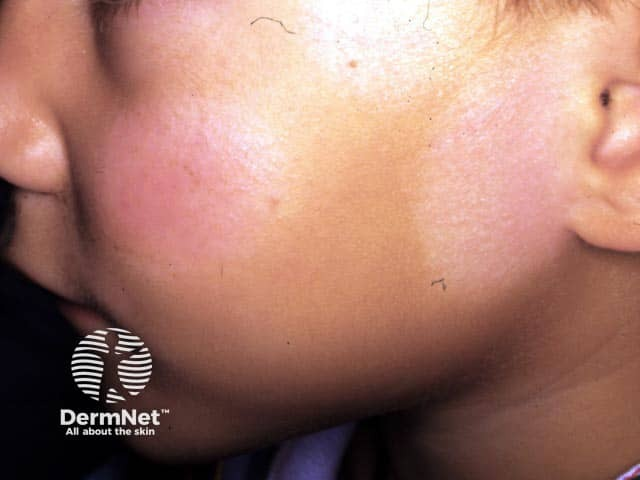
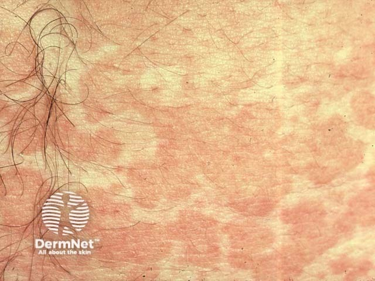
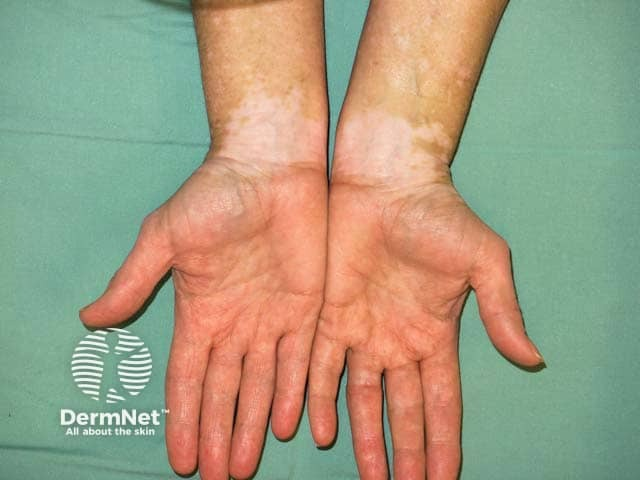

## 淺色斑：先找細屑與脫色程度 {#atlas-c5}

| 面向 | 白色糠疹 | 變色糠疹／汗斑 | 白斑症 |
| --- | --- | --- | --- |
| 顏色 | 淡白，非完全去色素。 | 可白、褐或粉紅。 | 乳白／粉筆白的去色素。 |
| 表面／邊界 | 乾燥細屑，常較模糊。 | 糠秕細屑；可融合成大片。 | 一般無屑、邊界清楚。 |
| 典型部位 | 兒童臉頰，亦可頸臂。 | 上胸背、頸、近端上臂。 | 肢端、口眼周；可對稱或節段型。 |
| 檢驗 | 真菌檢查陰性。 | KOH：短菌絲＋酵母。 | Wood lamp 使脫色與邊界更明顯。 |

細屑可能要放大或輕刮才能看見。Wood lamp 陰性不能排除汗斑；汗斑是 Malassezia 酵母相關，不是皮癬菌。顏色尚未恢復也不等於仍有活性感染。

[@A:c5]

<figure class="clinical-image" data-asset-id="asset-dermatology-da474057e86ded7c"><figcaption>臨床照片 兒童臉頰較淡、乾燥的斑片，邊界不像典型白斑症般銳利。Image sourced from DermNet · © DermNet · 原圖／出處 · <a href="https://dermnetnz.org/imagedetail/2261-pityriasis-alba" target="_blank" rel="noopener">原圖來源</a> · <a href="https://creativecommons.org/licenses/by-nc-nd/4.0/" target="_blank" rel="noopener">CC BY-NC-ND 4.0</a> · 原圖未修改</figcaption></figure>
<figure class="clinical-image" data-asset-id="asset-dermatology-6d0e2f5a970f2d73"><figcaption>臨床照片 胸部多發淡色細屑斑，邊緣彼此融合，呈地圖樣外觀。Image sourced from DermNet · © DermNet · 原圖／出處 · <a href="https://dermnetnz.org/imagedetail/17293-pityriasis-versicolor" target="_blank" rel="noopener">原圖來源</a> · <a href="https://creativecommons.org/licenses/by-nc-nd/4.0/" target="_blank" rel="noopener">CC BY-NC-ND 4.0</a> · 原圖未修改</figcaption></figure>
<figure class="clinical-image" data-asset-id="asset-dermatology-c1a0b4cb5bfef2de"><figcaption>臨床照片 雙側手腕呈大致對稱的白色斑塊，與正常膚色形成清楚界線。Image sourced from DermNet · © DermNet · 原圖／出處 · <a href="https://dermnetnz.org/imagedetail/2846-vitiligo" target="_blank" rel="noopener">原圖來源</a> · <a href="https://creativecommons.org/licenses/by-nc-nd/4.0/" target="_blank" rel="noopener">CC BY-NC-ND 4.0</a> · 原圖未修改</figcaption></figure>

## 延伸閱讀

- [白色糠疹](../concepts/pityriasis-alba.md#atlas-d27)
- [變色糠疹／汗斑](../concepts/pityriasis-versicolor.md#atlas-d34)
- [白斑症](../concepts/vitiligo.md#atlas-d54)
