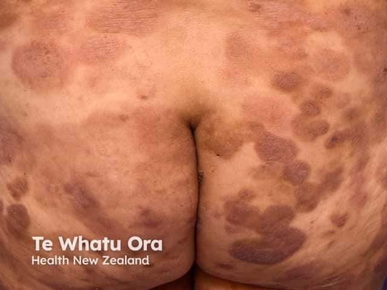
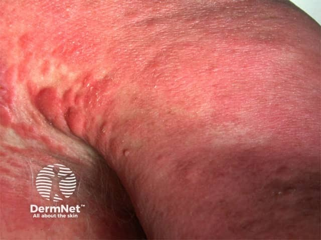

## MF 與 Sézary：皮膚外觀之外，還缺什麼？ {#atlas-ctcl}

| 面向 | Mycosis fungoides | Sézary syndrome |
| --- | --- | --- |
| 典型外觀 | 慢性斑片／斑塊；部分可有腫瘤。 | 廣泛紅皮、脫屑；可有掌蹠角化、眼瞼外翻。 |
| 分布與病程 | 常見衣物遮蔽區，可能多年反覆。 | 常以廣泛紅皮與明顯搔癢呈現。 |
| 照片的限制 | 早期可與濕疹、體癬相似。 | 不能僅由紅皮症照片確診。 |
| 關鍵確認 | 臨床-病理對照；必要時重複切片。 | 皮膚病理＋血液流式分析＋相符 TCR 克隆。 |
| 血液要點 | 皮膚表現不代表必有大量血液腫瘤細胞。 | 需評估高血液腫瘤負荷（B2）及克隆性證據。 |
| 關係 | 可進展，但不是每例都會。 | 不能視作所有 MF 的必然末期。 |

**數字要放回原本用途：**一般紅皮症常用約 90% 體表範圍描述；MF／SS 的 TNMB 分期中，T4 採 ≥80%。兩者是不同使用情境。B2 是高血液腫瘤負荷的分級，須結合異常 T 細胞絕對數、克隆性與臨床病理；不要把局部紅皮照片直接換成 T4 或 Sézary 診斷。

[@B:ctcl]

<figure class="clinical-image" data-asset-id="asset-dermatology-0d8a1c58c30414d6"><figcaption>臨床照片 MF 分布例：臀部與下背部有多發、不規則的紅褐色斑塊，示範衣物遮蔽區受累。Image sourced from DermNet · © Te Whatu Ora · 原圖／出處 · <a href="https://dermnetnz.org/imagedetail/6276-plaque-stage-mycosis-fungoides" target="_blank" rel="noopener">原圖來源</a> · <a href="https://creativecommons.org/licenses/by-nc-nd/4.0/" target="_blank" rel="noopener">CC BY-NC-ND 4.0</a> · 原圖未修改</figcaption></figure>
<figure class="clinical-image" data-asset-id="asset-dermatology-b0a21c6b4dac8c93"><figcaption>臨床照片 來源列於 Sézary 頁面的紅皮症近照：皮膚泛紅、紋理增粗。外觀本身不能確定紅皮病因。Image sourced from DermNet · © DermNet · 原圖／出處 · <a href="https://dermnetnz.org/imagedetail/10528-sezary-syndrome" target="_blank" rel="noopener">原圖來源</a> · <a href="https://creativecommons.org/licenses/by-nc-nd/4.0/" target="_blank" rel="noopener">CC BY-NC-ND 4.0</a> · 原圖未修改</figcaption></figure>

## 延伸閱讀

- [紅皮症](../concepts/erythroderma.md#atlas-d14)
- [蕈狀肉芽腫（皮膚 T 細胞淋巴瘤）](../concepts/mycosis-fungoides.md#atlas-d56)
