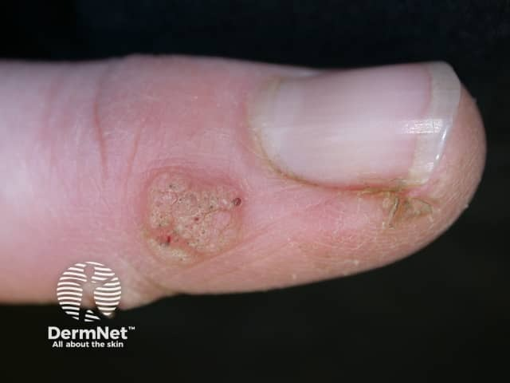
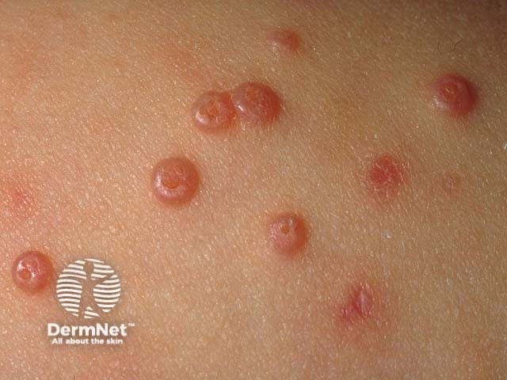
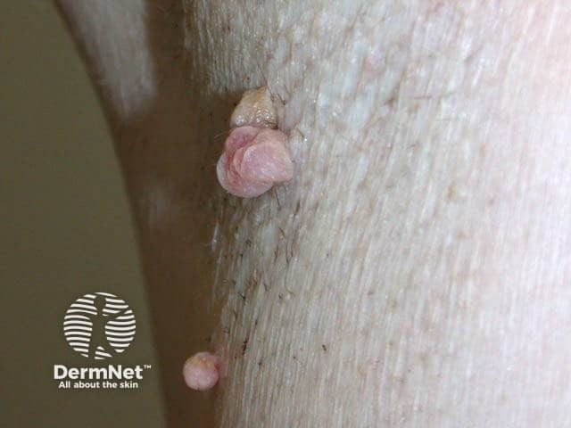
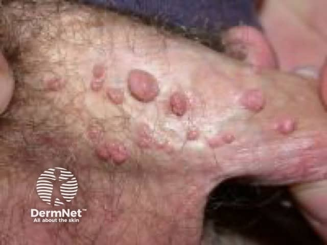

## 小丘疹：表面比名稱更有用 {#atlas-c6}

| 病灶 | 外觀關鍵 | 常見定位／題幹 | 區別重點 |
| --- | --- | --- | --- |
| 尋常疣 | 粗糙角化、血管黑紅點、皮紋中斷。 | 手指、甲周，亦可其他部位。 | 皮膚型 HPV；黑點不是病毒根。 |
| 傳染性軟疣 | 光滑、發亮、圓頂與中央臍凹。 | 兒童常見，可線狀自體接種。 | 痘病毒；與 HPV 疣不同。 |
| 皮贅 | 柔軟、有細柄，表面較平滑。 | 頸、腋下、鼠蹊、眼皮。 | 典型不具病毒疣的傳染性。 |
| 尖圭濕疣 | 不規則乳突／菜花狀群聚，亦可平坦。 | 肛生殖區。 | 多與 HPV 6/11 相關。 |
| 扁平濕疣 | 較寬平、潮濕的丘疹／斑塊。 | 二期梅毒；找掌蹠疹與黏膜斑。 | 以梅毒血清／直接檢測判讀。 |

最下列扁平濕疣是重要鑑別，非上方第 4 張尖圭濕疣照片的診斷。不能簡化為「平＝梅毒、凸＝HPV」。一般生殖器疣不以 HPV 檢測確診。

[@A:c6]

<figure class="clinical-image" data-asset-id="asset-dermatology-fe483c6616f0035b"><figcaption>臨床照片 拇指甲旁界清的角化丘疹，可見點狀血管與不規則表面。Image sourced from DermNet · © DermNet · 原圖／出處 · <a href="https://dermnetnz.org/imagedetail/10137-viral-warts" target="_blank" rel="noopener">原圖來源</a> · <a href="https://creativecommons.org/licenses/by-nc-nd/4.0/" target="_blank" rel="noopener">CC BY-NC-ND 4.0</a> · 原圖未修改</figcaption></figure>
<figure class="clinical-image" data-asset-id="asset-dermatology-66d4d37f1d06e0bd"><figcaption>臨床照片 多顆光滑圓頂狀丘疹，中央臍窩凹陷清楚，是最典型的辨認點。Image sourced from DermNet · © DermNet · 原圖／出處 · <a href="https://dermnetnz.org/imagedetail/19122-molluscum-contagiosum" target="_blank" rel="noopener">原圖來源</a> · <a href="https://creativecommons.org/licenses/by-nc-nd/4.0/" target="_blank" rel="noopener">CC BY-NC-ND 4.0</a> · 原圖未修改</figcaption></figure>
<figure class="clinical-image" data-asset-id="asset-dermatology-ef007dcce71d9734"><figcaption>臨床照片 皺摺旁可見帶蒂、外形圓潤的膚色至粉紅小腫塊。Image sourced from DermNet · © DermNet · 原圖／出處 · <a href="https://dermnetnz.org/imagedetail/14267-skin-tag" target="_blank" rel="noopener">原圖來源</a> · <a href="https://creativecommons.org/licenses/by-nc-nd/4.0/" target="_blank" rel="noopener">CC BY-NC-ND 4.0</a> · 原圖未修改</figcaption></figure>
<figure class="clinical-image" data-asset-id="asset-dermatology-80517952f2f2ed17"><figcaption>臨床照片 陰莖近端群聚膚色至粉紅丘疹，大小不一，可呈有蒂與乳突狀。Image sourced from DermNet · © DermNet · 原圖／出處 · <a href="https://dermnetnz.org/imagedetail/5078-genital-warts" target="_blank" rel="noopener">原圖來源</a> · <a href="https://creativecommons.org/licenses/by-nc-nd/4.0/" target="_blank" rel="noopener">CC BY-NC-ND 4.0</a> · 原圖未修改</figcaption></figure>

## 延伸閱讀

- [尖圭濕疣／尖形濕疣](../concepts/condyloma-acuminatum.md#atlas-d23)
- [二期梅毒](../concepts/syphilis.md#atlas-d30)
- [傳染性軟疣](../concepts/molluscum-contagiosum.md#atlas-d35)
- [尋常疣](../concepts/verruca-vulgaris.md#atlas-d36)
- [皮贅／軟纖維瘤](../concepts/skin-tag.md#atlas-d53)
