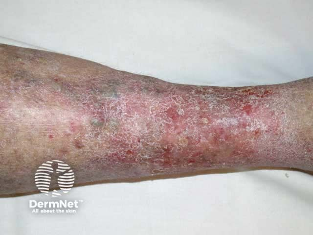
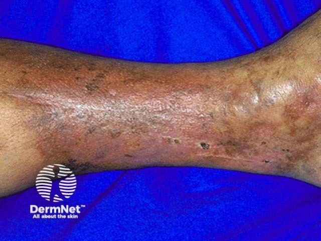
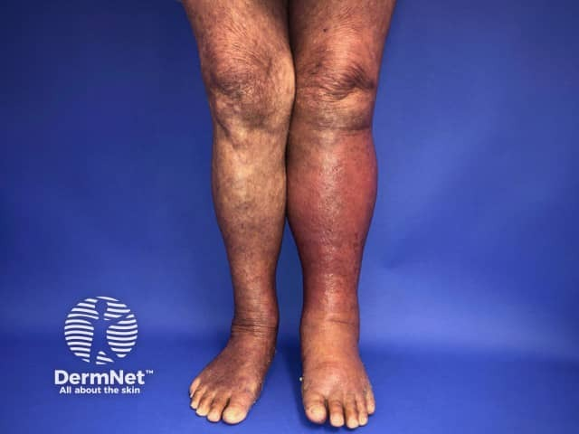

## 小腿紅：濕疹、硬化或感染？ {#atlas-c4}

| 面向 | Stasis dermatitis | Lipodermatosclerosis | Cellulitis |
| --- | --- | --- | --- |
| 主體 | 表淺濕疹、屑、滲液或結痂。 | 皮下發炎與纖維化；慢性踝上收窄。 | 大片紅腫，常急性擴散。 |
| 背景 | 慢性水腫、靜脈曲張、褐色沉著。 | 靜脈病背景；可與鬱滯性濕疹並存。 | 常單側；可能有皮膚入口傷口。 |
| 題幹／觸診 | 癢較突出；常慢性、可雙側。 | 硬、緊繃；急性期也可痛紅腫。 | 熱、痛、發燒與急性病程支持感染。 |
| 不能硬分 | 可能繼發感染。 | 沒有倒香檳瓶形也不能排除早期。 | 雙側雖少見，但「紅」本身不是診斷。 |

靜脈鬱滯性濕疹與脂性皮膚硬化症不是互斥診斷。照片不能證實皮下硬度、熱度或壓痛。靜脈潰瘍典型在踝上，腳跟潰瘍還要辨別壓力及缺血。

[@A:c4]

<figure class="clinical-image" data-asset-id="asset-dermatology-82b5e3664aa3a2a4"><figcaption>臨床照片 小腿下段濕疹樣紅斑與廣泛細屑，伴棕褐色背景。Image sourced from DermNet · © DermNet · 原圖／出處 · <a href="https://dermnetnz.org/imagedetail/15193-venous-eczema" target="_blank" rel="noopener">原圖來源</a> · <a href="https://creativecommons.org/licenses/by-nc-nd/4.0/" target="_blank" rel="noopener">CC BY-NC-ND 4.0</a> · 原圖未修改</figcaption></figure>
<figure class="clinical-image" data-asset-id="asset-dermatology-d48c91ad88df4583"><figcaption>臨床照片 小腿下段呈深褐色且表面緊繃發亮，夾有小型糜爛與色素不均。Image sourced from DermNet · © DermNet · 原圖／出處 · <a href="https://dermnetnz.org/imagedetail/18920-lipodermatosclerosis" target="_blank" rel="noopener">原圖來源</a> · <a href="https://creativecommons.org/licenses/by-nc-nd/4.0/" target="_blank" rel="noopener">CC BY-NC-ND 4.0</a> · 原圖未修改</figcaption></figure>
<figure class="clinical-image" data-asset-id="asset-dermatology-34b228e6a9b0c9d2"><figcaption>臨床照片 左小腿較另一側明顯紅腫；熱度、壓痛仍需理學檢查。Image sourced from DermNet · © DermNet · 原圖／出處 · <a href="https://dermnetnz.org/imagedetail/6036-cellulitis-of-the-left-leg" target="_blank" rel="noopener">原圖來源</a> · <a href="https://creativecommons.org/licenses/by-nc-nd/4.0/" target="_blank" rel="noopener">CC BY-NC-ND 4.0</a> · 原圖未修改</figcaption></figure>

## 延伸閱讀

- [脂性皮膚硬化症](../concepts/lipodermatosclerosis.md#atlas-d17)
- [鬱滯性皮膚炎與靜脈性潰瘍](../concepts/stasis-dermatitis.md#atlas-d20)
- [蜂窩性組織炎](../concepts/cellulitis.md#atlas-d22)
