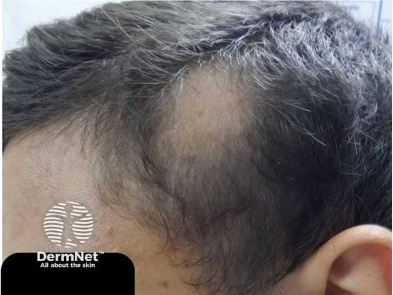
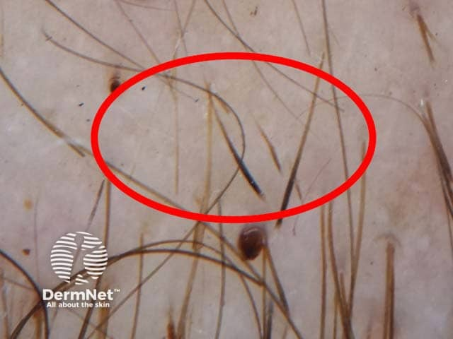

## 圓禿 {#atlas-d02}

**光滑圓形禿髮斑＋驚嘆號髮，是典型圖像組合。** [@A:d02]

### 辨認特徵

- 一個或多個界線清楚、圓形或橢圓形的光滑禿髮區，通常沒有明顯鱗屑。 [@A:d02]
- 毛囊開口保留；活動期邊緣可見驚嘆號髮：近頭皮端細、遠端較粗。 [@A:d02]
- 毛髮鏡可見黃點、黑點及斷髮；可能伴點狀甲凹陷，亦可呈枕顳部帶狀落髮。 [@A:d02]

### 最容易混淆

- 頭癬：較常有鱗屑、斷髮或發炎，兒童尤其要做真菌檢查。 [@A:d02]
- 拔毛症：斑塊較不規則，殘留長短不一的斷髮。 [@A:d02]
- DLE 等瘢痕性禿髮：毛囊口消失，常見萎縮、色素改變或毛囊角栓。 [@A:d02]

### 驗證方法

以臨床及毛髮鏡診斷；若伴鱗屑或發炎，取毛髮／皮屑作 KOH 與真菌檢查。 [@A:d02]

### 判讀限制

**黑點和斷髮不是圓禿獨有；驚嘆號髮未必每張照片都看得到。** [@A:d02]

### 圖像對照

<figure class="clinical-image" data-asset-id="asset-dermatology-080daf3923d8d262"><figcaption>臨床照片 顳部可見單一界線清楚、表面光滑的圓形禿髮斑，未見明顯鱗屑或瘢痕。Image sourced from DermNet · © DermNet · 原圖／出處 · <a href="https://dermnetnz.org/imagedetail/3294-alopecia-areata" target="_blank" rel="noopener">原圖來源</a> · <a href="https://creativecommons.org/licenses/by-nc-nd/4.0/" target="_blank" rel="noopener">CC BY-NC-ND 4.0</a> · 原圖未修改</figcaption></figure>
<figure class="clinical-image" data-asset-id="asset-dermatology-a6e20c01b4c07b60"><figcaption>皮膚鏡／毛髮鏡 毛髮鏡紅圈內可見短而朝近頭皮端漸細的驚嘆號樣髮幹。Image sourced from DermNet · © DermNet · 原圖／出處 · <a href="https://dermnetnz.org/imagedetail/3277-alopecia-areata" target="_blank" rel="noopener">原圖來源</a> · <a href="https://creativecommons.org/licenses/by-nc-nd/4.0/" target="_blank" rel="noopener">CC BY-NC-ND 4.0</a> · 原圖未修改</figcaption></figure>

[@A:d02]

### 講義所列參考頁

查看外部參考連結

以下連結由講義提供，未將這些原文視為本次已完整閱讀的獨立來源。
<ul><li><a href="https://dermnetnz.org/topics/alopecia-areata" target="_blank" rel="noopener">DermNet - Alopecia areata</a></li><li><a href="https://dermnetnz.org/topics/trichotillomania" target="_blank" rel="noopener">DermNet - Trichotillomania</a></li><li><a href="https://dermnetnz.org/topics/discoid-lupus-erythematosus" target="_blank" rel="noopener">DermNet - Discoid lupus erythematosus</a></li></ul>

## 延伸閱讀

- [圓盤狀紅斑性狼瘡](discoid-lupus-erythematosus.md#atlas-d05)
- [頭癬](tinea-capitis.md#atlas-d31)
