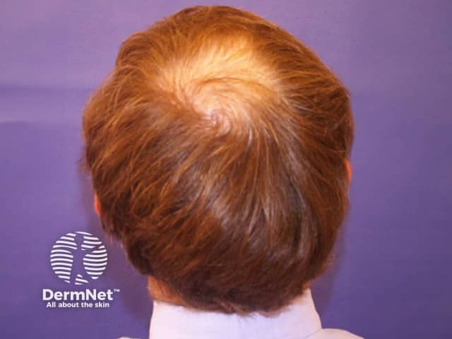
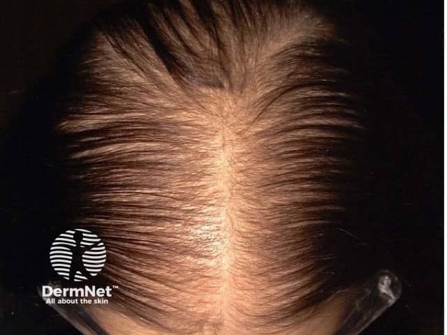

## 雄性禿／雄性素性禿髮 {#atlas-d01}

**漸進、特定分布的髮量減少，比「某一塊完全光滑」更支持雄性禿。** [@A:d01]

### 辨認特徵

- 男性：雙側額角後退形成 M 型，合併頭頂稀疏；枕部與側頭相對保留。 [@A:d01]
- 女性型：中央分線逐漸變寬、頭頂瀰漫稀疏，前額髮線常保留。 [@A:d01]
- 屬非瘢痕性禿髮：仍見毛囊開口，粗細不一的髮幹與細軟短髮反映毛囊微小化。 [@A:d01]

### 最容易混淆

- 圓禿：典型為突然出現的界線清楚圓／橢圓禿髮斑，邊緣可見驚嘆號髮。 [@A:d01]
- 休止期落髮：常有疾病、壓力或產後等誘因後的瀰漫掉髮，需結合病程及毛髮鏡判別。 [@A:d01]

### 驗證方法

病史、頭皮分布及毛髮鏡為主；女性型落髮本身不等於雄性素過高。 [@A:d01]

### 判讀限制

**不是所有禿髮都是雄性禿；若毛囊口消失、發炎或結痂，需考慮瘢痕性禿髮。** [@A:d01]

### 圖像對照

<figure class="clinical-image" data-asset-id="asset-dermatology-c93679689d9236ca"><figcaption>臨床照片 頭頂旋渦區毛髮變稀、頭皮透出，周圍與枕部毛髮相對保留。Image sourced from DermNet · © DermNet · 原圖／出處 · <a href="https://dermnetnz.org/imagedetail/9751-pattern-balding" target="_blank" rel="noopener">原圖來源</a> · <a href="https://creativecommons.org/licenses/by-nc-nd/4.0/" target="_blank" rel="noopener">CC BY-NC-ND 4.0</a> · 原圖未修改</figcaption></figure>
<figure class="clinical-image" data-asset-id="asset-dermatology-142594488f3bf045"><figcaption>臨床照片 中央分線明顯變寬，頂部髮量減少而兩側仍有較多毛髮。Image sourced from DermNet · © DermNet · 原圖／出處 · <a href="https://dermnetnz.org/imagedetail/5141-female-pattern-hair-loss" target="_blank" rel="noopener">原圖來源</a> · <a href="https://creativecommons.org/licenses/by-nc-nd/4.0/" target="_blank" rel="noopener">CC BY-NC-ND 4.0</a> · 原圖未修改</figcaption></figure>

[@A:d01]

### 講義所列參考頁

查看外部參考連結

以下連結由講義提供，未將這些原文視為本次已完整閱讀的獨立來源。
<ul><li><a href="https://dermnetnz.org/topics/male-pattern-hair-loss" target="_blank" rel="noopener">DermNet - Male pattern hair loss</a></li><li><a href="https://dermnetnz.org/topics/female-pattern-hair-loss" target="_blank" rel="noopener">DermNet - Female pattern hair loss</a></li><li><a href="https://dermnetnz.org/topics/alopecia-areata" target="_blank" rel="noopener">DermNet - Alopecia areata</a></li></ul>

## 延伸閱讀

- [圓禿](alopecia-areata.md#atlas-d02)
