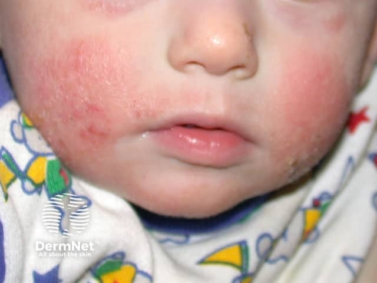
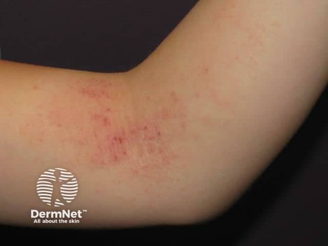
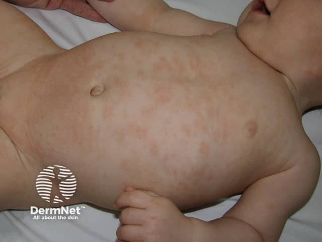

## 異位性皮膚炎 {#atlas-d13}

**年齡相符的分布＋癢與反覆發作，才是 AD；「小孩全身紅」不夠。** [@A:d13]

### 辨認特徵

- 乾燥、強烈搔癢、反覆發作的濕疹；急性可紅腫滲液，慢性見抓痕與苔蘚化。 [@A:d13]
- 嬰幼兒常見臉頰、頭皮與四肢；兒童長大後常集中肘窩、膝窩、頸及腕踝。 [@A:d13]
- 慢性病灶皮紋加深、色素沉著或低色素，深色膚色不一定呈鮮紅。 [@A:d13]

### 最容易混淆

- 疥瘡：夜間癢、同住者也癢，找指縫／腕部隧道與特徵分布。 [@A:d13]
- 接觸性皮膚炎：常與接觸部位及暴露時序吻合。 [@A:d13]
- 乾癬：伸側、界線清楚厚斑與指甲變化較支持。 [@A:d13]

### 驗證方法

屬臨床診斷，結合慢性／復發病程、搔癢與個人／家族異位體質；IgE 升高不是必要條件。 [@A:d13]

### 判讀限制

**兒童常考的是肘窩、膝窩的屈側病灶，不能把所有年齡的分布都背成同一種；突發密集疼痛糜爛需考慮皰疹性濕疹。** [@A:d13]

### 圖像對照

<figure class="clinical-image" data-asset-id="asset-dermatology-6e78bd2db4a66d0e"><figcaption>臨床照片 嬰兒雙側臉頰有紅斑與細屑，嘴周可見局部表面粗糙及輕微結痂。Image sourced from DermNet · © DermNet · 原圖／出處 · <a href="https://dermnetnz.org/imagedetail/10875-atopic-eczema" target="_blank" rel="noopener">原圖來源</a> · <a href="https://creativecommons.org/licenses/by-nc-nd/4.0/" target="_blank" rel="noopener">CC BY-NC-ND 4.0</a> · 原圖未修改</figcaption></figure>
<figure class="clinical-image" data-asset-id="asset-dermatology-b2fcc0236eb822a5"><figcaption>臨床照片 肘窩紅色濕疹斑跨在屈側皺摺上，可見抓痕與細小痂點。Image sourced from DermNet · © DermNet · 原圖／出處 · <a href="https://dermnetnz.org/imagedetail/10915-atopic-dermatitis" target="_blank" rel="noopener">原圖來源</a> · <a href="https://creativecommons.org/licenses/by-nc-nd/4.0/" target="_blank" rel="noopener">CC BY-NC-ND 4.0</a> · 原圖未修改</figcaption></figure>
<figure class="clinical-image" data-asset-id="asset-dermatology-6699402f73d5cec8"><figcaption>臨床照片 嬰兒胸腹及肩臂散布淡紅色小丘疹與斑片，呈較廣泛分布。Image sourced from DermNet · © DermNet · 原圖／出處 · <a href="https://dermnetnz.org/imagedetail/10726-atopic-dermatitis" target="_blank" rel="noopener">原圖來源</a> · <a href="https://creativecommons.org/licenses/by-nc-nd/4.0/" target="_blank" rel="noopener">CC BY-NC-ND 4.0</a> · 原圖未修改</figcaption></figure>

[@A:d13]

### 講義所列參考頁

查看外部參考連結

以下連結由講義提供，未將這些原文視為本次已完整閱讀的獨立來源。
<ul><li><a href="https://dermnetnz.org/topics/atopic-dermatitis" target="_blank" rel="noopener">DermNet - Atopic dermatitis</a></li><li><a href="https://www.aad.org/public/diseases/eczema/types/atopic-dermatitis/symptoms" target="_blank" rel="noopener">American Academy of Dermatology - Atopic dermatitis symptoms</a></li><li><a href="https://pmc.ncbi.nlm.nih.gov/articles/PMC4410183/" target="_blank" rel="noopener">American Academy of Dermatology - Guidelines of care, Part 1: Diagnosis and assessment of atopic dermatitis</a></li><li><a href="https://dermnetnz.org/topics/eczema-herpeticum" target="_blank" rel="noopener">DermNet - Eczema herpeticum</a></li></ul>

## 延伸閱讀

- [皰疹性濕疹](eczema-herpeticum.md#atlas-d26)
- [疥瘡](scabies.md#atlas-d28)
