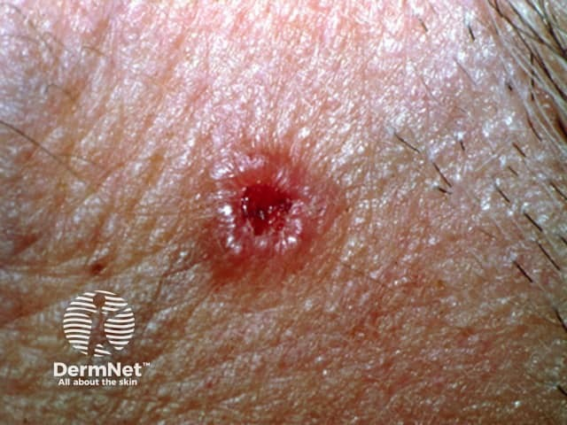
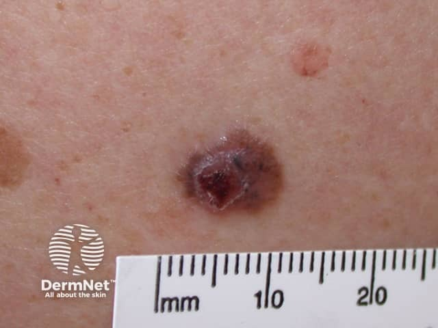

## 基底細胞癌 {#atlas-d37}

**長不好的小潰瘍，旁邊有光亮捲邊及細血管：先想 BCC。** [@A:d37]

### 辨認特徵

- 典型結節型為光亮、珍珠樣或半透明丘疹／結節，表面可見微血管擴張。 [@A:d37]
- 邊緣隆起如捲邊，中央凹陷、潰瘍或反覆結痂；好發鼻、眼周及其他日曬部位。 [@A:d37]
- 色素型可呈棕黑色；表淺型則可只是薄而微脫屑的紅斑，不能只背珍珠色。 [@A:d37]

### 最容易混淆

- 與鱗狀細胞癌：SCC 通常角化、厚痂較突出；兩者潰瘍型仍須切片。 [@A:d37]
- 與黑色素瘤：黑色 BCC 也可不規則，顏色不能單獨區分；找捲邊、血管，並用皮膚鏡與病理確認。 [@A:d37]

### 驗證方法

疑似病灶做皮膚切片；照片中的顏色及外形只能建立懷疑，不能判定組織亞型與侵犯深度。 [@A:d37]

### 判讀限制

**『黑色＝melanoma』不成立；亞洲病人的色素性 BCC 是重要圖像陷阱。** [@A:d37]

### 圖像對照

<figure class="clinical-image" data-asset-id="asset-dermatology-886bd1a72bfe2127"><figcaption>臨床照片 中央紅色小潰瘍，周圍有光亮、微隆起的邊緣。Image sourced from DermNet · © DermNet · 原圖／出處 · <a href="https://dermnetnz.org/imagedetail/8508-nodular-basal-cell-carcinoma" target="_blank" rel="noopener">原圖來源</a> · <a href="https://creativecommons.org/licenses/by-nc-nd/4.0/" target="_blank" rel="noopener">CC BY-NC-ND 4.0</a> · 原圖未修改</figcaption></figure>
<figure class="clinical-image" data-asset-id="asset-dermatology-3d386480b929f1e3"><figcaption>臨床照片 黑褐色隆起結節帶有光亮邊緣，中央呈紅黑色糜爛與結痂。Image sourced from DermNet · © DermNet · 原圖／出處 · <a href="https://dermnetnz.org/imagedetail/8552-pigmented-basal-cell-carcinoma" target="_blank" rel="noopener">原圖來源</a> · <a href="https://creativecommons.org/licenses/by-nc-nd/4.0/" target="_blank" rel="noopener">CC BY-NC-ND 4.0</a> · 原圖未修改</figcaption></figure>

[@A:d37]

### 講義所列參考頁

查看外部參考連結

以下連結由講義提供，未將這些原文視為本次已完整閱讀的獨立來源。
<ul><li><a href="https://dermnetnz.org/topics/basal-cell-carcinoma" target="_blank" rel="noopener">DermNet: Basal cell carcinoma</a></li><li><a href="https://www.aad.org/public/diseases/skin-cancer/basal-cell-carcinoma" target="_blank" rel="noopener">AAD: Basal cell carcinoma, from symptoms to treatments</a></li></ul>

## 延伸閱讀

- [黑色素瘤](melanoma.md#atlas-d39)
