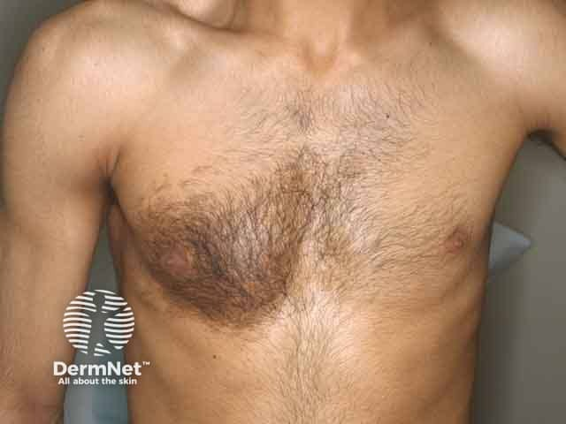
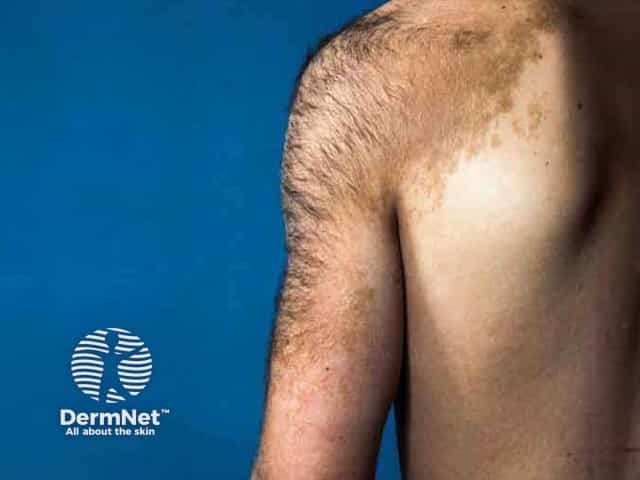

## 貝克痣 {#atlas-d41}

**青春期男性、單側肩胸棕斑，再加局部多毛：Becker naevus。** [@A:d41]

### 辨認特徵

- 單側大片棕色斑，輪廓可不規則但與周圍皮膚界線清楚。 [@A:d41]
- 典型部位為肩、上胸或上背；常在青春期逐漸明顯。 [@A:d41]
- 斑內毛髮增粗增多，皮膚可稍增厚，偶爾合併痤瘡；早期不一定已有明顯多毛。 [@A:d41]

### 最容易混淆

- 與咖啡牛奶斑：後者通常較早存在、色澤均一，沒有典型局部多毛或青春期加深的組合。 [@A:d41]
- 與先天性黑色素細胞痣：CMN 多自出生或出生後不久可見，可有厚實顆粒狀表面與衛星痣。 [@A:d41]

### 驗證方法

通常依出現年齡、分布與毛髮表現診斷；外觀不典型時可切片。 [@A:d41]

### 判讀限制

**重點不只是『不規則色素沉澱』，而是單側上軀幹色素斑與多毛；少數伴同側乳房或肌肉發育不足。** [@A:d41]

### 圖像對照

<figure class="clinical-image" data-asset-id="asset-dermatology-ca7bf01313287022"><figcaption>臨床照片 單側胸前大片棕色色素斑，斑內粗毛明顯密於周圍皮膚。Image sourced from DermNet · © DermNet · 原圖／出處 · <a href="https://dermnetnz.org/imagedetail/1224-becker-naevus" target="_blank" rel="noopener">原圖來源</a> · <a href="https://creativecommons.org/licenses/by-nc-nd/4.0/" target="_blank" rel="noopener">CC BY-NC-ND 4.0</a> · 原圖未修改</figcaption></figure>
<figure class="clinical-image" data-asset-id="asset-dermatology-b0374d2ac5cfaf2d"><figcaption>臨床照片 肩部至上臂的大片不規則棕斑，內有明顯多毛與較深色區。Image sourced from DermNet · © Dr Richard Ashton · 原圖／出處 · <a href="https://dermnetnz.org/imagedetail/1220-becker-naevus" target="_blank" rel="noopener">原圖來源</a> · <a href="https://creativecommons.org/licenses/by-nc-nd/4.0/" target="_blank" rel="noopener">CC BY-NC-ND 4.0</a> · 原圖未修改</figcaption></figure>

[@A:d41]

### 講義所列參考頁

查看外部參考連結

以下連結由講義提供，未將這些原文視為本次已完整閱讀的獨立來源。
<ul><li><a href="https://dermnetnz.org/topics/becker-naevus" target="_blank" rel="noopener">DermNet: Becker naevus</a></li><li><a href="https://www.bad.org.uk/pils/beckers-naevus" target="_blank" rel="noopener">British Association of Dermatologists: Becker’s naevus</a></li></ul>

