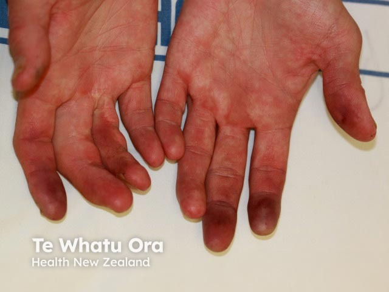
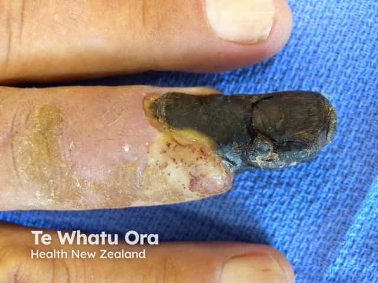

## 伯格氏病／閉塞性血栓血管炎 {#atlas-d43}

**年輕吸菸者＋遠端缺血性潰瘍／壞疽：考慮 Buerger disease。** [@A:d43]

### 辨認特徵

- 手指或腳趾末端可呈藍紫色、缺血性潰瘍，嚴重時形成乾燥黑色壞疽。 [@A:d43]
- 缺損集中於肢端；可見多個手指／趾受累，而非單純下腿大片濕疹。 [@A:d43]
- 圖片只呈現缺血結果；年輕吸菸者、肢端疼痛、冰冷及脈搏異常是必須搭配的題幹。 [@A:d43]

### 最容易混淆

- 與動脈粥樣硬化／栓塞：年齡、危險因子、發作方式與血管檢查不同，照片可完全相似。 [@A:d43]
- 與血管炎、抗磷脂症候群及嚴重 Raynaud：均可造成指端壞死，需尋找系統性或血栓線索。 [@A:d43]

### 驗證方法

結合吸菸史、缺血證據及血管影像，排除糖尿病血管病、粥樣硬化、栓塞與其他血管炎；沒有專屬的皮膚照片。 [@A:d43]

### 判讀限制

**原清單『指端末端黑死』只是乾性壞疽，並非 Buerger 的特異診斷。** [@A:d43]

### 圖像對照

<figure class="clinical-image" data-asset-id="asset-dermatology-033f738d3382656d"><figcaption>臨床照片 多個手指遠端呈暗紅至藍紫色，與較近端皮膚形成明顯色差。Image sourced from DermNet · © DermNet · 原圖／出處 · <a href="https://dermnetnz.org/imagedetail/16719-thromboangiitis-obliterans" target="_blank" rel="noopener">原圖來源</a> · <a href="https://creativecommons.org/licenses/by-nc-nd/4.0/" target="_blank" rel="noopener">CC BY-NC-ND 4.0</a> · 原圖未修改</figcaption></figure>
<figure class="clinical-image" data-asset-id="asset-dermatology-7afc87388f0ec6d2"><figcaption>臨床照片 對照：趾端乾燥黑色壞死，與近端皮膚界線清楚。這是缺血／乾性壞疽示例，並非來源已確診的 Buerger 病例。Image sourced from DermNet · © Te Whatu Ora · 原圖／出處 · <a href="https://dermnetnz.org/imagedetail/12805-dry-gangrene-due-to-ischaemia" target="_blank" rel="noopener">原圖來源</a> · <a href="https://creativecommons.org/licenses/by-nc-nd/4.0/" target="_blank" rel="noopener">CC BY-NC-ND 4.0</a> · 原圖未修改</figcaption></figure>

[@A:d43]

### 講義所列參考頁

查看外部參考連結

以下連結由講義提供，未將這些原文視為本次已完整閱讀的獨立來源。
<ul><li><a href="https://dermnetnz.org/topics/thromboangiitis-obliterans" target="_blank" rel="noopener">DermNet: Thromboangiitis obliterans</a></li><li><a href="https://dermnetnz.org/topics/blue-toe-syndrome" target="_blank" rel="noopener">DermNet: Blue toe syndrome</a></li></ul>

