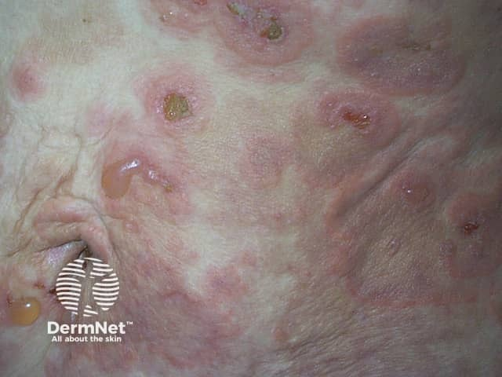
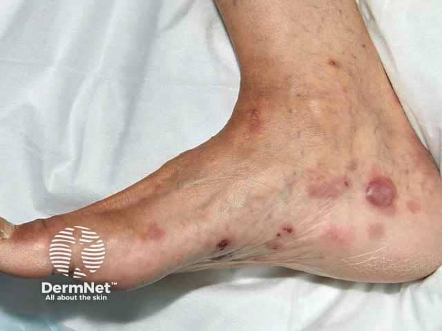

## 水疱性類天疱瘡 {#atlas-d03}

**老人＋很癢＋緊繃大水疱，優先想到 bullous pemphigoid。** [@A:d03]

### 辨認特徵

- 大而繃緊、圓頂狀的水疱；疱頂較完整，可含清澈或血性液體。 [@A:d03]
- 底部常是搔癢的蕁麻疹樣紅斑，常見於軀幹、近端四肢及屈側。 [@A:d03]
- 多見高齡患者；破裂後形成糜爛，但通常仍可找到完整的緊繃水疱。 [@A:d03]

### 最容易混淆

- 尋常天疱瘡：疱壁鬆弛、易破，口腔疼痛糜爛更常見。 [@A:d03]
- 線狀 IgA 水疱病與後天性表皮分解性水疱症也可能有緊繃水疱，需免疫病理分辨。 [@A:d03]

### 驗證方法

病理為表皮下水疱；病灶旁皮膚 DIF 典型為基底膜帶線狀 IgG／C3，可合併 BP180 等血清檢查。 [@A:d03]

### 判讀限制

**「大水疱」本身不夠；BP 可能先只有搔癢紅疹，少數也有黏膜病灶，不能用有無口腔病灶作絕對排除。** [@A:d03]

### 圖像對照

<figure class="clinical-image" data-asset-id="asset-dermatology-2c86e4afaa1b14be"><figcaption>臨床照片 紅色斑塊上同時可見完整圓頂水疱與破疱後的小糜爛、痂皮。Image sourced from DermNet · © DermNet · 原圖／出處 · <a href="https://dermnetnz.org/imagedetail/9292-bullous-pemphigoid" target="_blank" rel="noopener">原圖來源</a> · <a href="https://creativecommons.org/licenses/by-nc-nd/4.0/" target="_blank" rel="noopener">CC BY-NC-ND 4.0</a> · 原圖未修改</figcaption></figure>
<figure class="clinical-image" data-asset-id="asset-dermatology-d46ad7aa5b0a5244"><figcaption>臨床照片 足內側與踝周可見紅褐色圓形病灶及破疱後糜爛，周圍留有色素改變。Image sourced from DermNet · © DermNet · 原圖／出處 · <a href="https://dermnetnz.org/imagedetail/3844-bullous-pemphigoid" target="_blank" rel="noopener">原圖來源</a> · <a href="https://creativecommons.org/licenses/by-nc-nd/4.0/" target="_blank" rel="noopener">CC BY-NC-ND 4.0</a> · 原圖未修改</figcaption></figure>

[@A:d03]

### 講義所列參考頁

查看外部參考連結

以下連結由講義提供，未將這些原文視為本次已完整閱讀的獨立來源。
<ul><li><a href="https://dermnetnz.org/topics/bullous-pemphigoid" target="_blank" rel="noopener">DermNet - Bullous pemphigoid</a></li><li><a href="https://dermnetnz.org/topics/bullous-pemphigoid-pathology" target="_blank" rel="noopener">DermNet - Bullous pemphigoid pathology</a></li><li><a href="https://dermnetnz.org/topics/pemphigus-vulgaris" target="_blank" rel="noopener">DermNet - Pemphigus vulgaris</a></li></ul>

## 延伸閱讀

- [尋常天疱瘡](pemphigus-vulgaris.md#atlas-d09)
