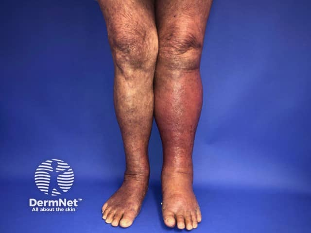
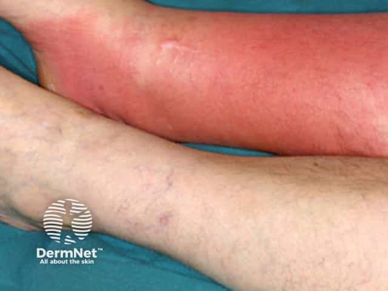

## 蜂窩性組織炎 {#atlas-d22}

**單側、急性、擴散的紅腫，病史另有熱與壓痛 → 蜂窩性組織炎。** [@A:d22]

### 辨認特徵

- 局部大片紅斑與腫脹，範圍可逐步擴大；邊界通常較模糊。 [@A:d22]
- 最常出題為單側小腿；皮膚可能緊亮或呈橘皮樣。 [@A:d22]
- 嚴重時可有水泡、出血性變化或淋巴管炎紅線，但這些不是每例都有。 [@A:d22]

### 最容易混淆

- 丹毒：較表淺，常有更鮮紅、隆起且界線清楚的邊緣。 [@A:d22]
- 鬱滯性皮膚炎：常慢性或雙側，伴癢、屑、褐色沉著與靜脈病徵。 [@A:d22]

### 驗證方法

溫度、壓痛、發燒及病程無法由靜態照片證實；須合併理學檢查，並評估有無膿瘍或其他感染。 [@A:d22]

### 判讀限制

**雙腿紅不應直接等同雙側蜂窩性組織炎；疼痛不成比例、快速惡化或壞死須排除壞死性軟組織感染。** [@A:d22]

### 圖像對照

<figure class="clinical-image" data-asset-id="asset-dermatology-34b228e6a9b0c9d2"><figcaption>臨床照片 左小腿較另一側明顯紅腫；熱度、壓痛仍需理學檢查。Image sourced from DermNet · © DermNet · 原圖／出處 · <a href="https://dermnetnz.org/imagedetail/6036-cellulitis-of-the-left-leg" target="_blank" rel="noopener">原圖來源</a> · <a href="https://creativecommons.org/licenses/by-nc-nd/4.0/" target="_blank" rel="noopener">CC BY-NC-ND 4.0</a> · 原圖未修改</figcaption></figure>
<figure class="clinical-image" data-asset-id="asset-dermatology-3531950826725e35"><figcaption>臨床照片 雙側對照可見其中一側大片紅斑；照片本身無法證實感染。Image sourced from DermNet · © Raimo Suhonen · 原圖／出處 · <a href="https://dermnetnz.org/imagedetail/11534-cellulitis" target="_blank" rel="noopener">原圖來源</a> · <a href="https://creativecommons.org/licenses/by-nc-nd/4.0/" target="_blank" rel="noopener">CC BY-NC-ND 4.0</a> · 原圖未修改</figcaption></figure>

[@A:d22]

### 講義所列參考頁

查看外部參考連結

以下連結由講義提供，未將這些原文視為本次已完整閱讀的獨立來源。
<ul><li><a href="https://dermnetnz.org/topics/cellulitis" target="_blank" rel="noopener">DermNet - Cellulitis</a></li><li><a href="https://dermnetnz.org/topics/cellulitis-mimics" target="_blank" rel="noopener">DermNet - Cellulitis mimics</a></li></ul>

