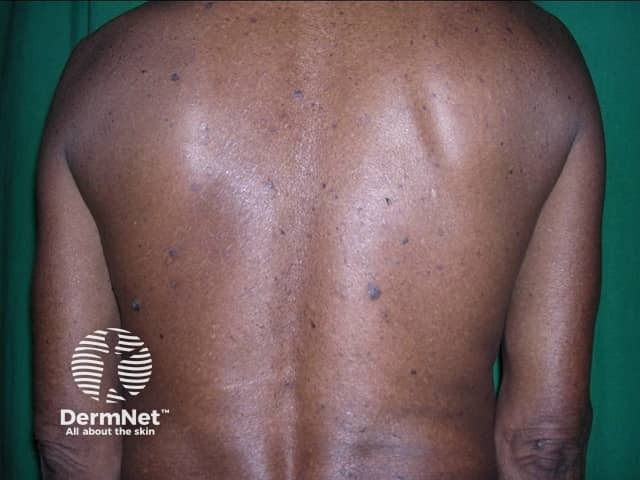
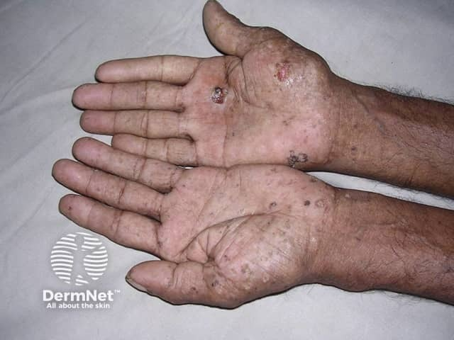

## 慢性砷中毒 {#atlas-d44}

**雨滴樣色素改變＋掌蹠角化＋長期暴露史：想慢性砷中毒。** [@A:d44]

### 辨認特徵

- 軀幹等處色素沉著，夾雜散在小片色素減退，形成雨滴樣（raindrop）斑駁。 [@A:d44]
- 掌蹠出現多發點狀、玉米粒樣角化丘疹，或較瀰漫的角化增厚。 [@A:d44]
- 可並見多發持續脫屑紅斑／斑塊等皮膚癌病灶；雨滴色素與掌蹠角化的組合最值得找。 [@A:d44]

### 最容易混淆

- 與汗斑／白色糠疹：後者是局部淺色斑伴細屑，沒有典型掌蹠多發砷角化症組合。 [@A:d44]
- 與掌蹠疣：疣可見粗糙角化與血管黑點；砷角化須合併全身色素及暴露背景判讀。 [@A:d44]

### 驗證方法

追查飲水、職業及藥物來源；依暴露時序安排砷檢測，對持續增厚、潰瘍或疑癌病灶做切片。 [@A:d44]

### 判讀限制

**單一黑趾不能診斷砷中毒；皮膚圖像重點是色素改變與角化，亦需注意 Bowen disease 等癌前／癌性病灶。** [@A:d44]

### 增補校正

辨認重點是雨滴樣色素改變、掌蹠角化及長期暴露史。 [@B:corrections]

### 圖像對照

<figure class="clinical-image" data-asset-id="asset-dermatology-22081fff7f6d67bb"><figcaption>臨床照片 背部可見廣泛細小深淺色斑，形成雨滴樣斑駁色素變化。Image sourced from DermNet · © DermNet · 原圖／出處 · <a href="https://dermnetnz.org/imagedetail/8394-arsenical-pigmentation" target="_blank" rel="noopener">原圖來源</a> · <a href="https://creativecommons.org/licenses/by-nc-nd/4.0/" target="_blank" rel="noopener">CC BY-NC-ND 4.0</a> · 原圖未修改</figcaption></figure>
<figure class="clinical-image" data-asset-id="asset-dermatology-45cb48957b13a4dc"><figcaption>臨床照片 雙掌散在多發角化丘疹與較厚結痂病灶，部分表面有破損。Image sourced from DermNet · © DermNet · 原圖／出處 · <a href="https://dermnetnz.org/imagedetail/8094-arsenical-keratoses" target="_blank" rel="noopener">原圖來源</a> · <a href="https://creativecommons.org/licenses/by-nc-nd/4.0/" target="_blank" rel="noopener">CC BY-NC-ND 4.0</a> · 原圖未修改</figcaption></figure>

[@A:d44]

### 講義所列參考頁

查看外部參考連結

以下連結由講義提供，未將這些原文視為本次已完整閱讀的獨立來源。
<ul><li><a href="https://dermnetnz.org/topics/chronic-arsenic-poisoning" target="_blank" rel="noopener">DermNet: Chronic arsenic poisoning</a></li><li><a href="https://www.who.int/news-room/fact-sheets/detail/arsenic" target="_blank" rel="noopener">WHO: Arsenic</a></li><li><a href="https://archive.cdc.gov/www_atsdr_cdc_gov/csem/arsenic/clinical_assessment.html" target="_blank" rel="noopener">CDC/ATSDR: Arsenic toxicity clinical assessment</a></li></ul>

## 延伸閱讀

- [白色糠疹](pityriasis-alba.md#atlas-d27)
