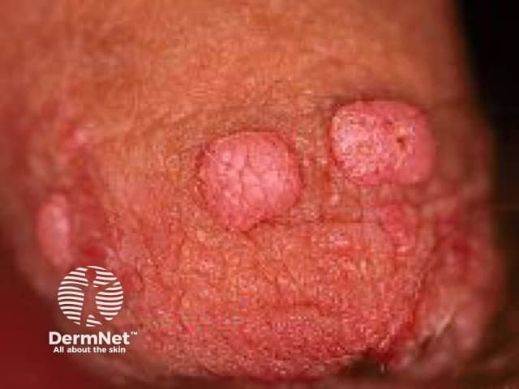
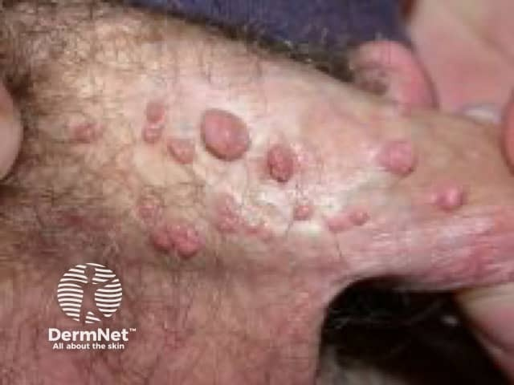

## 尖圭濕疣／尖形濕疣 {#atlas-d23}

**肛生殖區多顆不規則乳突／菜花狀丘疹 → 尖形濕疣。** [@A:d23]

### 辨認特徵

- 生殖器或肛周的膚色、粉紅至褐色丘疹，表面有乳突狀或菜花狀突起。 [@A:d23]
- 可單顆、多顆融合成斑塊，或呈有蒂狀；不一定每顆都很大。 [@A:d23]
- 黏膜上的病灶可較平坦，仍要看表面不規則與群聚分布。 [@A:d23]

### 最容易混淆

- Condyloma lata：二期梅毒的寬基底、較平滑且潮濕斑塊，與 HPV 尖形濕疣不同。 [@A:d23]
- 珍珠狀陰莖丘疹：大小均一、整齊環繞冠狀溝；skin tag 表面通常較平滑。 [@A:d23]

### 驗證方法

通常臨床診斷；色素異常、硬結、固定、出血或潰瘍等不典型病灶考慮切片。HPV 檢測不是一般疣的確診工具。 [@A:d23]

### 判讀限制

**原題僅寫 Condyloma 太廣；作答宜寫清楚 acuminatum，勿與 lata 混用。** [@A:d23]

### 圖像對照

<figure class="clinical-image" data-asset-id="asset-dermatology-12c771c25ed00ae9"><figcaption>臨床照片 龜頭上的粉紅色隆起丘疹，表面有分葉與細裂紋。Image sourced from DermNet · © DermNet · 原圖／出處 · <a href="https://dermnetnz.org/imagedetail/6225-genital-warts" target="_blank" rel="noopener">原圖來源</a> · <a href="https://creativecommons.org/licenses/by-nc-nd/4.0/" target="_blank" rel="noopener">CC BY-NC-ND 4.0</a> · 原圖未修改</figcaption></figure>
<figure class="clinical-image" data-asset-id="asset-dermatology-80517952f2f2ed17"><figcaption>臨床照片 陰莖近端群聚膚色至粉紅丘疹，大小不一，可呈有蒂與乳突狀。Image sourced from DermNet · © DermNet · 原圖／出處 · <a href="https://dermnetnz.org/imagedetail/5078-genital-warts" target="_blank" rel="noopener">原圖來源</a> · <a href="https://creativecommons.org/licenses/by-nc-nd/4.0/" target="_blank" rel="noopener">CC BY-NC-ND 4.0</a> · 原圖未修改</figcaption></figure>

[@A:d23]

### 講義所列參考頁

查看外部參考連結

以下連結由講義提供，未將這些原文視為本次已完整閱讀的獨立來源。
<ul><li><a href="https://dermnetnz.org/topics/anogenital-warts" target="_blank" rel="noopener">DermNet - Anogenital warts</a></li><li><a href="https://www.cdc.gov/std/treatment-guidelines/anogenital-warts.htm" target="_blank" rel="noopener">CDC STI Treatment Guidelines - Anogenital warts</a></li></ul>

## 延伸閱讀

- [二期梅毒](syphilis.md#atlas-d30)
- [皮贅／軟纖維瘤](skin-tag.md#atlas-d53)
