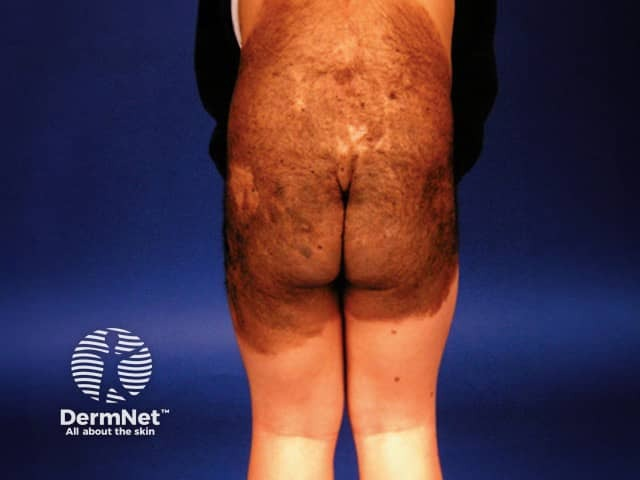

## 大型／巨型先天性黑色素細胞痣（舊稱 giant hairy nevus） {#atlas-d46}

**自出生存在的大面積色素痣，伴粗毛與衛星痣：大型／巨型 CMN。** [@A:d46]

### 辨認特徵

- 出生或出生後不久即見大片棕黑色斑／斑塊，可覆蓋軀幹如泳衣分布。 [@A:d46]
- 表面可平滑、顆粒狀、乳突狀或逐漸增厚，常有粗毛，但多毛不是必要條件。 [@A:d46]
- 周圍或其他部位可伴較小的衛星痣；隨兒童成長，病灶通常按比例增大。 [@A:d46]

### 最容易混淆

- 與 Becker 痣：後者多青春期才顯著，偏單側肩胸；CMN 的出生史更關鍵。 [@A:d46]
- 與黑色素瘤：先天痣可本來就不均勻；新出現且持續增大的硬結、潰瘍或變化要另外評估。 [@A:d46]

### 驗證方法

結合出生史、全身痣分布及預估成人尺寸分類；新結節需臨床評估，必要時切片。 [@A:d46]

### 判讀限制

**『大黑塊』太籠統；giant 的尺寸門檻依分類而異，2013 分類以預估成人直徑 >40 cm 為巨型，不能只看照片比例。** [@A:d46]

### 圖像對照

<figure class="clinical-image" data-asset-id="asset-dermatology-5c9750f1ee0a303c"><figcaption>臨床照片 大片棕色色素痣覆蓋下背、臀部及大腿近端，呈泳衣樣分布。Image sourced from DermNet · © DermNet · 原圖／出處 · <a href="https://dermnetnz.org/imagedetail/8677-congenital-naevus" target="_blank" rel="noopener">原圖來源</a> · <a href="https://creativecommons.org/licenses/by-nc-nd/4.0/" target="_blank" rel="noopener">CC BY-NC-ND 4.0</a> · 原圖未修改</figcaption></figure>

[@A:d46]

### 講義所列參考頁

查看外部參考連結

以下連結由講義提供，未將這些原文視為本次已完整閱讀的獨立來源。
<ul><li><a href="https://dermnetnz.org/topics/congenital-melanocytic-naevi" target="_blank" rel="noopener">DermNet: Congenital melanocytic naevi, including 2013 classification</a></li><li><a href="https://dermnetnz.org/topics/becker-naevus" target="_blank" rel="noopener">DermNet: Becker naevus</a></li></ul>

## 延伸閱讀

- [黑色素瘤](melanoma.md#atlas-d39)
- [貝克痣](becker-naevus.md#atlas-d41)
