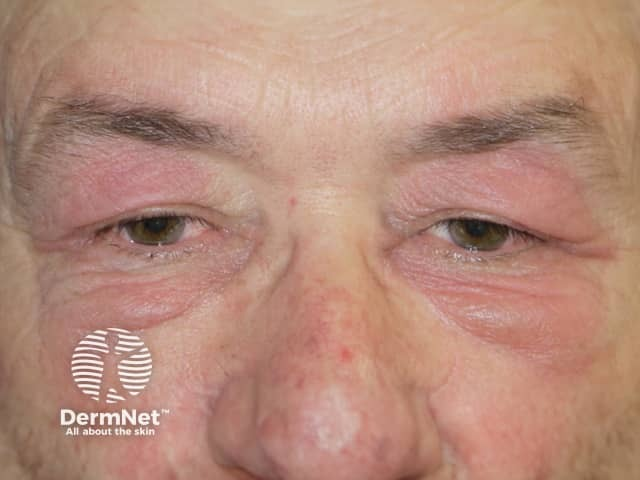
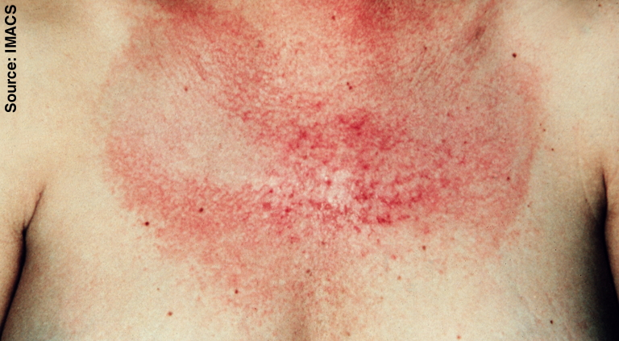
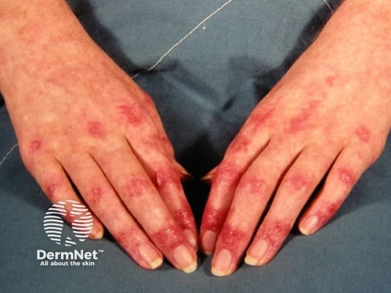
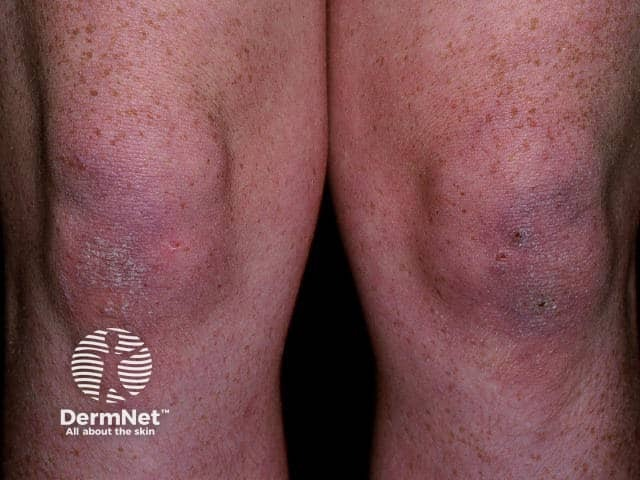

## 皮肌炎 {#atlas-d04}

**紫色上眼瞼＋手指關節伸側紫紅丘疹＋前胸 V 區紅斑，是三張圖的連結。** [@A:d04]

### 辨認特徵

- Heliotrope rash：雙側上眼瞼紫紅色斑，常伴眼周水腫。 [@A:d04]
- V sign：前胸 V 字形日曬區紅斑／色素與微血管變化；後頸及肩背分布稱 shawl sign。 [@A:d04]
- Gottron papules：MCP／PIP／DIP 關節伸側紫紅丘疹；Gottron sign 指伸側關節上的平坦紅紫斑，常見肘、膝。 [@A:d04]

### 最容易混淆

- 接觸性皮膚炎可有眼瞼紅腫，但缺少特徵性的 Gottron 病灶及整體分布。 [@A:d04]
- 乾癬也會累及肘膝；需同時找眼瞼、指關節及甲襞線索。 [@A:d04]

### 驗證方法

問近端肌無力、吞嚥與呼吸症狀，結合肌酵素、自體抗體及必要檢查；無肌無力仍可能是無肌病型皮肌炎。 [@A:d04]

### 判讀限制

**Gottron papules 與 Gottron sign 不宜完全混用；V sign 是支持線索，單獨出現並不具專一性。** [@A:d04]

### 圖像對照

<figure class="clinical-image" data-asset-id="asset-dermatology-91f0ca7195f606be"><figcaption>臨床照片 雙側上眼瞼呈紫紅色，眼周亦可見紅斑與腫脹。Image sourced from DermNet · © DermNet · 原圖／出處 · <a href="https://dermnetnz.org/imagedetail/5442-dermatomyositis-of-the-eyelids" target="_blank" rel="noopener">原圖來源</a> · <a href="https://creativecommons.org/licenses/by-nc-nd/4.0/" target="_blank" rel="noopener">CC BY-NC-ND 4.0</a> · 原圖未修改</figcaption></figure>
<figure class="clinical-image" data-asset-id="asset-dermatology-e1e98ae517fa1e45"><figcaption>臨床照片 V sign：前頸至上胸開領區的片狀紅斑與微血管擴張；紅斑不必形成銳利幾何 V 字。Elizabeth M. Dugan, Adam M. Huber, Frederick W. Miller, Lisa G. Rider / IMACS Group · <a href="https://commons.wikimedia.org/wiki/File:Dermatomyositis17.jpg" target="_blank" rel="noopener">原圖來源</a> · <a href="https://creativecommons.org/licenses/by-sa/3.0/" target="_blank" rel="noopener">CC BY-SA 3.0</a> · 原圖未修改</figcaption></figure>
<figure class="clinical-image" data-asset-id="asset-dermatology-a3a2daba711915cb"><figcaption>臨床照片 雙手指關節伸側可見對稱紫紅色丘疹及斑塊，病灶集中在關節上。Image sourced from DermNet · © DermNet · 原圖／出處 · <a href="https://dermnetnz.org/imagedetail/5557-dermatomyositis-of-the-hand" target="_blank" rel="noopener">原圖來源</a> · <a href="https://creativecommons.org/licenses/by-nc-nd/4.0/" target="_blank" rel="noopener">CC BY-NC-ND 4.0</a> · 原圖未修改</figcaption></figure>
<figure class="clinical-image" data-asset-id="asset-dermatology-3f603d03edf1568b"><figcaption>臨床照片 雙膝伸側覆有紫紅色斑，部分表面帶細屑，兩側分布相對對稱。Image sourced from DermNet · © DermNet · 原圖／出處 · <a href="https://dermnetnz.org/imagedetail/5016-dermatomyositis-of-the-leg" target="_blank" rel="noopener">原圖來源</a> · <a href="https://creativecommons.org/licenses/by-nc-nd/4.0/" target="_blank" rel="noopener">CC BY-NC-ND 4.0</a> · 原圖未修改</figcaption></figure>

[@A:d04]

### 講義所列參考頁

查看外部參考連結

以下連結由講義提供，未將這些原文視為本次已完整閱讀的獨立來源。
<ul><li><a href="https://dermnetnz.org/topics/adult-onset-dermatomyositis" target="_blank" rel="noopener">DermNet - Adult-onset dermatomyositis</a></li><li><a href="https://dermnetnz.org/topics/chronic-plaque-psoriasis" target="_blank" rel="noopener">DermNet - Chronic plaque psoriasis</a></li><li><a href="https://escholarship.org/content/qt0f26q4rm/riderphotos.html" target="_blank" rel="noopener">Dugan et al. / IMACS photoessay, Figure 31</a></li></ul>

## 延伸閱讀

- [尋常性乾癬／斑塊型乾癬](plaque-psoriasis.md#atlas-d10)
