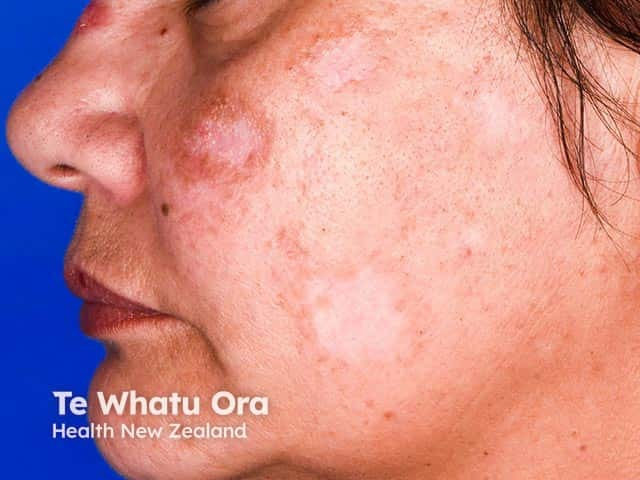
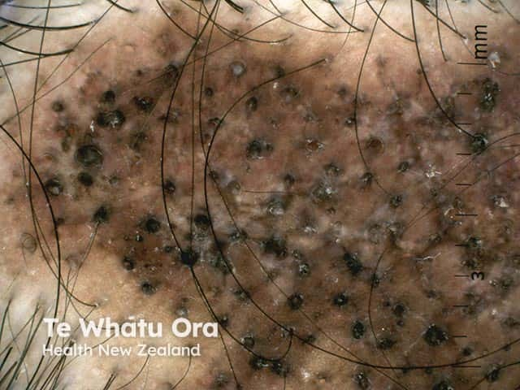

## 圓盤狀紅斑性狼瘡 {#atlas-d05}

**黏著鱗屑＋毛囊角栓＋中央萎縮瘢痕，是 DLE 的辨認核心。** [@A:d05]

### 辨認特徵

- 界線較清楚的紅斑斑塊，表面為黏著性鱗屑，毛囊口可見角栓。 [@A:d05]
- 老病灶中央萎縮、瘢痕及低色素，外圍可伴深色色素沉著。 [@A:d05]
- 常見臉、耳廓／耳甲腔與頭皮；頭皮病灶可造成毛囊口消失的永久性瘢痕禿髮。 [@A:d05]

### 最容易混淆

- 乾癬：雖有厚鱗屑，但典型病灶不造成中央萎縮及瘢痕性禿髮。 [@A:d05]
- 圓禿：頭皮光滑但毛囊口保留，沒有典型紅斑角栓與瘢痕。 [@A:d05]

### 驗證方法

以臨床分布與皮膚切片確認；並評估有無其他狼瘡表現。病理可見界面皮膚炎、毛囊受累及真皮黏液。 [@A:d05]

### 判讀限制

**DLE 不等於已確診全身性紅斑性狼瘡；ANA 陰性也不能排除 DLE。** [@A:d05]

### 圖像對照

<figure class="clinical-image" data-asset-id="asset-dermatology-8afe96bc09b49446"><figcaption>臨床照片 頰部及鼻側可見紅色斑塊，其中夾雜較淡、略凹的瘢痕樣區域。Image sourced from DermNet · © Te Whatu Ora · 原圖／出處 · <a href="https://dermnetnz.org/imagedetail/2354-discoid-lupus-erythematosus" target="_blank" rel="noopener">原圖來源</a> · <a href="https://creativecommons.org/licenses/by-nc-nd/4.0/" target="_blank" rel="noopener">CC BY-NC-ND 4.0</a> · 原圖未修改</figcaption></figure>
<figure class="clinical-image" data-asset-id="asset-dermatology-689a5318adb98b02"><figcaption>皮膚鏡／毛髮鏡 頭皮皮膚鏡下可見多個擴大的毛囊口角栓、色素不均與白色瘢痕樣區。Image sourced from DermNet · © Te Whatu Ora · 原圖／出處 · <a href="https://dermnetnz.org/imagedetail/2368-discoid-lupus-erythematosus" target="_blank" rel="noopener">原圖來源</a> · <a href="https://creativecommons.org/licenses/by-nc-nd/4.0/" target="_blank" rel="noopener">CC BY-NC-ND 4.0</a> · 原圖未修改</figcaption></figure>

[@A:d05]

### 講義所列參考頁

查看外部參考連結

以下連結由講義提供，未將這些原文視為本次已完整閱讀的獨立來源。
<ul><li><a href="https://dermnetnz.org/topics/discoid-lupus-erythematosus" target="_blank" rel="noopener">DermNet - Discoid lupus erythematosus</a></li><li><a href="https://dermnetnz.org/topics/alopecia-areata" target="_blank" rel="noopener">DermNet - Alopecia areata</a></li></ul>

## 延伸閱讀

- [圓禿](alopecia-areata.md#atlas-d02)
