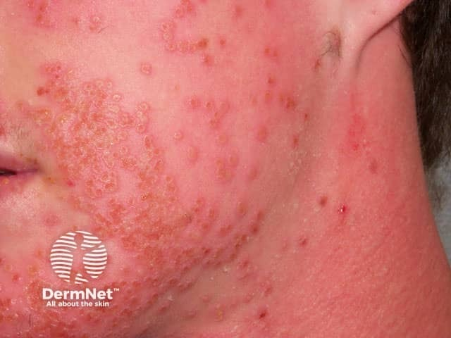
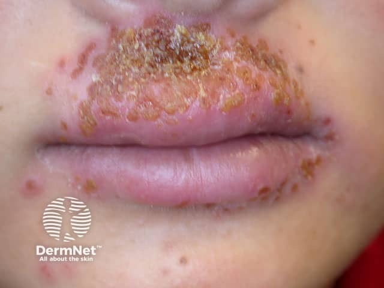

## 皰疹性濕疹 {#atlas-d26}

**異位性皮膚炎＋急性同形性水泡／鑿孔樣糜爛＋疼痛或發燒 → Eczema herpeticum。** [@A:d26]

### 辨認特徵

- 原有濕疹區突然出現大量大小與形態相近的群聚水泡／小膿疱。 [@A:d26]
- 破裂後形成圓形、邊界清楚的 punched-out 糜爛，可有中央凹陷。 [@A:d26]
- 常見出血性深色痂；臉頸常受累，可快速擴散。 [@A:d26]

### 最容易混淆

- 膿痂疹：蜂蜜色痂較典型；但可與皰疹性濕疹合併。 [@A:d26]
- 水痘：常見不同演進階段同時存在；KVE 更強調原病皮膚上的同形性病灶。 [@A:d26]

### 驗證方法

新鮮水泡底部採樣作 HSV PCR；有細菌感染疑慮可另採培養。臨床高度懷疑屬須即時處理的皮膚急症。 [@A:d26]

### 判讀限制

**不是只看「密集紅點」；多由 HSV-1/2 引起。KVE 也可發生在燒傷、Darier 病等非濕疹的屏障受損皮膚。** [@A:d26]

### 圖像對照

<figure class="clinical-image" data-asset-id="asset-dermatology-3e7d4759c3a49224"><figcaption>臨床照片 臉頰密集且大小相近的小水疱與凹陷糜爛，呈同形性分布。Image sourced from DermNet · © DermNet · 原圖／出處 · <a href="https://dermnetnz.org/imagedetail/10866-eczema-herpeticum" target="_blank" rel="noopener">原圖來源</a> · <a href="https://creativecommons.org/licenses/by-nc-nd/4.0/" target="_blank" rel="noopener">CC BY-NC-ND 4.0</a> · 原圖未修改</figcaption></figure>
<figure class="clinical-image" data-asset-id="asset-dermatology-59aa68ab6848f6f6"><figcaption>臨床照片 口周群聚糜爛、密集結痂；痂皮外觀仍需與膿痂疹鑑別。Image sourced from DermNet · © DermNet · 原圖／出處 · <a href="https://dermnetnz.org/imagedetail/10834-eczema-herpeticum" target="_blank" rel="noopener">原圖來源</a> · <a href="https://creativecommons.org/licenses/by-nc-nd/4.0/" target="_blank" rel="noopener">CC BY-NC-ND 4.0</a> · 原圖未修改</figcaption></figure>

[@A:d26]

### 講義所列參考頁

查看外部參考連結

以下連結由講義提供，未將這些原文視為本次已完整閱讀的獨立來源。
<ul><li><a href="https://dermnetnz.org/topics/eczema-herpeticum" target="_blank" rel="noopener">DermNet - Eczema herpeticum</a></li><li><a href="https://dermnetnz.org/topics/herpes-zoster" target="_blank" rel="noopener">DermNet - Herpes zoster</a></li></ul>

## 延伸閱讀

- [異位性皮膚炎](atopic-dermatitis.md#atlas-d13)
- [帶狀疱疹](herpes-zoster.md#atlas-d24)
