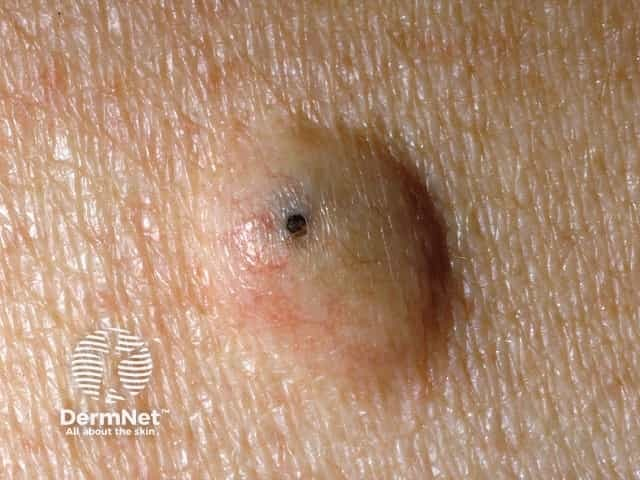
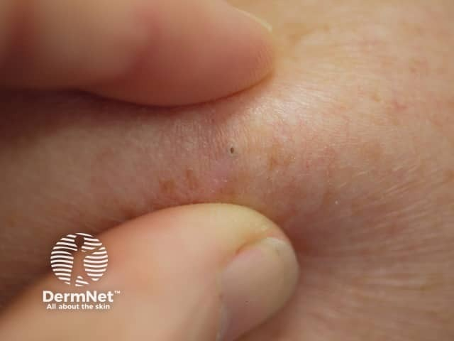

## 毛囊囊腫（常指表皮樣囊腫） {#atlas-d45}

**皮下圓結節＋中央黑點／開口：優先想到 epidermoid cyst。** [@A:d45]

### 辨認特徵

- 膚色或淡黃、圓頂狀的真皮／皮下結節，邊界清楚；表面通常平滑。 [@A:d45]
- 中央小開口（punctum）是表皮樣囊腫的重要線索，常見於臉、頸或軀幹。 [@A:d45]
- 發炎或破裂時變紅腫；題幹可能描述排出乳酪樣、帶氣味的角質內容物。 [@A:d45]

### 最容易混淆

- 與毛鞘囊腫（pilar cyst）：多在頭皮，通常沒有中央開口；兩者都含角質。 [@A:d45]
- 與脂肪瘤：通常較柔軟、位於皮下，沒有表皮開口；發炎囊腫也須與真正膿瘍區分。 [@A:d45]

### 驗證方法

典型者以臨床檢查判斷，必要時切除病理；『follicular cyst』是較寬的名稱，應依位置及形態再細分。 [@A:d45]

### 判讀限制

**俗稱『皮脂腺囊腫』容易誤導；表皮樣囊腫的內容主要是角質，發紅也不一定代表細菌感染。** [@A:d45]

### 圖像對照

<figure class="clinical-image" data-asset-id="asset-dermatology-ad48d73eedbb62e3"><figcaption>臨床照片 平滑圓頂結節中央有明顯黑色小開口（punctum）。Image sourced from DermNet · © Raimo Suhonen · 原圖／出處 · <a href="https://dermnetnz.org/imagedetail/4472-epidermoid-cyst" target="_blank" rel="noopener">原圖來源</a> · <a href="https://creativecommons.org/licenses/by-nc-nd/4.0/" target="_blank" rel="noopener">CC BY-NC-ND 4.0</a> · 原圖未修改</figcaption></figure>
<figure class="clinical-image" data-asset-id="asset-dermatology-68f5f82735beb3b4"><figcaption>臨床照片 手指擠壓兩側皮膚後，皮下隆起中央的小開口更容易看見。Image sourced from DermNet · © DermNet · 原圖／出處 · <a href="https://dermnetnz.org/imagedetail/8525-palpating-an-epidermoid-cyst" target="_blank" rel="noopener">原圖來源</a> · <a href="https://creativecommons.org/licenses/by-nc-nd/4.0/" target="_blank" rel="noopener">CC BY-NC-ND 4.0</a> · 原圖未修改</figcaption></figure>

[@A:d45]

### 講義所列參考頁

查看外部參考連結

以下連結由講義提供，未將這些原文視為本次已完整閱讀的獨立來源。
<ul><li><a href="https://dermnetnz.org/topics/epidermoid-cyst" target="_blank" rel="noopener">DermNet: Epidermoid cyst</a></li><li><a href="https://dermnetnz.org/topics/trichilemmal-cyst" target="_blank" rel="noopener">DermNet: Trichilemmal (pilar) cyst</a></li></ul>

