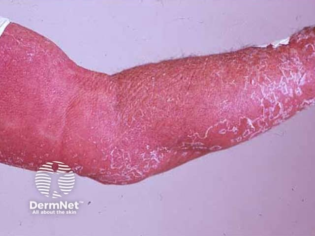
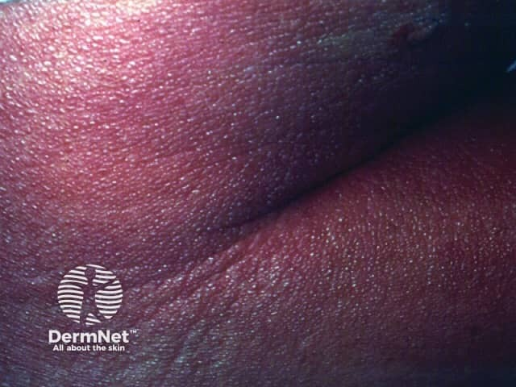

## 紅皮症 {#atlas-d14}

**先回答「紅皮症」，再用原病灶、用藥與全身線索追查病因。** [@A:d14]

### 辨認特徵

- 近乎全身、通常 ≥90% 體表的瀰漫紅斑，常伴細屑或大片脫屑。 [@A:d14]
- 可能合併水腫、抓痕、皮膚增厚、掌蹠角化與眼瞼外翻。 [@A:d14]
- 先找殘存的原發病灶：肘膝乾癬斑、濕疹滲液，或橘紅色皮膚中的正常皮膚小島。 [@A:d14]

### 最容易混淆

- 常見原因包括乾癬、濕疹與藥疹；毛髮紅糠疹可見 islands of sparing。 [@A:d14]
- 皮膚 T 細胞淋巴瘤亦可造成紅皮症；長期難治、淋巴結腫大、掌蹠角化時須評估。 [@A:d14]
- MF 與 Sézary syndrome 需病理及血液分期，不能由紅皮照片直接命名。 [@A:d14]

### 驗證方法

全面病史與檢查，必要時多處／重複皮膚切片及周邊血流式細胞分析、T 細胞相關檢查。 [@A:d14]

### 判讀限制

**紅皮症是臨床表型，不是病因診斷；MF 不是黴菌感染，Sézary syndrome 也不是單憑全身紅就能確診。** [@A:d14]

### 圖像對照

<figure class="clinical-image" data-asset-id="asset-dermatology-d1a22904a0fa0999"><figcaption>臨床照片 整段可見手臂呈融合紅斑，表面有大片白色脫屑。Image sourced from DermNet · © DermNet · 原圖／出處 · <a href="https://dermnetnz.org/imagedetail/8268-erythroderma" target="_blank" rel="noopener">原圖來源</a> · <a href="https://creativecommons.org/licenses/by-nc-nd/4.0/" target="_blank" rel="noopener">CC BY-NC-ND 4.0</a> · 原圖未修改</figcaption></figure>
<figure class="clinical-image" data-asset-id="asset-dermatology-220146cc249bf48d"><figcaption>臨床照片 深色皮膚局部呈紫紅色，表面有細小鱗屑與明顯皮紋。Image sourced from DermNet · © DermNet · 原圖／出處 · <a href="https://dermnetnz.org/imagedetail/8296-erythroderma" target="_blank" rel="noopener">原圖來源</a> · <a href="https://creativecommons.org/licenses/by-nc-nd/4.0/" target="_blank" rel="noopener">CC BY-NC-ND 4.0</a> · 原圖未修改</figcaption></figure>

[@A:d14]

### 講義所列參考頁

查看外部參考連結

以下連結由講義提供，未將這些原文視為本次已完整閱讀的獨立來源。
<ul><li><a href="https://dermnetnz.org/topics/erythroderma" target="_blank" rel="noopener">DermNet - Erythroderma</a></li><li><a href="https://dermnetnz.org/topics/mycosis-fungoides" target="_blank" rel="noopener">DermNet - Mycosis fungoides</a></li><li><a href="https://dermnetnz.org/topics/sezary-syndrome" target="_blank" rel="noopener">DermNet - Sézary syndrome</a></li></ul>

## 延伸閱讀

- [蕈狀肉芽腫（皮膚 T 細胞淋巴瘤）](mycosis-fungoides.md#atlas-d56)
