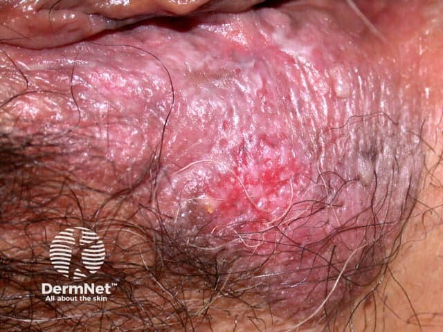
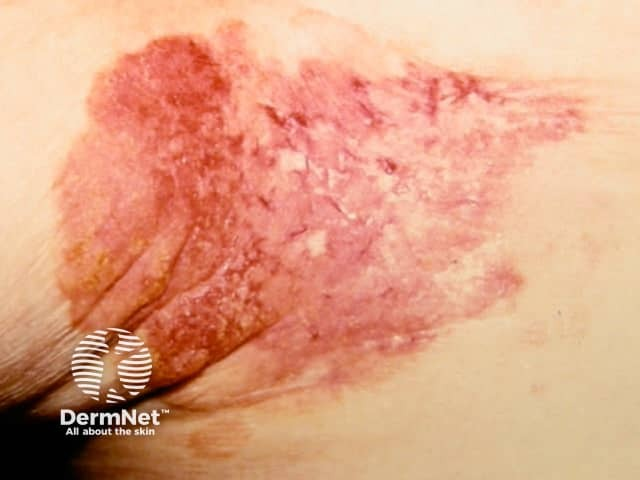

## 乳房外柏哲氏病 {#atlas-d38}

**年長者生殖器或肛周『治不好的濕疹』：要想到 EMPD 並切片。** [@A:d38]

### 辨認特徵

- 外陰、會陰、肛周、陰囊或腋下的慢性紅／粉紅斑塊，常單側或不對稱。 [@A:d38]
- 表面可脫屑、浸潤、糜爛、滲液或結痂，看起來很像長期濕疹。 [@A:d38]
- 病灶緩慢擴大；紅底可夾白色區或色素改變，晚期出現結節時須考慮侵犯。 [@A:d38]

### 最容易混淆

- 與股癬／念珠菌：股癬重在外圍活動性脫屑邊，念珠菌常有衛星丘疹膿疱；真菌檢查可協助區分。 [@A:d38]
- 與反向乾癬／濕疹：乾癬常較對稱且其他部位有線索；單側持續糜爛不能只按濕疹處理。 [@A:d38]

### 驗證方法

皮膚切片找表皮內 Paget cells，配合免疫染色；確診後依部位與病理評估相關內臟惡性腫瘤。 [@A:d38]

### 判讀限制

**外觀沒有專一性；不能因『很像濕疹』排除腫瘤，也不能把所有 EMPD 都說成必有內臟癌。** [@A:d38]

### 圖像對照

<figure class="clinical-image" data-asset-id="asset-dermatology-e02d3b7634ee340d"><figcaption>臨床照片 外陰部呈不均勻紅粉色斑塊，夾雜白色表面變化與糜爛區。Image sourced from DermNet · © DermNet · 原圖／出處 · <a href="https://dermnetnz.org/imagedetail/4386-extramammary-paget-disease-of-the-skin-of-the-vulva" target="_blank" rel="noopener">原圖來源</a> · <a href="https://creativecommons.org/licenses/by-nc-nd/4.0/" target="_blank" rel="noopener">CC BY-NC-ND 4.0</a> · 原圖未修改</figcaption></figure>
<figure class="clinical-image" data-asset-id="asset-dermatology-5971e8561a12768b"><figcaption>臨床照片 腋下大片不對稱紅色斑塊，表面糜爛、脫屑，邊緣不規則。Image sourced from DermNet · © DermNet · 原圖／出處 · <a href="https://dermnetnz.org/imagedetail/4440-extramammary-paget-disease-of-the-skin-of-the-axilla" target="_blank" rel="noopener">原圖來源</a> · <a href="https://creativecommons.org/licenses/by-nc-nd/4.0/" target="_blank" rel="noopener">CC BY-NC-ND 4.0</a> · 原圖未修改</figcaption></figure>

[@A:d38]

### 講義所列參考頁

查看外部參考連結

以下連結由講義提供，未將這些原文視為本次已完整閱讀的獨立來源。
<ul><li><a href="https://dermnetnz.org/topics/extramammary-paget-disease" target="_blank" rel="noopener">DermNet: Extramammary Paget disease</a></li><li><a href="https://dermnetnz.org/topics/extramammary-paget-disease-pathology" target="_blank" rel="noopener">DermNet: Extramammary Paget disease pathology</a></li></ul>

## 延伸閱讀

- [股癬](tinea-cruris.md#atlas-d32)
