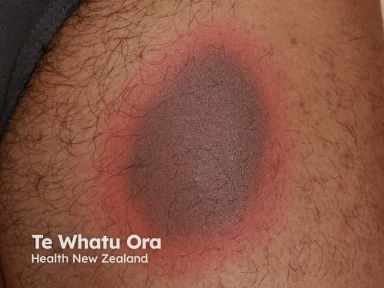
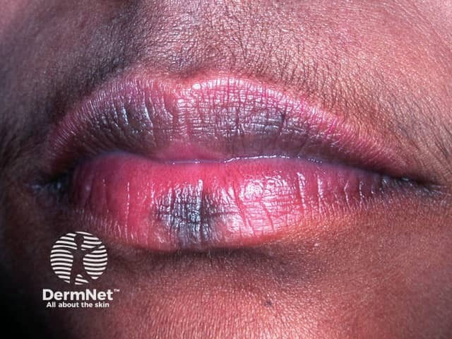

## 固定型藥物疹 {#atlas-d08}

**「吃同一顆藥，每次同一塊紅，再留下黑印」是最關鍵病史。** [@A:d08]

### 辨認特徵

- 一個或少數邊界非常清楚的圓／橢圓暗紅至紫褐色斑塊。 [@A:d08]
- 中央可起水疱、糜爛或結痂；唇、生殖器、手足均可能受累。 [@A:d08]
- 典型消退後留下褐色色素沉著，再次使用同一藥物時在原處復發。 [@A:d08]

### 最容易混淆

- EM：通常有較多、對稱肢端的三環靶形病灶。 [@A:d08]
- SJS／TEN：需警覺廣泛疼痛表皮剝離與全身症狀；廣泛水疱性 FDE 外觀可非常相似，不能僅由照片判定。 [@A:d08]

### 驗證方法

對照用藥與舊病灶分布；不典型時考慮切片及專科藥物過敏評估。 [@A:d08]

### 判讀限制

**固定是指復發位置，不是永遠只有一塊；少數有不留色素型。嚴重水疱型不應自行重吃藥驗證。** [@A:d08]

### 圖像對照

<figure class="clinical-image" data-asset-id="asset-dermatology-e74ee754bb226837"><figcaption>臨床照片 單一橢圓斑塊邊界清楚，中央暗紫褐色，外圍有鮮紅色環。Image sourced from DermNet · © Te Whatu Ora · 原圖／出處 · <a href="https://dermnetnz.org/imagedetail/11596-targetoid-lesion-in-fixed-drug-eruption" target="_blank" rel="noopener">原圖來源</a> · <a href="https://creativecommons.org/licenses/by-nc-nd/4.0/" target="_blank" rel="noopener">CC BY-NC-ND 4.0</a> · 原圖未修改</figcaption></figure>
<figure class="clinical-image" data-asset-id="asset-dermatology-ee83710f7d1c04de"><figcaption>臨床照片 上下唇局部可見界線較清楚的暗褐色斑，與周圍粉紅唇色形成對比。Image sourced from DermNet · © DermNet · 原圖／出處 · <a href="https://dermnetnz.org/imagedetail/8104-fixed-drug-eruption" target="_blank" rel="noopener">原圖來源</a> · <a href="https://creativecommons.org/licenses/by-nc-nd/4.0/" target="_blank" rel="noopener">CC BY-NC-ND 4.0</a> · 原圖未修改</figcaption></figure>

[@A:d08]

### 講義所列參考頁

查看外部參考連結

以下連結由講義提供，未將這些原文視為本次已完整閱讀的獨立來源。
<ul><li><a href="https://dermnetnz.org/topics/fixed-drug-eruption" target="_blank" rel="noopener">DermNet - Fixed drug eruption</a></li><li><a href="https://dermnetnz.org/topics/erythema-multiforme" target="_blank" rel="noopener">DermNet - Erythema multiforme</a></li><li><a href="https://dermnetnz.org/topics/stevens-johnson-syndrome-toxic-epidermal-necrolysis" target="_blank" rel="noopener">DermNet - SJS/TEN</a></li></ul>

## 延伸閱讀

- [多形性紅斑](erythema-multiforme.md#atlas-d06)
- [毒性表皮壞死溶解症](sjs-ten.md#atlas-d12)
