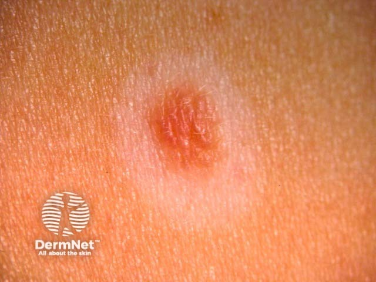
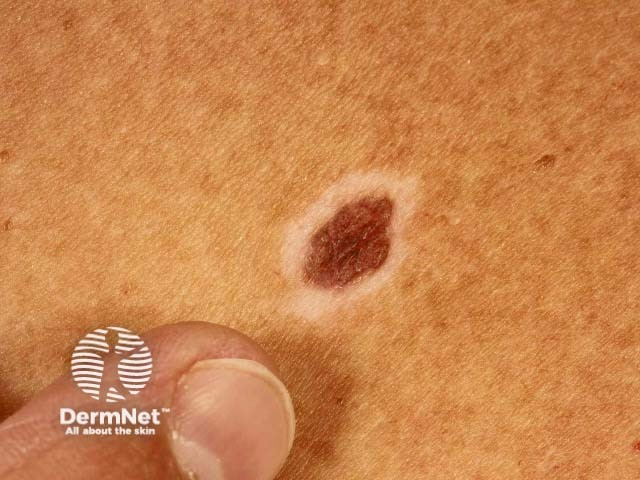

## 暈痣 {#atlas-d47}

**中央一顆痣＋對稱白暈：halo naevus；先確認中央痣是否也對稱。** [@A:d47]

### 辨認特徵

- 中央為棕色、淡褐或粉紅痣，外圍有一圈明顯白色脫色環。 [@A:d47]
- 典型白環圓形或橢圓、左右對稱，厚度相對均勻，像『痣外套白圈』。 [@A:d47]
- 常見於兒童、青少年軀幹，可多發；中央痣可能逐漸退色，最後只留白斑。 [@A:d47]

### 最容易混淆

- 與白斑症：vitiligo 的白斑不必以痣為中心，兩者也可能並存。 [@A:d47]
- 與退化中的黑色素瘤：色素與白色退化區常不對稱、不規則，不能只因出現白圈便當良性。 [@A:d47]

### 驗證方法

典型者以臨床及皮膚鏡確認；成人新出現、不規則中央痣或可疑變化時，評估全身皮膚並考慮完整切除。 [@A:d47]

### 判讀限制

**『荷包蛋』可幫助記憶，但良性判讀還須有規則、對稱的中央痣與白暈。** [@A:d47]

### 圖像對照

<figure class="clinical-image" data-asset-id="asset-dermatology-ff3f02334561b745"><figcaption>臨床照片 中央粉紅色小丘疹外圍有一圈相對對稱的淡白色暈。Image sourced from DermNet · © DermNet · 原圖／出處 · <a href="https://dermnetnz.org/imagedetail/15221-halo-naevus" target="_blank" rel="noopener">原圖來源</a> · <a href="https://creativecommons.org/licenses/by-nc-nd/4.0/" target="_blank" rel="noopener">CC BY-NC-ND 4.0</a> · 原圖未修改</figcaption></figure>
<figure class="clinical-image" data-asset-id="asset-dermatology-dc3fead2f3868cef"><figcaption>臨床照片 中央棕色痣外圍有清楚白色環，呈典型痣與白暈的組合。Image sourced from DermNet · © DermNet · 原圖／出處 · <a href="https://dermnetnz.org/imagedetail/14671-halo-naevus" target="_blank" rel="noopener">原圖來源</a> · <a href="https://creativecommons.org/licenses/by-nc-nd/4.0/" target="_blank" rel="noopener">CC BY-NC-ND 4.0</a> · 原圖未修改</figcaption></figure>

[@A:d47]

### 講義所列參考頁

查看外部參考連結

以下連結由講義提供，未將這些原文視為本次已完整閱讀的獨立來源。
<ul><li><a href="https://dermnetnz.org/topics/halo-naevus" target="_blank" rel="noopener">DermNet: Halo naevus</a></li><li><a href="https://dermnetnz.org/topics/vitiligo" target="_blank" rel="noopener">DermNet: Vitiligo</a></li></ul>

## 延伸閱讀

- [黑色素瘤](melanoma.md#atlas-d39)
- [白斑症](vitiligo.md#atlas-d54)
