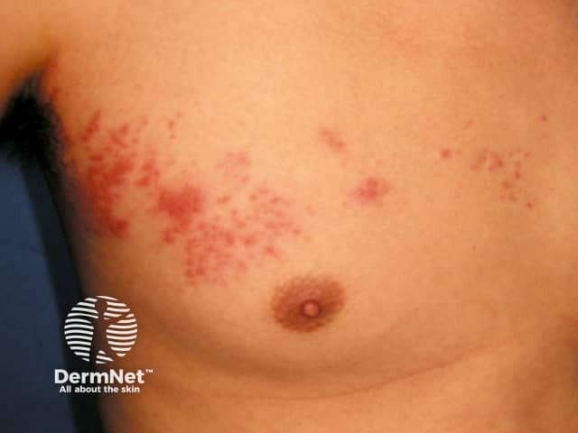
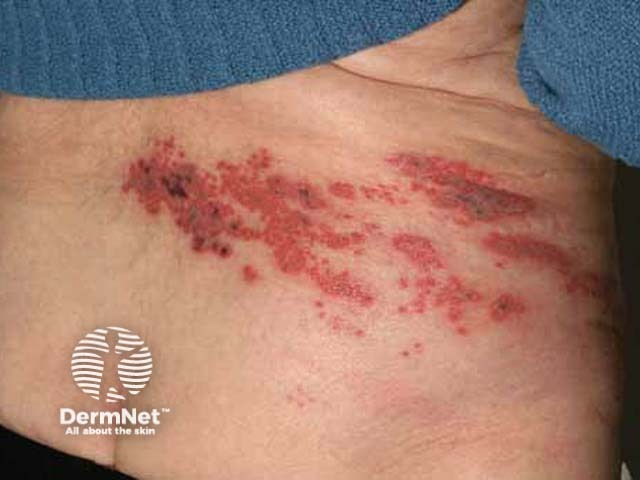

## 帶狀疱疹 {#atlas-d24}

**單側皮節成帶的群聚水泡＋疼痛先於出疹 → 帶狀疱疹。** [@A:d24]

### 辨認特徵

- 紅斑底上的群聚小水泡，後續可混有膿疱、糜爛與結痂。 [@A:d24]
- 沿一個或相鄰皮節呈帶狀分布，通常單側且不越過正中線。 [@A:d24]
- 常見胸背部或三叉神經區；整體分布比單顆水泡更具辨識力。 [@A:d24]

### 最容易混淆

- 單純疱疹：也有群聚水泡，但通常較局限、反覆同處，未必符合完整皮節。 [@A:d24]
- 接觸性皮膚炎：可成線狀或幾何形，通常接觸範圍與搔癢較突出。 [@A:d24]

### 驗證方法

典型病例可臨床判斷；不典型或免疫抑制者可用皮疹檢體 VZV PCR 協助。 [@A:d24]

### 判讀限制

**「不跨中線」是典型而非絕對；免疫抑制者可能播散。眼周與鼻尖病灶須特別評估眼侵犯。** [@A:d24]

### 圖像對照

<figure class="clinical-image" data-asset-id="asset-dermatology-9f3a12d1616cdf2a"><figcaption>臨床照片 胸部一側呈帶狀群聚紅丘疹與小水疱，留意皮節分布。Image sourced from DermNet · © DermNet · 原圖／出處 · <a href="https://dermnetnz.org/imagedetail/10105-herpes-zoster" target="_blank" rel="noopener">原圖來源</a> · <a href="https://creativecommons.org/licenses/by-nc-nd/4.0/" target="_blank" rel="noopener">CC BY-NC-ND 4.0</a> · 原圖未修改</figcaption></figure>
<figure class="clinical-image" data-asset-id="asset-dermatology-eb8ebe0a070fefd2"><figcaption>臨床照片 肩頸單側帶狀群聚水疱及結痂，不是隨機散布的全身疹。Image sourced from DermNet · © DermNet · 原圖／出處 · <a href="https://dermnetnz.org/imagedetail/19134-herpes-zoster" target="_blank" rel="noopener">原圖來源</a> · <a href="https://creativecommons.org/licenses/by-nc-nd/4.0/" target="_blank" rel="noopener">CC BY-NC-ND 4.0</a> · 原圖未修改</figcaption></figure>

[@A:d24]

### 講義所列參考頁

查看外部參考連結

以下連結由講義提供，未將這些原文視為本次已完整閱讀的獨立來源。
<ul><li><a href="https://dermnetnz.org/topics/herpes-zoster" target="_blank" rel="noopener">DermNet - Herpes zoster</a></li><li><a href="https://www.cdc.gov/shingles/hcp/clinical-signs/index.html" target="_blank" rel="noopener">CDC - Clinical features of shingles</a></li></ul>

