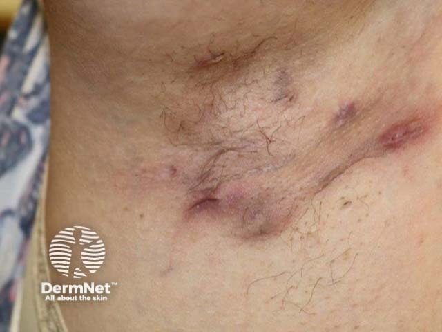
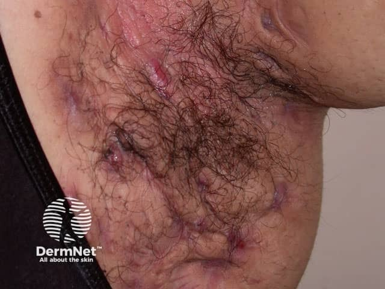

## 化膿性汗腺炎 {#atlas-d15}

**皺摺部位＋反覆膿瘍＋隧道與瘢痕，是 HS 的典型組合。** [@A:d15]

### 辨認特徵

- 腋下、腹股溝、乳下或臀會陰部反覆的深部疼痛結節與膿瘍。 [@A:d15]
- 同一區可見開放性粉刺、雙開口粉刺、流膿開口及皮下隧道。 [@A:d15]
- 慢性形成繩索樣、橋狀或凹陷瘢痕，多種不同時期病灶並存。 [@A:d15]

### 最容易混淆

- 單次癤／細菌性膿瘍：可能也很痛，但通常缺少長期同區復發、雙粉刺及隧道網絡。 [@A:d15]
- 發炎表皮囊腫：較像單個皮下結節，可能見中央開口，未必有典型多發皺摺分布。 [@A:d15]

### 驗證方法

診斷依典型病灶、典型部位與慢性復發；常用復發線索為六個月內至少兩次。必要時培養處理繼發感染。 [@A:d15]

### 判讀限制

**不是單純汗腺細菌感染或不清潔造成；未形成瘢痕與隧道的早期 HS 也可以確診。** [@A:d15]

### 圖像對照

<figure class="clinical-image" data-asset-id="asset-dermatology-badfde7173f020d3"><figcaption>臨床照片 腋下可見多個紅褐色結節、凹陷開口與條狀瘢痕，相鄰病灶呈線狀連結。Image sourced from DermNet · © DermNet · 原圖／出處 · <a href="https://dermnetnz.org/imagedetail/16264-hidradenitis-suppurativa" target="_blank" rel="noopener">原圖來源</a> · <a href="https://creativecommons.org/licenses/by-nc-nd/4.0/" target="_blank" rel="noopener">CC BY-NC-ND 4.0</a> · 原圖未修改</figcaption></figure>
<figure class="clinical-image" data-asset-id="asset-dermatology-3fe73750f0c6cce5"><figcaption>臨床照片 腋下多個結節及開口夾在粗厚、相互牽連的瘢痕中，可見局部變形。Image sourced from DermNet · © DermNet · 原圖／出處 · <a href="https://dermnetnz.org/imagedetail/7478-hidradenitis-suppurativa-axilla" target="_blank" rel="noopener">原圖來源</a> · <a href="https://creativecommons.org/licenses/by-nc-nd/4.0/" target="_blank" rel="noopener">CC BY-NC-ND 4.0</a> · 原圖未修改</figcaption></figure>

[@A:d15]

### 講義所列參考頁

查看外部參考連結

以下連結由講義提供，未將這些原文視為本次已完整閱讀的獨立來源。
<ul><li><a href="https://dermnetnz.org/topics/hidradenitis-suppurativa" target="_blank" rel="noopener">DermNet - Hidradenitis suppurativa</a></li></ul>

