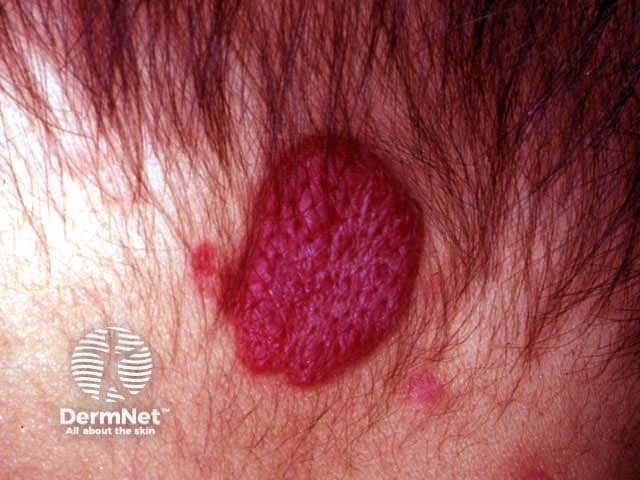
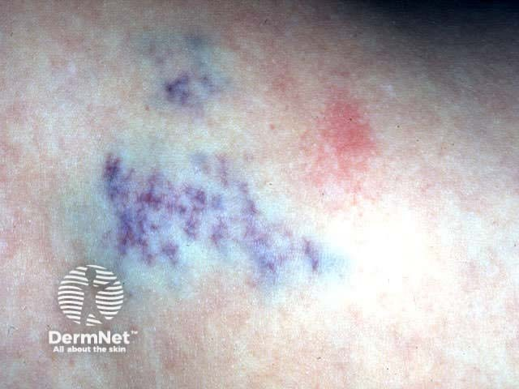

## 嬰兒血管瘤 {#atlas-d48}

**嬰兒出生後逐漸長大的草莓樣紅斑塊：infantile haemangioma。** [@A:d48]

### 辨認特徵

- 表淺型為鮮紅色、隆起、分葉或草莓樣丘疹／斑塊，常見於頭頸。 [@A:d48]
- 深部型可主要是膚色或藍色的皮下腫塊；混合型同時有紅色表面與深部隆起。 [@A:d48]
- 出生後數週逐漸明顯，早期快速增生，之後逐年變淡、變軟與消退，是圖像時序重點。 [@A:d48]

### 最容易混淆

- 與血管畸形：通常出生時已存在，隨身體成長而變大，沒有典型增生後消退週期。 [@A:d48]
- 與化膿性肉芽腫：PG 多是後天快速出現的小型脆弱結節，容易反覆出血，沒有嬰兒血管瘤自然病程。 [@A:d48]

### 驗證方法

通常靠出生後出現與成長病史診斷；深部或範圍不明時以超音波等確認。 [@A:d48]

### 判讀限制

**不是每個嬰兒血管瘤都鮮紅；照片看不到的深部成分、眼周位置或潰瘍會改變評估重點。** [@A:d48]

### 圖像對照

<figure class="clinical-image" data-asset-id="asset-dermatology-2979ccf07a6f6759"><figcaption>臨床照片 頭皮上可見鮮紅隆起、表面細分葉的草莓樣斑塊。Image sourced from DermNet · © DermNet · 原圖／出處 · <a href="https://dermnetnz.org/imagedetail/19606-superficial-infantile-haemangioma" target="_blank" rel="noopener">原圖來源</a> · <a href="https://creativecommons.org/licenses/by-nc-nd/4.0/" target="_blank" rel="noopener">CC BY-NC-ND 4.0</a> · 原圖未修改</figcaption></figure>
<figure class="clinical-image" data-asset-id="asset-dermatology-2c7abb350d11d032"><figcaption>臨床照片 皮膚下呈藍紫色團狀色變，表面沒有明顯草莓樣鮮紅突起。Image sourced from DermNet · © DermNet · 原圖／出處 · <a href="https://dermnetnz.org/imagedetail/19598-deep-infantile-haemangioma" target="_blank" rel="noopener">原圖來源</a> · <a href="https://creativecommons.org/licenses/by-nc-nd/4.0/" target="_blank" rel="noopener">CC BY-NC-ND 4.0</a> · 原圖未修改</figcaption></figure>

[@A:d48]

### 講義所列參考頁

查看外部參考連結

以下連結由講義提供，未將這些原文視為本次已完整閱讀的獨立來源。
<ul><li><a href="https://dermnetnz.org/topics/infantile-haemangioma-definition-and-pathogenesis" target="_blank" rel="noopener">DermNet: Infantile haemangioma, definition and pathogenesis</a></li><li><a href="https://dermnetnz.org/topics/pyogenic-granuloma" target="_blank" rel="noopener">DermNet: Pyogenic granuloma</a></li></ul>

## 延伸閱讀

- [化膿性肉芽腫（小葉狀微血管瘤）](pyogenic-granuloma.md#atlas-d40)
