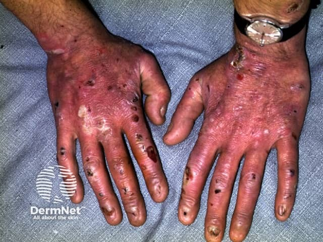
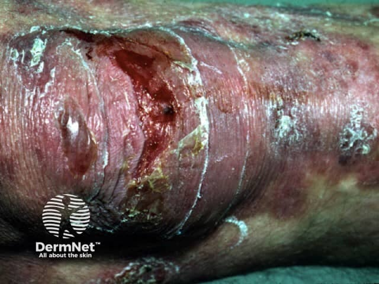

## 遺傳性表皮分解性水疱症 {#atlas-d07}

**幼年開始＋輕微摩擦即反覆起疱，比單看「大片脫皮」更能指向 EB。** [@A:d07]

### 辨認特徵

- 出生、嬰幼兒期或開始爬走後，摩擦與輕微外傷處反覆出現水疱及糜爛。 [@A:d07]
- 手足、肘膝等機械受力處常受累；可同時見新水疱與舊傷痕。 [@A:d07]
- 部分較重亞型可有瘢痕、粟粒疹、指甲變形或缺失，甚至手指融合。 [@A:d07]

### 最容易混淆

- SSSS：常為幼童急性發燒後的廣泛觸痛紅斑與淺層剝落，黏膜通常保留。 [@A:d07]
- SJS／TEN：急性疼痛暗紅斑、藥物時間關聯、顯著黏膜糜爛與表皮壞死。 [@A:d07]

### 驗證方法

需依皮膚分離層次、免疫螢光抗原定位與基因檢查分型；不同 EB 亞型的分離層次不同。 [@A:d07]

### 判讀限制

**並非所有 EB 都有瘢痕或出生即很嚴重；後天性 EBA 是自體免疫病，不能與遺傳性 EB 混稱。** [@A:d07]

### 圖像對照

<figure class="clinical-image" data-asset-id="asset-dermatology-1782197d0e318b23"><figcaption>臨床照片 雙手背及指節可見糜爛、結痂與白色瘢痕樣區，部分指甲變形或缺失。Image sourced from DermNet · © DermNet · 原圖／出處 · <a href="https://dermnetnz.org/imagedetail/7599-epidermolysis-bullosa" target="_blank" rel="noopener">原圖來源</a> · <a href="https://creativecommons.org/licenses/by-nc-nd/4.0/" target="_blank" rel="noopener">CC BY-NC-ND 4.0</a> · 原圖未修改</figcaption></figure>
<figure class="clinical-image" data-asset-id="asset-dermatology-04117c49a5c2d4bb"><figcaption>臨床照片 關節附近可見透明薄疱皮、大片糜爛及周圍發亮的舊瘢痕樣皮膚。Image sourced from DermNet · © DermNet · 原圖／出處 · <a href="https://dermnetnz.org/imagedetail/7589-epidermolysis-bullosa" target="_blank" rel="noopener">原圖來源</a> · <a href="https://creativecommons.org/licenses/by-nc-nd/4.0/" target="_blank" rel="noopener">CC BY-NC-ND 4.0</a> · 原圖未修改</figcaption></figure>

[@A:d07]

### 講義所列參考頁

查看外部參考連結

以下連結由講義提供，未將這些原文視為本次已完整閱讀的獨立來源。
<ul><li><a href="https://dermnetnz.org/topics/epidermolysis-bullosa" target="_blank" rel="noopener">DermNet - Epidermolysis bullosa</a></li><li><a href="https://www.niams.nih.gov/health-topics/epidermolysis-bullosa/diagnosis-treatment-and-steps-to-take" target="_blank" rel="noopener">NIAMS - Epidermolysis bullosa: Diagnosis</a></li><li><a href="https://dermnetnz.org/topics/staphylococcal-scalded-skin-syndrome" target="_blank" rel="noopener">DermNet - Staphylococcal scalded skin syndrome</a></li></ul>

## 延伸閱讀

- [毒性表皮壞死溶解症](sjs-ten.md#atlas-d12)
- [葡萄球菌燙傷樣皮膚症候群](staphylococcal-scalded-skin-syndrome.md#atlas-d58)
