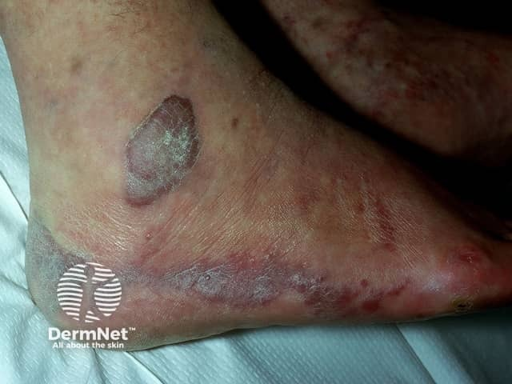
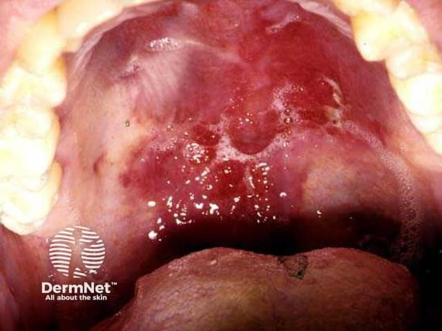

## 卡波西肉瘤 {#atlas-d25}

**多發紫紅色血管性斑塊／結節，合併免疫抑制線索 → 考慮 Kaposi sarcoma。** [@A:d25]

### 辨認特徵

- 紅褐、紫紅至紫黑色斑、斑塊或結節，可在同一患者同時存在。 [@A:d25]
- 經典型常見下肢、踝與足部，可能伴腿部淋巴水腫。 [@A:d25]
- 口腔硬顎可見紫紅色斑或結節；免疫抑制相關病例可廣泛分布。 [@A:d25]

### 最容易混淆

- 紫斑／瘀青：通常缺乏持續增大的實質結節，但早期 Kaposi 仍可相似。 [@A:d25]
- 化膿性肉芽腫或桿菌性血管瘤病也會呈紅紫病灶，需病理區別。 [@A:d25]

### 驗證方法

須切片證實；典型病理有梭形細胞與裂隙狀血管，HHV-8 LANA 免疫染色有助確診。 [@A:d25]

### 判讀限制

**不是只有 HIV 患者才會發生；Kaposi sarcoma 與 eczema herpeticum／KVE 是不同疾病。** [@A:d25]

### 圖像對照

<figure class="clinical-image" data-asset-id="asset-dermatology-d62fc8afe45ca408"><figcaption>臨床照片 踝足部紫褐色斑塊與隆起病灶，顏色偏紫而非一般紅疹。Image sourced from DermNet · © DermNet · 原圖／出處 · <a href="https://dermnetnz.org/imagedetail/8886-kaposi-sarcoma" target="_blank" rel="noopener">原圖來源</a> · <a href="https://creativecommons.org/licenses/by-nc-nd/4.0/" target="_blank" rel="noopener">CC BY-NC-ND 4.0</a> · 原圖未修改</figcaption></figure>
<figure class="clinical-image" data-asset-id="asset-dermatology-78b9d49fd34a120f"><figcaption>臨床照片 硬顎紫紅色斑塊與結節，示範口腔黏膜的 Kaposi sarcoma。Image sourced from DermNet · © DermNet · 原圖／出處 · <a href="https://dermnetnz.org/imagedetail/8625-kaposi-sarcoma" target="_blank" rel="noopener">原圖來源</a> · <a href="https://creativecommons.org/licenses/by-nc-nd/4.0/" target="_blank" rel="noopener">CC BY-NC-ND 4.0</a> · 原圖未修改</figcaption></figure>

[@A:d25]

### 講義所列參考頁

查看外部參考連結

以下連結由講義提供，未將這些原文視為本次已完整閱讀的獨立來源。
<ul><li><a href="https://dermnetnz.org/topics/kaposi-sarcoma" target="_blank" rel="noopener">DermNet - Kaposi sarcoma</a></li><li><a href="https://clinicalinfo.hiv.gov/en/guidelines/hiv-clinical-guidelines-adult-and-adolescent-opportunistic-infections/human-herpesvirus" target="_blank" rel="noopener">NIH - Human herpesvirus-8 disease</a></li><li><a href="https://www.cancer.gov/types/soft-tissue-sarcoma/hp/kaposi-treatment-pdq" target="_blank" rel="noopener">NCI - Kaposi sarcoma treatment (PDQ), health professional version</a></li></ul>

## 延伸閱讀

- [皰疹性濕疹](eczema-herpeticum.md#atlas-d26)
