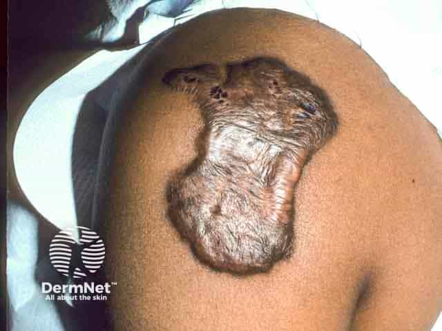
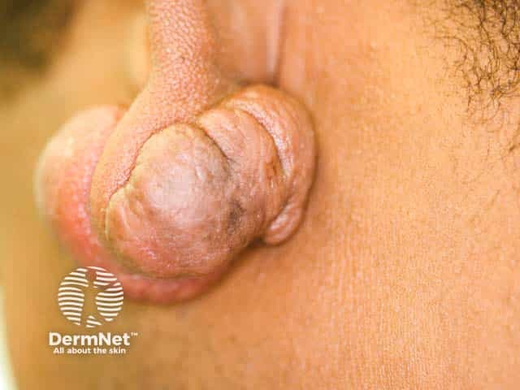
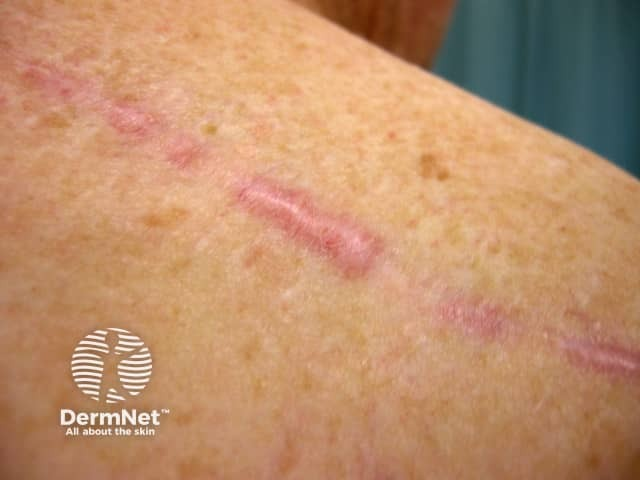

## 蟹足腫 {#atlas-d16}

**重點是「超出原傷口範圍」，不是只看疤痕很凸。** [@A:d16]

### 辨認特徵

- 光滑、隆起、質地較硬的瘢痕組織，呈紅、紫紅或褐色。 [@A:d16]
- 生長超出原傷口邊界；耳洞可見啞鈴樣耳垂腫塊，前胸可見分枝狀隆起。 [@A:d16]
- 常出現在胸肩、上背、耳垂，可能有外傷、手術、疫苗或痘痘史。 [@A:d16]

### 最容易混淆

- 肥厚性瘢痕：仍侷限於原傷口範圍，較有自然變平的傾向。 [@A:d16]
- 若沒有可信的受傷病史、快速改變或外觀不典型，要考慮其他皮膚腫瘤而非一律當蟹足腫。 [@A:d16]

### 驗證方法

通常由病史與觸診診斷；不典型時由皮膚科評估是否切片。 [@A:d16]

### 判讀限制

**外傷可能很輕微或年代久遠；蟹足腫不是會轉移的惡性腫瘤，但切除後可以復發。** [@A:d16]

### 圖像對照

<figure class="clinical-image" data-asset-id="asset-dermatology-b1b31876f1177619"><figcaption>臨床照片 肩部可見厚實隆起、表面光滑發亮的褐色瘢痕斑塊，外形不規則。Image sourced from DermNet · © Dr Lawrence Meyerson · 原圖／出處 · <a href="https://dermnetnz.org/imagedetail/1624-keloid-scar" target="_blank" rel="noopener">原圖來源</a> · <a href="https://creativecommons.org/licenses/by-nc-nd/4.0/" target="_blank" rel="noopener">CC BY-NC-ND 4.0</a> · 原圖未修改</figcaption></figure>
<figure class="clinical-image" data-asset-id="asset-dermatology-85fea91574641472"><figcaption>臨床照片 耳垂前後形成大型、光滑隆起的肉色瘢痕團塊，外觀近似啞鈴。Image sourced from DermNet · © Dr Richard Ashton · 原圖／出處 · <a href="https://dermnetnz.org/imagedetail/1614-keloid-scar" target="_blank" rel="noopener">原圖來源</a> · <a href="https://creativecommons.org/licenses/by-nc-nd/4.0/" target="_blank" rel="noopener">CC BY-NC-ND 4.0</a> · 原圖未修改</figcaption></figure>
<figure class="clinical-image" data-asset-id="asset-dermatology-2cb948e748c158d5"><figcaption>臨床照片 對照圖：上背線狀傷口上有局部粉紅色隆起，仍沿原傷口的走向分布。Image sourced from DermNet · © DermNet · 原圖／出處 · <a href="https://dermnetnz.org/imagedetail/3193-hypertrophic-scar" target="_blank" rel="noopener">原圖來源</a> · <a href="https://creativecommons.org/licenses/by-nc-nd/4.0/" target="_blank" rel="noopener">CC BY-NC-ND 4.0</a> · 原圖未修改</figcaption></figure>

[@A:d16]

### 講義所列參考頁

查看外部參考連結

以下連結由講義提供，未將這些原文視為本次已完整閱讀的獨立來源。
<ul><li><a href="https://dermnetnz.org/topics/keloid-and-hypertrophic-scar" target="_blank" rel="noopener">DermNet - Keloid and hypertrophic scar</a></li><li><a href="https://www.aad.org/public/diseases/a-z/keloids-symptoms" target="_blank" rel="noopener">American Academy of Dermatology - Keloid scars: Signs and symptoms</a></li></ul>

## 延伸閱讀

- [大型／巨型先天性黑色素細胞痣（舊稱 giant hairy nevus）](congenital-melanocytic-naevus.md#atlas-d46)
