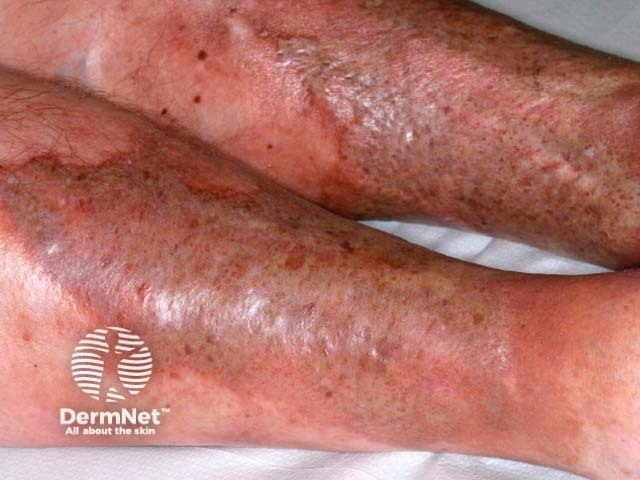
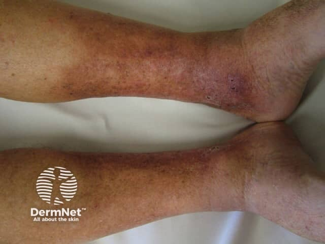

## 脂性皮膚硬化症 {#atlas-d17}

**靜脈鬱滯背景中，若特別突出的是硬化及踝上方收窄，要想到 lipodermatosclerosis。** [@A:d17]

### 辨認特徵

- 小腿下段棕紅色、硬化緊繃的皮膚，尤其靠近內踝與脛前。 [@A:d17]
- 慢性皮下纖維化使踝上方變細，形成「倒置香檳瓶」腿形。 [@A:d17]
- 可同時見水腫、靜脈曲張、含鐵血黃素色素沉著、白色萎縮及靜脈性潰瘍。 [@A:d17]

### 最容易混淆

- 鬱滯性皮膚炎：較突出表淺搔癢、濕疹、鱗屑或滲液；兩者可以同時存在。 [@A:d17]
- 蜂窩性組織炎：較常單側急性紅熱痛，伴感染病程；急性脂性皮膚硬化症可非常相似。 [@A:d17]

### 驗證方法

觸診確認硬化，配合靜脈超音波；照片無法直接量出皮下硬度，切片也須考量傷口癒合。 [@A:d17]

### 判讀限制

**兩者不是互斥診斷；單靠腳踝紅不能分清。急性期也可能尚未出現香檳瓶外觀。** [@A:d17]

### 圖像對照

<figure class="clinical-image" data-asset-id="asset-dermatology-02675ff99dfc6f4b"><figcaption>臨床照片 兩側小腿下段呈紅腫、棕色色素改變與表面鱗屑，皮膚外觀緊繃。Image sourced from DermNet · © DermNet · 原圖／出處 · <a href="https://dermnetnz.org/imagedetail/15640-acute-lipodermatosclerosis" target="_blank" rel="noopener">原圖來源</a> · <a href="https://creativecommons.org/licenses/by-nc-nd/4.0/" target="_blank" rel="noopener">CC BY-NC-ND 4.0</a> · 原圖未修改</figcaption></figure>
<figure class="clinical-image" data-asset-id="asset-dermatology-c0005387cd5b99e8"><figcaption>臨床照片 雙側踝上小腿變窄、呈紅褐色，較粗的上方小腿與細窄踝部形成對比。Image sourced from DermNet · © DermNet · 原圖／出處 · <a href="https://dermnetnz.org/imagedetail/9611-lipodermatosclerosis" target="_blank" rel="noopener">原圖來源</a> · <a href="https://creativecommons.org/licenses/by-nc-nd/4.0/" target="_blank" rel="noopener">CC BY-NC-ND 4.0</a> · 原圖未修改</figcaption></figure>

[@A:d17]

### 講義所列參考頁

查看外部參考連結

以下連結由講義提供，未將這些原文視為本次已完整閱讀的獨立來源。
<ul><li><a href="https://dermnetnz.org/topics/lipodermatosclerosis" target="_blank" rel="noopener">DermNet - Lipodermatosclerosis</a></li><li><a href="https://dermnetnz.org/topics/venous-eczema" target="_blank" rel="noopener">DermNet - Venous eczema</a></li></ul>

## 延伸閱讀

- [蜂窩性組織炎](cellulitis.md#atlas-d22)
