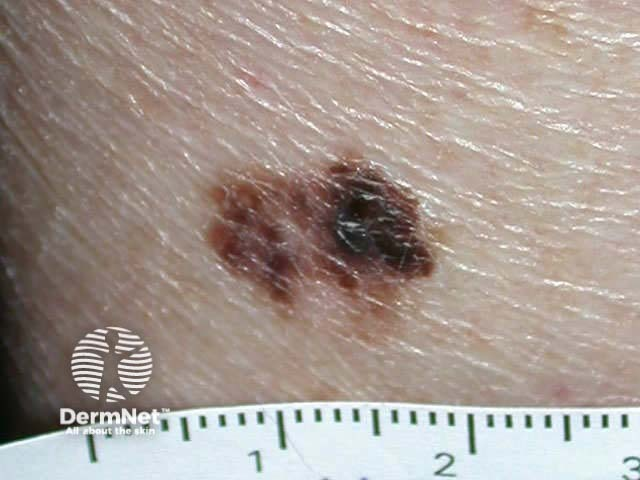
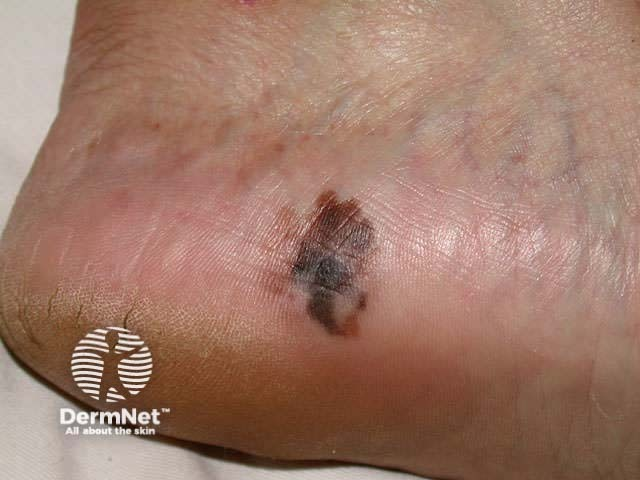
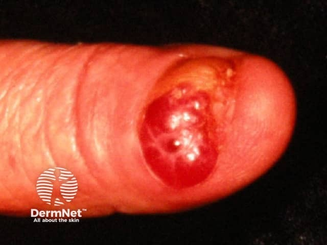

## 黑色素瘤 {#atlas-d39}

**不對稱、多色、持續變化的色素病灶，尤其掌蹠或甲部，優先排除 melanoma。** [@A:d39]

### 辨認特徵

- 看 ABCDE：不對稱、邊界不規則、顏色不均、直徑偏大，以及持續變化；E 特別重要。 [@A:d39]
- 同一病灶可混合棕、黑、灰藍、紅與白；也要找與其他痣明顯不同的 ugly duckling。 [@A:d39]
- 肢端型留意掌、蹠不規則色素斑；甲部留意逐漸變寬不均的黑色縱帶、甲周色素與甲板破壞。 [@A:d39]

### 最容易混淆

- 與良性痣：良性痣較常對稱、色彩與結構一致且穩定，但僅靠肉眼仍有重疊。 [@A:d39]
- 與脂漏性角化／色素型 BCC：貼上去的蠟樣表面、珠光捲邊可供判讀，疑似者仍靠皮膚鏡及切片。 [@A:d39]

### 驗證方法

以適當切片確診並評估 Breslow 厚度；照片不能用來分期。 [@A:d39]

### 判讀限制

**小於 6 mm、單色或粉紅色都不能排除；結節型與無色素型可能不符合典型 ABCD。** [@A:d39]

### 圖像對照

<figure class="clinical-image" data-asset-id="asset-dermatology-fe99ff81ec83fb8d"><figcaption>臨床照片 色素斑左右不對稱，棕黑深淺不均，外緣呈不規則輪廓。Image sourced from DermNet · © DermNet · 原圖／出處 · <a href="https://dermnetnz.org/imagedetail/14527-mel4-sm" target="_blank" rel="noopener">原圖來源</a> · <a href="https://creativecommons.org/licenses/by-nc-nd/4.0/" target="_blank" rel="noopener">CC BY-NC-ND 4.0</a> · 原圖未修改</figcaption></figure>
<figure class="clinical-image" data-asset-id="asset-dermatology-c23f218936ce8a70"><figcaption>臨床照片 足跟可見形狀不對稱的棕黑斑，中央較深，邊緣延伸不均。Image sourced from DermNet · © DermNet · 原圖／出處 · <a href="https://dermnetnz.org/imagedetail/19601-melanoma" target="_blank" rel="noopener">原圖來源</a> · <a href="https://creativecommons.org/licenses/by-nc-nd/4.0/" target="_blank" rel="noopener">CC BY-NC-ND 4.0</a> · 原圖未修改</figcaption></figure>
<figure class="clinical-image" data-asset-id="asset-dermatology-dd166d8f089caf7b"><figcaption>臨床照片 甲部出現鮮紅、表面發亮的腫塊，原本甲板結構明顯被破壞。Image sourced from DermNet · © DermNet · 原圖／出處 · <a href="https://dermnetnz.org/imagedetail/5072-amelanotic-melanoma" target="_blank" rel="noopener">原圖來源</a> · <a href="https://creativecommons.org/licenses/by-nc-nd/4.0/" target="_blank" rel="noopener">CC BY-NC-ND 4.0</a> · 原圖未修改</figcaption></figure>

[@A:d39]

### 講義所列參考頁

查看外部參考連結

以下連結由講義提供，未將這些原文視為本次已完整閱讀的獨立來源。
<ul><li><a href="https://dermnetnz.org/topics/melanoma" target="_blank" rel="noopener">DermNet: Melanoma</a></li><li><a href="https://www.aad.org/public/diseases/skin-cancer/abcdes-melanoma" target="_blank" rel="noopener">AAD: ABCDEs of melanoma</a></li><li><a href="https://dermnetnz.org/topics/amelanotic-melanoma" target="_blank" rel="noopener">DermNet: Amelanotic melanoma</a></li></ul>

