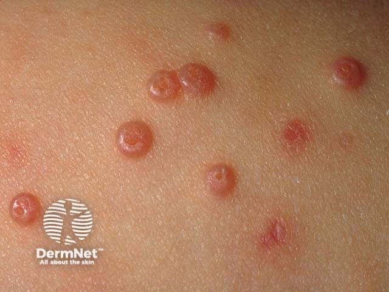
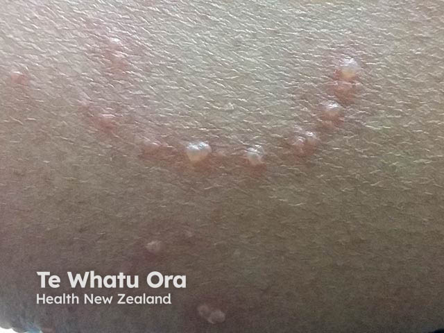

## 傳染性軟疣 {#atlas-d35}

**光滑珍珠樣小丘疹＋中央臍凹 → 傳染性軟疣。** [@A:d35]

### 辨認特徵

- 數毫米大小、圓頂狀、膚色至珍珠白／粉紅丘疹，表面平滑發亮。 [@A:d35]
- 中央臍窩狀凹陷是核心線索，內可有白色乳酪樣物質。 [@A:d35]
- 常群聚於兒童軀幹與皺褶處，抓搔可造成線狀排列；周圍可伴濕疹。 [@A:d35]

### 最容易混淆

- 尋常疣：表面粗糙角化，常有黑紅血管點，沒有典型平滑臍凹。 [@A:d35]
- 皮脂腺增生：成人臉上較黃，亦可中央凹陷，需看年齡、大小與血管形態。 [@A:d35]

### 驗證方法

多依臨床或皮膚鏡辨識；不典型者切片可見細胞質內 molluscum bodies。 [@A:d35]

### 判讀限制

**病原為痘病毒，不是 HPV。免疫低下者可出現大量、巨大或臉部病灶；臍凹也不是此病專屬。** [@A:d35]

### 圖像對照

<figure class="clinical-image" data-asset-id="asset-dermatology-66d4d37f1d06e0bd"><figcaption>臨床照片 多顆光滑圓頂狀丘疹，中央臍窩凹陷清楚，是最典型的辨認點。Image sourced from DermNet · © DermNet · 原圖／出處 · <a href="https://dermnetnz.org/imagedetail/19122-molluscum-contagiosum" target="_blank" rel="noopener">原圖來源</a> · <a href="https://creativecommons.org/licenses/by-nc-nd/4.0/" target="_blank" rel="noopener">CC BY-NC-ND 4.0</a> · 原圖未修改</figcaption></figure>
<figure class="clinical-image" data-asset-id="asset-dermatology-0856ccb6e8c0dde6"><figcaption>臨床照片 抓痕路徑上排列的光亮丘疹，示範自體接種造成的線狀分布。Image sourced from DermNet · © Te Whatu Ora · 原圖／出處 · <a href="https://dermnetnz.org/imagedetail/14487-molluscum-contagiosum" target="_blank" rel="noopener">原圖來源</a> · <a href="https://creativecommons.org/licenses/by-nc-nd/4.0/" target="_blank" rel="noopener">CC BY-NC-ND 4.0</a> · 原圖未修改</figcaption></figure>

[@A:d35]

### 講義所列參考頁

查看外部參考連結

以下連結由講義提供，未將這些原文視為本次已完整閱讀的獨立來源。
<ul><li><a href="https://dermnetnz.org/topics/molluscum-contagiosum" target="_blank" rel="noopener">DermNet - Molluscum contagiosum</a></li><li><a href="https://dermnetnz.org/topics/viral-wart" target="_blank" rel="noopener">DermNet - Viral wart</a></li></ul>

## 延伸閱讀

- [尋常疣](verruca-vulgaris.md#atlas-d36)
