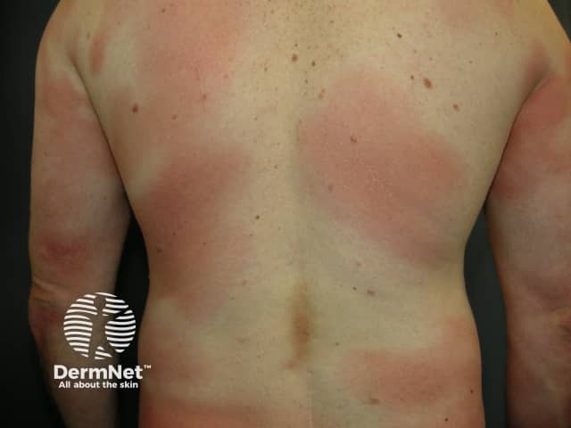
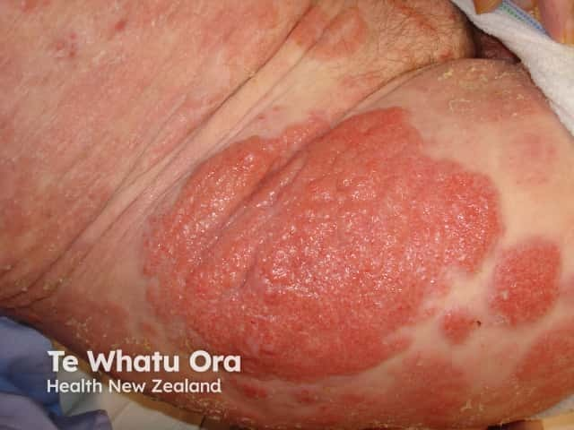
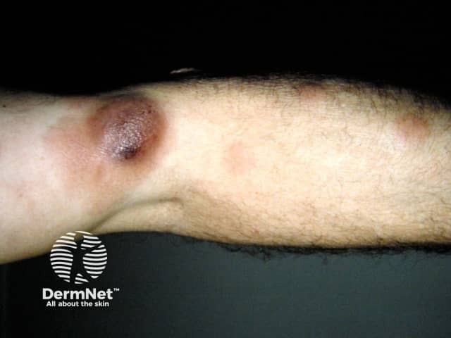

## 蕈狀肉芽腫（皮膚 T 細胞淋巴瘤） {#atlas-d56}

**長期反覆、分布不對稱的濕疹樣斑片／斑塊，偏在衣服遮蔽處 → 想到 MF，安排臨床與切片對照。** [@B:d56]

**三張來自不同病例，示範不同外觀；不是同一患者的連續病程照片。** [@B:d56]

### 辨認特徵

- 早期為持續或反覆出現的紅褐色斑片，薄鱗屑、邊界與形狀不規則，可見皮膚變薄或皺縮。 [@B:d56]
- 典型偏好較少日曬的軀幹、臀部及大腿近端；病灶可不對稱，長期像濕疹或體癬。 [@B:d56]
- 較厚的斑塊可呈弧形、環形或暗紅紫色；進展時可能出現結節／腫瘤及潰瘍，但不是每位患者都會進展。 [@B:d56]
- 另有低色素型與異色症型：淡色斑，或色素不均、微血管擴張與萎縮並存。 [@B:d56]

### 最容易混淆

- 慢性濕疹／乾癬：可以非常相似；病程、分布與多次具代表性的切片比單張照片更有判別力。 [@B:d56]
- 體癬：尋找活動性鱗屑邊緣並作 KOH／培養；環形外觀本身不能證明真菌感染。 [@B:d56]
- 低色素型可像白色糠疹或白斑；需結合鱗屑、皮膚變薄、分布與病理。 [@B:d56]

### 驗證方法

取代表性病灶作皮膚切片、免疫染色及適當 TCR 克隆性分析；早期可能須不同部位或不同時間重複切片。表皮向性異型 T 細胞可支持，Pautrier microabscess 並非每例都有。 [@B:d56]

### 判讀限制

**Mycosis fungoides 是淋巴瘤，不是真菌感染。斑片→斑塊→腫瘤是可能的演進，非每例必經；「後期一定變成 Sézary」也不正確。** [@B:d56]

### 分類與分期的使用情境

**MF 與 Sézary 為不同疾病實體，不能寫成必然的先後階段。一般紅皮症描述約 90% 體表；MF／SS 的 TNMB 分期 T4 採 ≥80%，用途不同。** [@B:ctcl][@B:corrections]

### 圖像對照

<figure class="clinical-image" data-asset-id="asset-dermatology-a233b05dc680cf9c"><figcaption>臨床照片 斑片型：背部可見大小不一、邊界不規則的淡紅斑片，外觀容易與慢性濕疹混淆。Image sourced from DermNet · © DermNet · 原圖／出處 · <a href="https://dermnetnz.org/imagedetail/5852-patch-stage-mycosis-fungoides" target="_blank" rel="noopener">原圖來源</a> · <a href="https://creativecommons.org/licenses/by-nc-nd/4.0/" target="_blank" rel="noopener">CC BY-NC-ND 4.0</a> · 原圖未修改</figcaption></figure>
<figure class="clinical-image" data-asset-id="asset-dermatology-d600dec5ce4f0164"><figcaption>臨床照片 斑塊型：可見界線較清楚的紅色隆起斑塊，表面帶有鱗屑。Image sourced from DermNet · © Te Whatu Ora · 原圖／出處 · <a href="https://dermnetnz.org/imagedetail/6142-plaque-stage-mycosis-fungoides" target="_blank" rel="noopener">原圖來源</a> · <a href="https://creativecommons.org/licenses/by-nc-nd/4.0/" target="_blank" rel="noopener">CC BY-NC-ND 4.0</a> · 原圖未修改</figcaption></figure>
<figure class="clinical-image" data-asset-id="asset-dermatology-931d44192d76a86f"><figcaption>臨床照片 腫瘤型：肢體上可見單顆明顯隆起的暗紅紫色腫塊；來源已標示為 MF 腫瘤型。Image sourced from DermNet · © DermNet · 原圖／出處 · <a href="https://dermnetnz.org/imagedetail/5971-tumour-stage-mycosis-fungoides" target="_blank" rel="noopener">原圖來源</a> · <a href="https://creativecommons.org/licenses/by-nc-nd/4.0/" target="_blank" rel="noopener">CC BY-NC-ND 4.0</a> · 原圖未修改</figcaption></figure>

[@B:d56]

### 講義所列參考頁

查看外部參考連結

以下連結由講義提供，未將這些原文視為本次已完整閱讀的獨立來源。
<ul><li><a href="https://dermnetnz.org/topics/mycosis-fungoides" target="_blank" rel="noopener">DermNet - Mycosis fungoides</a></li><li><a href="https://dermnetnz.org/topics/mycosis-fungoides-pathology" target="_blank" rel="noopener">DermNet - Mycosis fungoides pathology</a></li><li><a href="https://www.cancer.gov/types/lymphoma/hp/mycosis-fungoides-treatment-pdq" target="_blank" rel="noopener">NCI PDQ - Mycosis fungoides and other CTCL</a></li><li><a href="https://seer.cancer.gov/seertools/hemelymph/51f6cf56e3e27c3994bd52e2/" target="_blank" rel="noopener">NCI SEER / WHO5 - Sézary syndrome</a></li></ul>

## 延伸閱讀

- [紅皮症](erythroderma.md#atlas-d14)
- [白色糠疹](pityriasis-alba.md#atlas-d27)
