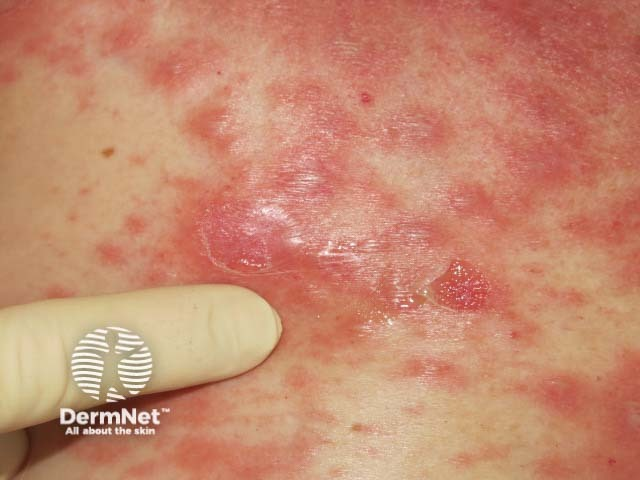

## 尼可斯基徵象 {#atlas-d49}

**輕擦皮膚就剝離＝Nikolsky sign positive；接著問是哪一種疾病。** [@A:d49]

### 辨認特徵

- 重點是輕度側向摩擦／剪力後，表皮滑動或剝離，形成新的糜爛或擴大原病灶。 [@A:d49]
- 示範圖可見手指施力及表皮鬆脫；只有已存在的糜爛照片，並不能證明檢查陽性。 [@A:d49]
- 考題需與整體分布、黏膜病灶、水泡鬆緊及病史一起看，這是皮膚脆弱性的體徵。 [@A:d49]

### 最容易混淆

- PV、PF、SSSS 可陽性；SJS/TEN 的全層壞死所致剝離常稱 pseudo-Nikolsky；不能以陽性直接選 TEN。 [@A:d49]
- 與 Asboe-Hansen sign：後者是壓住完整水泡，使泡液向旁邊擴展；兩種操作概念要分清。 [@A:d49]

### 驗證方法

仍依病史、組織切片與適當 DIF／抗體檢查確定疾病；BP 通常沒有典型 Nikolsky 陽性。 [@A:d49]

### 判讀限制

**此項不是疾病名稱，也不是 TEN 專屬徵象；講義示範若只呈剝皮外觀，應標『剝離外觀』而非宣稱已做檢查。** [@A:d49]

### 增補校正

輕微側向剪力所致表皮剝離，屬檢查徵象；分離層次依疾病而異，並非一律「破到真皮」。 [@B:corrections]

### 圖像對照

<figure class="clinical-image" data-asset-id="asset-dermatology-4645d62885c61ad6"><figcaption>臨床照片 手指在紅斑皮膚旁施力，附近可見薄層表皮剝離與新鮮紅色糜爛面。Image sourced from DermNet · © DermNet · 原圖／出處 · <a href="https://dermnetnz.org/imagedetail/16832-severe-cutaneous-drug-eruption" target="_blank" rel="noopener">原圖來源</a> · <a href="https://creativecommons.org/licenses/by-nc-nd/4.0/" target="_blank" rel="noopener">CC BY-NC-ND 4.0</a> · 原圖未修改</figcaption></figure>

[@A:d49]

### 講義所列參考頁

查看外部參考連結

以下連結由講義提供，未將這些原文視為本次已完整閱讀的獨立來源。
<ul><li><a href="https://dermnetnz.org/topics/nikolskys-sign" target="_blank" rel="noopener">DermNet: Nikolsky’s sign</a></li><li><a href="https://www.msdmanuals.com/professional/dermatologic-disorders/bullous-diseases/pemphigus-vulgaris" target="_blank" rel="noopener">MSD Manual Professional: Pemphigus vulgaris</a></li></ul>

## 延伸閱讀

- [水疱性類天疱瘡](bullous-pemphigoid.md#atlas-d03)
- [尋常天疱瘡](pemphigus-vulgaris.md#atlas-d09)
- [毒性表皮壞死溶解症](sjs-ten.md#atlas-d12)
- [葡萄球菌燙傷樣皮膚症候群](staphylococcal-scalded-skin-syndrome.md#atlas-d58)
