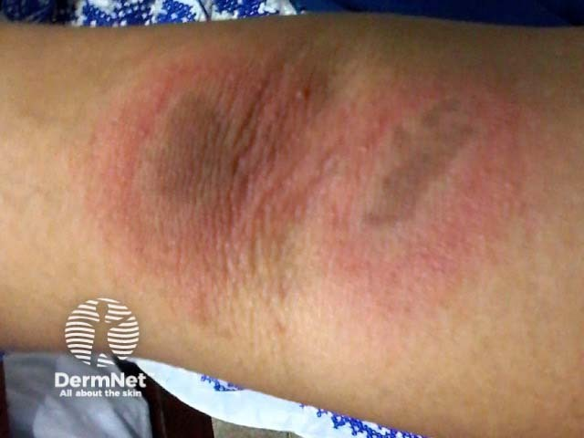

## 隱翅蟲皮膚炎 {#atlas-d18}

**線狀灼傷樣紅斑／水疱＋對吻病灶＋隱翅蟲暴露，是典型圖片題。** [@A:d18]

### 辨認特徵

- 暴露部位出現線狀或刷痕狀紅斑，中央可有密集小水疱、膿疱或糜爛。 [@A:d18]
- 相接觸的兩側皮膚可出現對吻性病灶（kissing lesions），通常灼熱明顯。 [@A:d18]
- 題目若附昆蟲，找細長、黑橘相間、鞘翅短而腹部外露的隱翅蟲。 [@A:d18]

### 最容易混淆

- 帶狀皰疹：沿單側皮節的成群水疱與神經痛，通常不是拖抹樣線狀。 [@A:d18]
- 植物光毒性皮膚炎：也可線狀或滴濺狀，需植物汁液與日曬病史。 [@A:d18]

### 驗證方法

臨床形態及暴露史診斷；接觸後常延遲一至兩天出現症狀。 [@A:d18]

### 判讀限制

**主要是蟲體被壓碎後 pederin 毒素接觸皮膚，不是咬傷或螫傷；蟲在皮膚上應輕輕移除，避免拍碎。** [@A:d18]

### 圖像對照

<figure class="clinical-image" data-asset-id="asset-dermatology-e481ad5fafa9fc94"><figcaption>臨床照片 皮膚皺摺兩側出現相互對應的紅褐色橢圓斑，呈對吻性分布。Image sourced from DermNet · © DermNet · 原圖／出處 · <a href="https://dermnetnz.org/imagedetail/15498-paedarus-dermatitis" target="_blank" rel="noopener">原圖來源</a> · <a href="https://creativecommons.org/licenses/by-nc-nd/4.0/" target="_blank" rel="noopener">CC BY-NC-ND 4.0</a> · 原圖未修改</figcaption></figure>

附圖暫未公開：使用條件尚待確認。原講義其餘圖片仍可閱讀。

[@A:d18]

### 講義所列參考頁

查看外部參考連結

以下連結由講義提供，未將這些原文視為本次已完整閱讀的獨立來源。
<ul><li><a href="https://dermnetnz.org/topics/paederus-dermatitis" target="_blank" rel="noopener">DermNet - Paederus dermatitis</a></li><li><a href="https://ph.health.mil/topics/entomology/what/Pages/Paederus-Beetle.aspx" target="_blank" rel="noopener">Defense Centers for Public Health - Paederus Beetle</a></li></ul>

