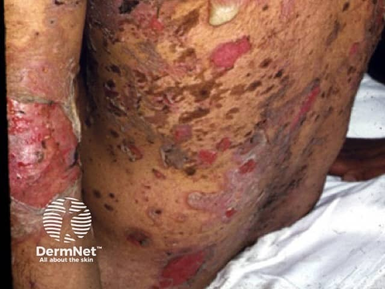
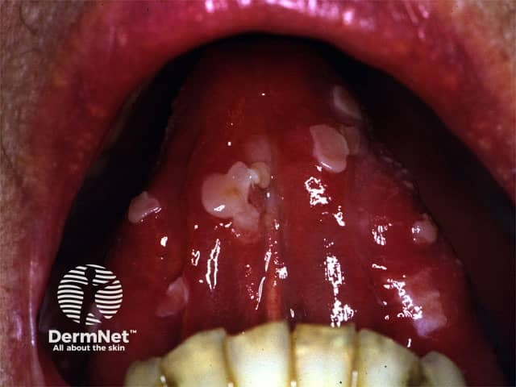

## 尋常天疱瘡 {#atlas-d09}

**鬆弛易破水疱／糜爛＋口腔疼痛病灶，比「背部很紅」有辨識力。** [@A:d09]

### 辨認特徵

- 水疱薄而鬆弛、極易破，所以照片常是大片淺表糜爛、濕潤紅底與痂皮。 [@A:d09]
- 胸背、頭皮、臉與皺摺處可受累；完整水疱可能很少。 [@A:d09]
- 口腔常有疼痛、持續不癒的糜爛，並可能先於皮膚病灶。 [@A:d09]

### 最容易混淆

- BP：完整的緊繃水疱、強烈搔癢及高齡發病更典型。 [@A:d09]
- 落葉型天疱瘡：以更淺層的鱗屑、痂皮為主，通常不侵犯黏膜。 [@A:d09]
- TEN：病程急、表皮壞死剝離，需結合藥物史、全身症狀與病理。 [@A:d09]

### 驗證方法

病理為基底層上棘層鬆解；病灶旁 DIF 呈表皮細胞間網狀 IgG／C3，可測 anti-desmoglein 3／1。 [@A:d09]

### 判讀限制

**Nikolsky 徵可陽性，但不能單靠此徵象診斷；照片沒有完整水疱也不能排除。** [@A:d09]

### 圖像對照

<figure class="clinical-image" data-asset-id="asset-dermatology-135a14c7466b27b1"><figcaption>臨床照片 軀幹皮膚散布大小不一的紅色糜爛與痂皮，周圍有明顯深色色素改變。Image sourced from DermNet · © DermNet · 原圖／出處 · <a href="https://dermnetnz.org/imagedetail/9413-pemphigus-vulgaris" target="_blank" rel="noopener">原圖來源</a> · <a href="https://creativecommons.org/licenses/by-nc-nd/4.0/" target="_blank" rel="noopener">CC BY-NC-ND 4.0</a> · 原圖未修改</figcaption></figure>
<figure class="clinical-image" data-asset-id="asset-dermatology-95e1e68a4c51fc88"><figcaption>臨床照片 口腔黏膜可見多處糜爛及不規則白色表面剝離。Image sourced from DermNet · © DermNet · 原圖／出處 · <a href="https://dermnetnz.org/imagedetail/9401-oral-pemphigus-vulgaris" target="_blank" rel="noopener">原圖來源</a> · <a href="https://creativecommons.org/licenses/by-nc-nd/4.0/" target="_blank" rel="noopener">CC BY-NC-ND 4.0</a> · 原圖未修改</figcaption></figure>

[@A:d09]

### 講義所列參考頁

查看外部參考連結

以下連結由講義提供，未將這些原文視為本次已完整閱讀的獨立來源。
<ul><li><a href="https://dermnetnz.org/topics/pemphigus-vulgaris" target="_blank" rel="noopener">DermNet - Pemphigus vulgaris</a></li><li><a href="https://dermnetnz.org/topics/bullous-pemphigoid" target="_blank" rel="noopener">DermNet - Bullous pemphigoid</a></li></ul>

## 延伸閱讀

- [水疱性類天疱瘡](bullous-pemphigoid.md#atlas-d03)
- [毒性表皮壞死溶解症](sjs-ten.md#atlas-d12)
