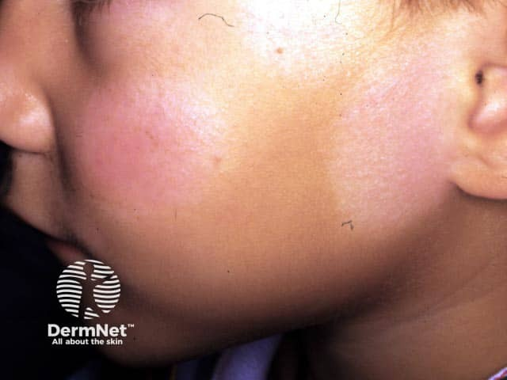
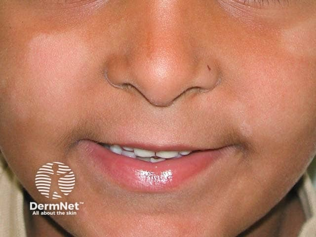

## 白色糠疹 {#atlas-d27}

**小孩臉頰邊界不清的淡白斑＋細屑 → 白色糠疹。** [@A:d27]

### 辨認特徵

- 兒童／青少年臉頰常見淡白色斑，顏色減淡但通常不是全白。 [@A:d27]
- 邊界多較模糊，表面有很細的乾燥鱗屑；早期可帶淡紅色。 [@A:d27]
- 可多發於臉、頸、肩與上臂，曬黑後與周圍對比更明顯。 [@A:d27]

### 最容易混淆

- 白斑症：乳白／粉筆白、界線較明確，通常沒有鱗屑。 [@A:d27]
- 汗斑：常在上胸背與頸部群聚融合；KOH 可見 Malassezia 菌絲與酵母。 [@A:d27]

### 驗證方法

通常依臨床診斷；Wood lamp 不呈白斑症般明顯強化，真菌檢查陰性。 [@A:d27]

### 判讀限制

**是輕度濕疹相關的色素減退，不等於白斑症，也不能由白斑外觀就認定是黴菌感染。** [@A:d27]

### 圖像對照

<figure class="clinical-image" data-asset-id="asset-dermatology-da474057e86ded7c"><figcaption>臨床照片 兒童臉頰較淡、乾燥的斑片，邊界不像典型白斑症般銳利。Image sourced from DermNet · © DermNet · 原圖／出處 · <a href="https://dermnetnz.org/imagedetail/2261-pityriasis-alba" target="_blank" rel="noopener">原圖來源</a> · <a href="https://creativecommons.org/licenses/by-nc-nd/4.0/" target="_blank" rel="noopener">CC BY-NC-ND 4.0</a> · 原圖未修改</figcaption></figure>
<figure class="clinical-image" data-asset-id="asset-dermatology-89b0fde0b6d9d88e"><figcaption>臨床照片 口周與雙頰淡白色斑，仍可見皮膚底色，並非完全去色素。Image sourced from DermNet · © DermNet · 原圖／出處 · <a href="https://dermnetnz.org/imagedetail/2262-pityriasis-alba" target="_blank" rel="noopener">原圖來源</a> · <a href="https://creativecommons.org/licenses/by-nc-nd/4.0/" target="_blank" rel="noopener">CC BY-NC-ND 4.0</a> · 原圖未修改</figcaption></figure>

[@A:d27]

### 講義所列參考頁

查看外部參考連結

以下連結由講義提供，未將這些原文視為本次已完整閱讀的獨立來源。
<ul><li><a href="https://dermnetnz.org/topics/pityriasis-alba" target="_blank" rel="noopener">DermNet - Pityriasis alba</a></li><li><a href="https://dermnetnz.org/topics/pityriasis-versicolor" target="_blank" rel="noopener">DermNet - Pityriasis versicolor</a></li><li><a href="https://dermnetnz.org/topics/vitiligo" target="_blank" rel="noopener">DermNet - Vitiligo</a></li></ul>

## 延伸閱讀

- [變色糠疹／汗斑](pityriasis-versicolor.md#atlas-d34)
- [白斑症](vitiligo.md#atlas-d54)
