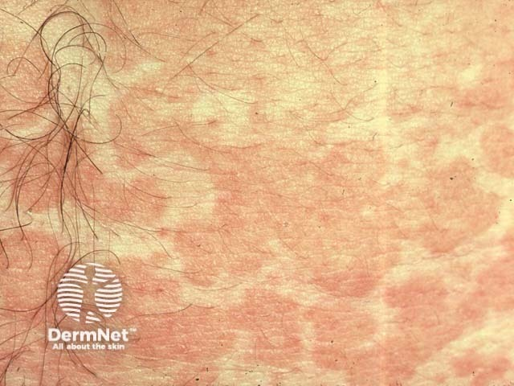
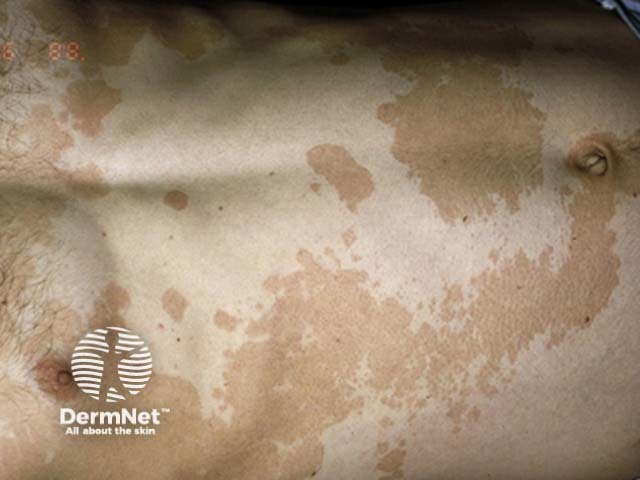
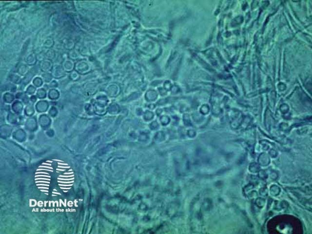

## 變色糠疹／汗斑 {#atlas-d34}

**胸背多發變色斑＋細屑，KOH 菌絲與酵母呈 spaghetti and meatballs → 汗斑。** [@A:d34]

### 辨認特徵

- 上胸、背、頸與近端上臂出現多個淡白、棕褐或淡粉紅色斑。 [@A:d34]
- 表面有很細的糠秕狀鱗屑，輕刮時更容易看到。 [@A:d34]
- 小斑可彼此融合成不規則大片；症狀常輕微。 [@A:d34]

### 最容易混淆

- 白斑症：完全去色素、界線清楚且無屑。 [@A:d34]
- 白色糠疹：兒童臉頰淡白乾燥斑較典型，真菌檢查陰性。 [@A:d34]

### 驗證方法

刮屑 KOH 可見短菌絲與酵母；Wood lamp 有時呈黃綠色螢光，但陰性不排除。 [@A:d34]

### 判讀限制

**病原是 Malassezia 酵母，非皮癬菌。治療後仍可能留淡斑，單靠顏色未恢復不能判定感染持續。** [@A:d34]

### 圖像對照

<figure class="clinical-image" data-asset-id="asset-dermatology-6d0e2f5a970f2d73"><figcaption>臨床照片 胸部多發淡色細屑斑，邊緣彼此融合，呈地圖樣外觀。Image sourced from DermNet · © DermNet · 原圖／出處 · <a href="https://dermnetnz.org/imagedetail/17293-pityriasis-versicolor" target="_blank" rel="noopener">原圖來源</a> · <a href="https://creativecommons.org/licenses/by-nc-nd/4.0/" target="_blank" rel="noopener">CC BY-NC-ND 4.0</a> · 原圖未修改</figcaption></figure>
<figure class="clinical-image" data-asset-id="asset-dermatology-6fb9aa8f41a005e8"><figcaption>臨床照片 軀幹大範圍淺色與褐色交錯斑片；汗斑不只呈白色。Image sourced from DermNet · © DermNet · 原圖／出處 · <a href="https://dermnetnz.org/imagedetail/19082-pityriasis-versicolor" target="_blank" rel="noopener">原圖來源</a> · <a href="https://creativecommons.org/licenses/by-nc-nd/4.0/" target="_blank" rel="noopener">CC BY-NC-ND 4.0</a> · 原圖未修改</figcaption></figure>
<figure class="clinical-image" data-asset-id="asset-dermatology-2f5d867f5e0f2f65"><figcaption>顯微鏡影像 顯微鏡可見圓形酵母與短菌絲；這是檢體所見，不是肉眼皮疹。Image sourced from DermNet · © DermNet · 原圖／出處 · <a href="https://dermnetnz.org/imagedetail/17299-malassezia-microscopy" target="_blank" rel="noopener">原圖來源</a> · <a href="https://creativecommons.org/licenses/by-nc-nd/4.0/" target="_blank" rel="noopener">CC BY-NC-ND 4.0</a> · 原圖未修改</figcaption></figure>

[@A:d34]

### 講義所列參考頁

查看外部參考連結

以下連結由講義提供，未將這些原文視為本次已完整閱讀的獨立來源。
<ul><li><a href="https://dermnetnz.org/topics/pityriasis-versicolor" target="_blank" rel="noopener">DermNet - Pityriasis versicolor</a></li><li><a href="https://dermnetnz.org/topics/pityriasis-alba" target="_blank" rel="noopener">DermNet - Pityriasis alba</a></li><li><a href="https://dermnetnz.org/topics/vitiligo" target="_blank" rel="noopener">DermNet - Vitiligo</a></li></ul>

## 延伸閱讀

- [白色糠疹](pityriasis-alba.md#atlas-d27)
- [白斑症](vitiligo.md#atlas-d54)
