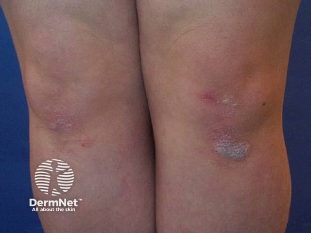
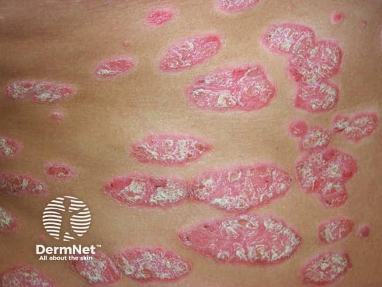

## 尋常性乾癬／斑塊型乾癬 {#atlas-d10}

**伸側＋清楚邊界＋厚銀白鱗屑，再找指甲變化。** [@A:d10]

### 辨認特徵

- 界線銳利、隆起的紅色斑塊，表面覆蓋銀白厚鱗屑，常對稱分布。 [@A:d10]
- 典型位置是肘膝伸側、頭皮、腰薦部與臀裂；頭皮病灶可超出髮線。 [@A:d10]
- 可伴甲凹點、甲床剝離或甲下角化；刮除鱗屑後的點狀出血稱 Auspitz sign。 [@A:d10]

### 最容易混淆

- 濕疹：通常更癢、邊界較不清，可滲液或苔蘚化。 [@A:d10]
- 體癬：外圍活動性鱗屑環與中央較淡，KOH 可找菌絲。 [@A:d10]
- 脂漏性皮膚炎：偏皮脂旺盛區，鱗屑較薄、偏黃油膩。 [@A:d10]

### 驗證方法

通常依臨床診斷；形態不典型時以 KOH 排除黴菌，必要時切片。 [@A:d10]

### 判讀限制

**不是鱗屑越多越能確診；皺摺／生殖器乾癬可能光滑少屑。Auspitz sign 不是絕對專一，也不必刻意刮出血。** [@A:d10]

### 圖像對照

<figure class="clinical-image" data-asset-id="asset-dermatology-1d33e82e94fecc78"><figcaption>臨床照片 膝部可見界線清楚、覆有銀白鱗屑的紅色小斑塊。Image sourced from DermNet · © DermNet · 原圖／出處 · <a href="https://dermnetnz.org/imagedetail/6380-chronic-plaque-psoriasis" target="_blank" rel="noopener">原圖來源</a> · <a href="https://creativecommons.org/licenses/by-nc-nd/4.0/" target="_blank" rel="noopener">CC BY-NC-ND 4.0</a> · 原圖未修改</figcaption></figure>
<figure class="clinical-image" data-asset-id="asset-dermatology-9f940ca860f96e16"><figcaption>臨床照片 軀幹上多個界線銳利的紅色斑塊覆有厚白鱗屑，部分已相互融合。Image sourced from DermNet · © DermNet · 原圖／出處 · <a href="https://dermnetnz.org/imagedetail/11077-chronic-plaque-psoriasis" target="_blank" rel="noopener">原圖來源</a> · <a href="https://creativecommons.org/licenses/by-nc-nd/4.0/" target="_blank" rel="noopener">CC BY-NC-ND 4.0</a> · 原圖未修改</figcaption></figure>

[@A:d10]

### 講義所列參考頁

查看外部參考連結

以下連結由講義提供，未將這些原文視為本次已完整閱讀的獨立來源。
<ul><li><a href="https://dermnetnz.org/topics/chronic-plaque-psoriasis" target="_blank" rel="noopener">DermNet - Chronic plaque psoriasis</a></li><li><a href="https://dermnetnz.org/topics/atopic-dermatitis" target="_blank" rel="noopener">DermNet - Atopic dermatitis</a></li></ul>

## 延伸閱讀

- [異位性皮膚炎](atopic-dermatitis.md#atlas-d13)
- [脂漏性皮膚炎](seborrhoeic-dermatitis.md#atlas-d21)
