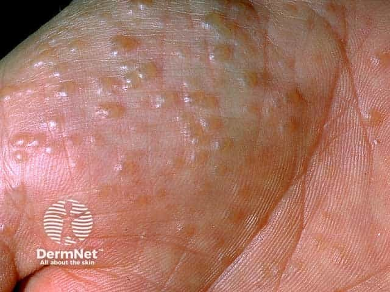
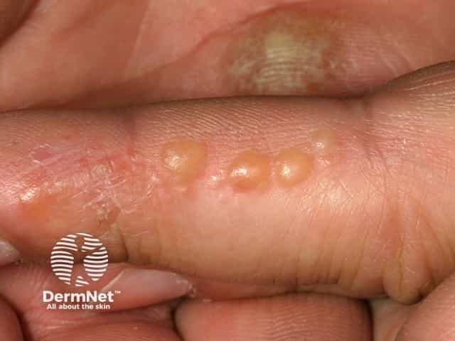

## 汗皰疹 {#atlas-d50}

**手指側面深埋小水泡＋劇癢＋反覆脫皮：pompholyx。** [@A:d50]

### 辨認特徵

- 手指側面、手掌或足底出現密集、深在、透明小水泡，像西米／木薯粉粒。 [@A:d50]
- 常雙側相對對稱且很癢；小泡可融合成較大的水泡。 [@A:d50]
- 消退期脫皮、乾燥與裂隙；慢性反覆者可有皮膚增厚，不能只找『出水』。 [@A:d50]

### 最容易混淆

- 與手足癬：單側為主、足趾縫或指甲同時有真菌線索時先做 KOH；兩者也可並存。 [@A:d50]
- 與疥瘡／掌蹠膿疱症：疥瘡找隧道與夜癢接觸史；掌蹠膿疱症為較不透明的黃白膿疱，不是透明深在水泡。 [@A:d50]

### 驗證方法

通常臨床診斷；不對稱、反覆或不典型者依情況安排真菌檢查、接觸過敏貼布試驗。 [@A:d50]

### 判讀限制

**名稱雖叫汗皰疹，並非汗腺堵住；最有辨識價值的是位置與深在小水泡。** [@A:d50]

### 圖像對照

<figure class="clinical-image" data-asset-id="asset-dermatology-811324bef8ee4d7b"><figcaption>臨床照片 手掌密集深在透明小水泡，散布於輕度泛紅的掌紋之間。Image sourced from DermNet · © Raimo Suhonen · 原圖／出處 · <a href="https://dermnetnz.org/imagedetail/13352-pompholyx" target="_blank" rel="noopener">原圖來源</a> · <a href="https://creativecommons.org/licenses/by-nc-nd/4.0/" target="_blank" rel="noopener">CC BY-NC-ND 4.0</a> · 原圖未修改</figcaption></figure>
<figure class="clinical-image" data-asset-id="asset-dermatology-d37528f462d97eb3"><figcaption>臨床照片 手指側面可見數顆透明至淡黃色水泡，周圍伴脫皮及紅斑。Image sourced from DermNet · © Raimo Suhonen · 原圖／出處 · <a href="https://dermnetnz.org/imagedetail/13342-pompholyx" target="_blank" rel="noopener">原圖來源</a> · <a href="https://creativecommons.org/licenses/by-nc-nd/4.0/" target="_blank" rel="noopener">CC BY-NC-ND 4.0</a> · 原圖未修改</figcaption></figure>

[@A:d50]

### 講義所列參考頁

查看外部參考連結

以下連結由講義提供，未將這些原文視為本次已完整閱讀的獨立來源。
<ul><li><a href="https://dermnetnz.org/topics/dyshidrotic-eczema" target="_blank" rel="noopener">DermNet: Dyshidrotic eczema</a></li><li><a href="https://www.aad.org/public/diseases/eczema/types/dyshidrotic-eczema/symptoms" target="_blank" rel="noopener">AAD: Dyshidrotic eczema signs and symptoms</a></li></ul>

## 延伸閱讀

- [疥瘡](scabies.md#atlas-d28)
- [足癬／香港腳](tinea-pedis.md#atlas-d33)
