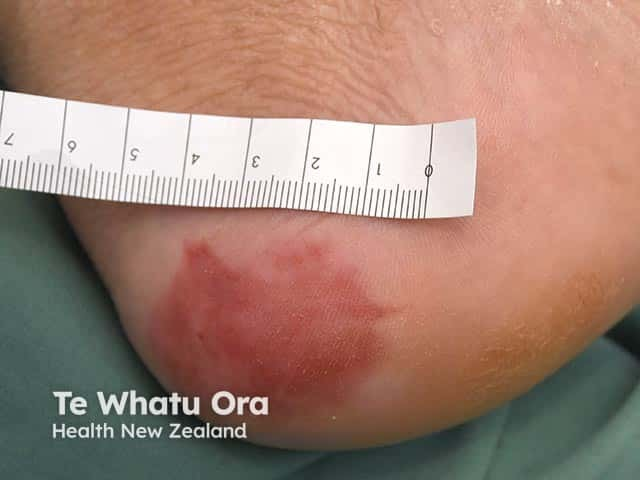
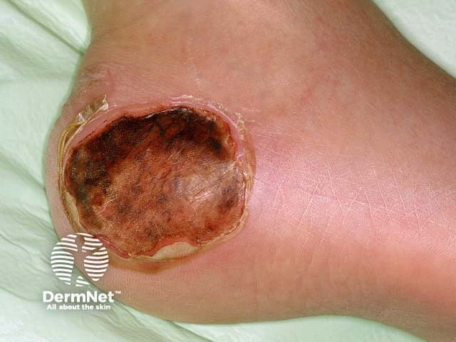

## 壓力性損傷／壓瘡 {#atlas-d42}

**臥床者骨突處的局限壞死或潰瘍，先用壓力性損傷架構判讀。** [@A:d42]

### 辨認特徵

- 先看位置：薦尾骨、足跟、髖部等骨突或器材接觸處，加上長時間受壓背景。 [@A:d42]
- 可由完整皮膚的壓不退紅斑，進展至水泡、淺潰瘍或深部組織缺損。 [@A:d42]
- 紫紅／暗栗色區或血泡可代表深層組織損傷；黑痂覆蓋時，底部真實深度可能看不到。 [@A:d42]

### 最容易混淆

- 與動脈性潰瘍：後者常在肢端，伴缺血、皮溫低或脈搏異常；單看黑色足跟不能決定病因。 [@A:d42]
- 與失禁相關皮膚炎：通常位於潮濕接觸區、較表淺散在，不因位於臀部就等同壓瘡。 [@A:d42]

### 驗證方法

分期看最深可確認組織：第2期露真皮；第3期全層皮膚缺損，可見脂肪；第4期露／可直接觸及深部構造。痂遮住深度則未能分期。 [@A:d42]

### 判讀限制

**『有黑痂＝第4期』錯誤；完整皮膚也可能已有第1期或深層組織損傷。** [@A:d42]

### 圖像對照

<figure class="clinical-image" data-asset-id="asset-dermatology-664fafaeff8e10c5"><figcaption>臨床照片 足跟受壓位置出現局限紅斑，皮膚表面尚未見明顯開放性潰瘍。Image sourced from DermNet · © Te Whatu Ora · 原圖／出處 · <a href="https://dermnetnz.org/imagedetail/2641-pressure-ulcer" target="_blank" rel="noopener">原圖來源</a> · <a href="https://creativecommons.org/licenses/by-nc-nd/4.0/" target="_blank" rel="noopener">CC BY-NC-ND 4.0</a> · 原圖未修改</figcaption></figure>
<figure class="clinical-image" data-asset-id="asset-dermatology-b124d7e9d2424542"><figcaption>臨床照片 足跟可見圓形皮膚缺損，創面覆蓋棕黑色痂與壞死組織。Image sourced from DermNet · © DermNet · 原圖／出處 · <a href="https://dermnetnz.org/imagedetail/16167-pressure-sore" target="_blank" rel="noopener">原圖來源</a> · <a href="https://creativecommons.org/licenses/by-nc-nd/4.0/" target="_blank" rel="noopener">CC BY-NC-ND 4.0</a> · 原圖未修改</figcaption></figure>

[@A:d42]

### 講義所列參考頁

查看外部參考連結

以下連結由講義提供，未將這些原文視為本次已完整閱讀的獨立來源。
<ul><li><a href="https://dermnetnz.org/topics/pressure-ulcer" target="_blank" rel="noopener">DermNet: Pressure ulcer</a></li><li><a href="https://cdn.ymaws.com/npiap.com/resource/resmgr/NPIAP-Staging-Poster.pdf" target="_blank" rel="noopener">NPIAP: Pressure injury staging poster</a></li></ul>

