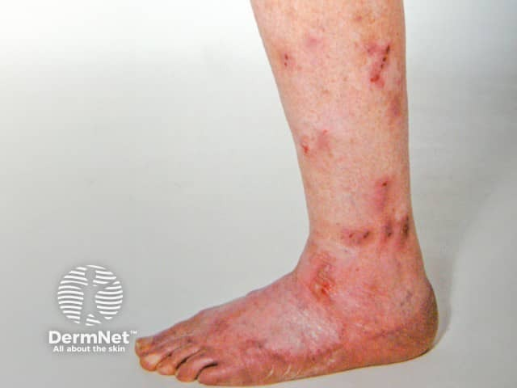
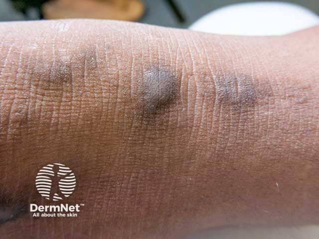

## 結節性癢疹 {#atlas-d51}

**伸側多顆硬癢結節＋反覆抓破＋色素改變：prurigo nodularis。** [@A:d51]

### 辨認特徵

- 多發堅實、隆起、角化的丘疹／結節，表面可有抓痕、糜爛或痂。 [@A:d51]
- 常雙側對稱分布於四肢伸側及容易搔抓處；病灶可紅、膚色或棕黑，並非一定黑色。 [@A:d51]
- 新舊病灶並存，周邊可見色素沉著、色素減退或疤痕，配合長期劇癢。 [@A:d51]

### 最容易混淆

- 與肥厚型扁平苔癬：可同樣在小腿厚實且癢，找紫色調、白色細紋與其他扁平苔癬病灶，必要時切片。 [@A:d51]
- 與結節型疥瘡／類天疱瘡結節型：接觸史、典型疥瘡分布或後續出現水泡可提供線索。 [@A:d51]

### 驗證方法

依慢性搔癢及形態診斷；不典型結節切片，並依病史尋找造成全身搔癢的皮膚或系統性原因。 [@A:d51]

### 判讀限制

**不能只記『黑、結節、伸側』；核心是癢與搔抓循環造成的堅實角化結節。** [@A:d51]

### 圖像對照

<figure class="clinical-image" data-asset-id="asset-dermatology-c558957cc8099478"><figcaption>臨床照片 小腿與足背散在紅色病灶，部分已被抓破或結痂，伴殘留色素變化。Image sourced from DermNet · © DermNet · 原圖／出處 · <a href="https://dermnetnz.org/imagedetail/3711-nodular-prurigo" target="_blank" rel="noopener">原圖來源</a> · <a href="https://creativecommons.org/licenses/by-nc-nd/4.0/" target="_blank" rel="noopener">CC BY-NC-ND 4.0</a> · 原圖未修改</figcaption></figure>
<figure class="clinical-image" data-asset-id="asset-dermatology-55c9b5393a34d4cf"><figcaption>臨床照片 深色皮膚上可見數顆棕黑色隆起結節，周圍皮膚乾燥且皮紋加深。Image sourced from DermNet · © DermNet · 原圖／出處 · <a href="https://dermnetnz.org/imagedetail/3723-nodular-prurigo" target="_blank" rel="noopener">原圖來源</a> · <a href="https://creativecommons.org/licenses/by-nc-nd/4.0/" target="_blank" rel="noopener">CC BY-NC-ND 4.0</a> · 原圖未修改</figcaption></figure>

[@A:d51]

### 講義所列參考頁

查看外部參考連結

以下連結由講義提供，未將這些原文視為本次已完整閱讀的獨立來源。
<ul><li><a href="https://dermnetnz.org/topics/nodular-prurigo" target="_blank" rel="noopener">DermNet: Nodular prurigo</a></li><li><a href="https://www.aad.org/public/diseases/a-z/prurigo-nodularis-symptoms" target="_blank" rel="noopener">AAD: Prurigo nodularis signs and symptoms</a></li></ul>

## 延伸閱讀

- [疥瘡](scabies.md#atlas-d28)
